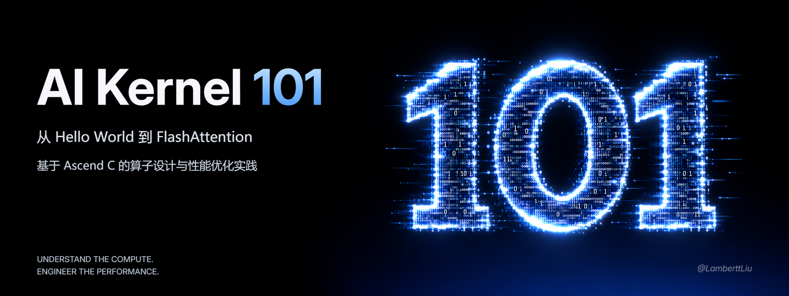

# AI Kernel 101：从 Hello World 到 FlashAttention

<p align="center">
  <strong>基于 Ascend C 的算子设计与性能优化实践</strong>
</p>

# 工程定位

以个人对 kernel 的学习、实践经历作为主线，沉淀为个人的知识库，再完成整个 Kernel 领域建构起完整的知识体系后，以统一的主线输出系列文章， 一方面是对自己经验的总结，一方面也是一种个人的经验分享。

整个过程以个人的思考、代码、实验论证为主，不排斥使用 AI 对现有内容进行创意升华、归纳总结、格式优化。但是，整个系列的定位、规划思路、实验构思、知识经验总结、发布思路必须得由人来掌控，极力反对 AI 代替人直接建构好知识体系框架。总而言之，**思考是人做的事情，工作和辅助才是AI做的事情**。

整体项目的流程遵循 “先把书读厚，再把书读薄” 的观念。经历以下阶段：
1. 规划了解一个陌生领域的学习路线；
2. 按照路线，从交付出发完成一个产品的开发，记录下这个过程中的代码（可参考已有示例）、运行结果；
3. 从结果倒查我需要哪些理论支持，补充相关理论，并通过现有理论分析预期的结果应该是什么样子的；
4. 比对当前的实际结果和预期，比较那些符合预期，哪些偏离预期，进一步修正自己的认知，总结成自己的知识库；
5. 继续重复以上循环，不断丰富自己的知识库。
6. 不断修正自己的学习路线，通过路线地图的逐渐打满，开展准备萃取以上知识库工作；
7. 回顾自己的已有知识库，萃取体检出共性的经验分析手法，作为自己的作品。
8. 将自己的作品分享大众，通过其他人的经验继续修正迭代优化自己的方法论，并真实内化升华成自己的一套系统性技能。

# 系列文章定位

> **以 Ascend C 为实践载体，从第一性原理理解 AI Kernel 的设计与性能优化**。

这里的第一性原理，是从**数学语义、数据依赖、硬件资源、存储层级、访存量与性能约束**等角度解释，再用实验检验判断。这一系列专栏文章，囊括了本人 Ascend C 真实学习中的问题、踩坑和失败经历，并将其转化为能够解释其他 Kernel 的工程案例。

本系列从最小 Kernel Hello World 出发，逐步讨论**数据流**、**Tiling**、**流水**、**归约**与**矩阵乘**，目标是完成范围明确的 FlashAttention 前向实现，并用模型和实验解释其行为。

本系列是作者对 AI Kernel 与推理系统性能工程的长期研究，目前规划五个知识阶段、16 篇核心文章，以 Ascend C 为实践载体。

当前文章的系列规划基本确定，已有对应的几篇草稿。目前将冻结处于暂不编辑状态。当前首要任务需要先扩充知识技能再丰富文章内容。

# 目录管理

```text
AI-Kernel-101/
├── docs/        # 系列文章草稿、定稿和配套素材
├── knowledge/   # 梳理实验结果，沉淀个人知识与经验
├── lab/         # 实验设计、代码、运行结果和分析报告
├── planning/    # 系列规划、技术依赖和工作区说明
└── publishing/  # 平台适配、发布记录和勘误
```

# 分支管理

`main` 是长期主干。按任务从 `main` 创建短期分支，采用 `类型/主题` 命名，主题用小写英文和连字符，例如 `research/vector-add-tiling`。

- `research-*` 用于算子研究、性能实验和试错。
- `docs-*` 用于技术文章、知识笔记和配图。
- `plan-*` 用于目录整理、构建工具和测试脚本。
- `fix-*` 用于修复已发现的问题。

工作分支合入 `main` 时统一使用 **Squash and merge**，将本次改动合为一个提交。

# 相关链接

- [知识记录总结](knowledge/README.md)，通过对现有实验结果梳理，总结出相关经验。
- [实验工作区](lab/README.md)，实验目录、设计、代码、结果与分析报告 
- [系列计划纲要](planning/series-plan.md)，整体规划纲要、行文逻辑链、技术依赖与逐篇论证规划简要 
- [插图说明](docs/assets/figures/README.md)，文章内部插图绘制流程与约束
- [品牌视觉](docs/assets/brand/README.md)，本品牌的视觉设计 


