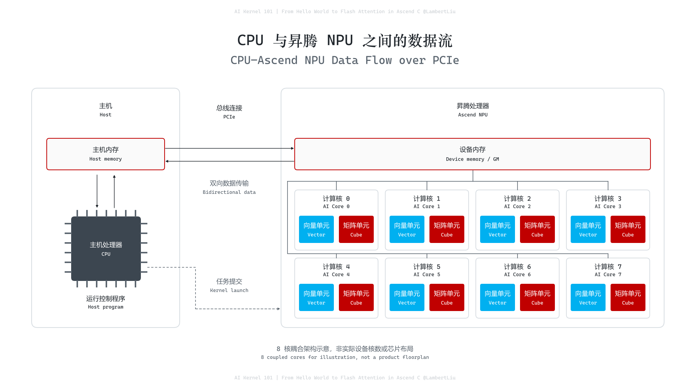
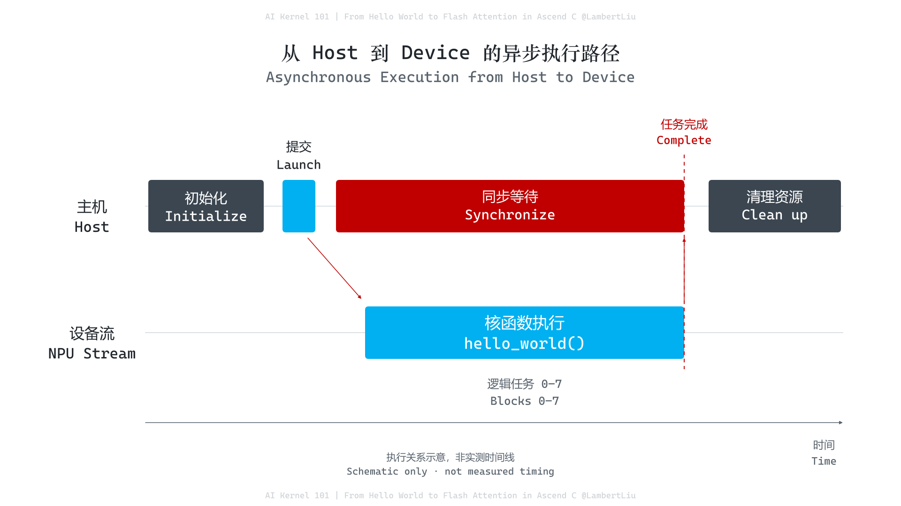
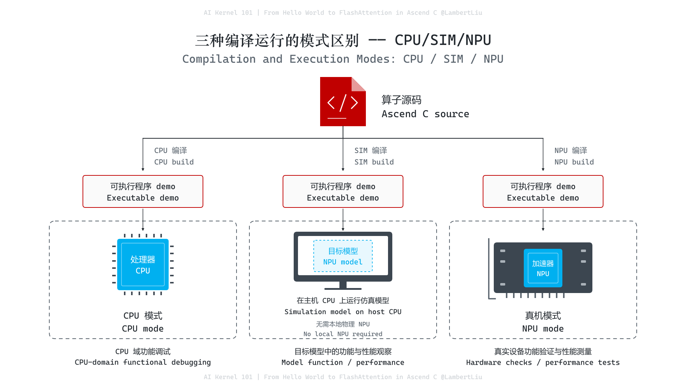

# 写在最前面

作为一名从事 AI 高性能计算的工程师，我日常主要面向昇腾 NPU 做算子开发和性能优化。在 Ascend C 和 CUDA 的学习与实践中，我时常遇到几个问题。**一个张量（Tensor）的计算公式，怎样变成设备上执行的程序？为什么计算本身只有几行，实现却需要安排搬运、存储和同步？程序跑对之后，又该怎样判断性能受什么限制？**

学习一门新的领域特定语言（Domain-Specific Language，DSL），通常从查阅文档和运行示例开始。但说明文档可能分散在不同章节，API 的能力又与软件版本、设备密切相关。即使知道怎样调用，换了输入形状、数据类型或数据布局，原先的判断是否仍然成立，也需要重新检查。

《AI Kernel 101：从 Hello World 到 Flash Attention 的 Ascend C 实践》就从这些问题出发，**以 Ascend C 为实践载体，从第一性原理理解 AI Kernel 的设计与性能优化。** 这里的第一性原理，是从数学语义、数据依赖、硬件资源、存储层级、访存量与性能约束出发，解释实现为什么这样选择，再用实验检验判断。学习过程中的踩坑和失败，也一并整理为系列工程案例。

## 目标读者

本系列主要面向初步接触 Kernel 的 C/C++ 工程师、使用 Ascend C/CUDA/Triton 的算子开发者，以及希望理解性能瓶颈的推理与部署工程师。具备基本 C/C++、矩阵运算和编程经验的学生与工程师，都可以开始阅读；异构执行、存储层级和 Roofline 等前提会在具体问题出现时解释。

## 系列文章计划

系列从 Hello World 开始，先建立程序执行与硬件数据流的认识，再通过向量加讨论分块（Tiling）、尾块和流水（Pipeline），随后处理 Softmax 的归约依赖与矩阵乘的数据复用，最终汇合到范围明确的 Flash Attention 前向实现。我希望把实现选择、误差和性能变化解释清楚，具体支持范围以实际验证为准，性能提速与退化都要有可核对的记录。各篇入口与当前状态见文章目录[^1]。

正文保留支撑解释所需的公式、图示、核心代码片段与实验结果。完整实现、构建配置和复现记录放在同一仓库[^2]的 lab 主题目录中。引用资料、理论估算和实际测量都会注明依据，方便读者核对。

# 首要的问题

学习面向专用硬件的编程语言，最先遇到的问题往往很实际：**如果本地没有昇腾 NPU，还能把第一个 Ascend C Kernel 跑起来吗？** 答案是可以的，我们可以先在本地环境开发和调试，再借助云端设备完成真机验证。

这里需要把“跑起来”说得具体一些。首先，编译通过说明程序在所选工具链下生成了构建产物。其次，程序能够启动并打印，进一步说明相应运行路径执行到了 Kernel。等到后面开始处理张量，还要检查输出数值。若要判断优化有没有收益，则需要另做目标设备上的性能测量。

第一篇先从没有输入张量的 Hello World 开始，让执行路径尽可能简单，观察代码怎样从 Host 的一次调用进入 Kernel，再回到 Host。

本篇围绕同一份 Hello World 样例，分别考察本地 WSL 中的 CPU 调试、SIM 仿真，以及 CANNLab 云端的 NPU 运行。WSL（Windows Subsystem for Linux）提供 Windows 上的 Linux 环境，本篇用它运行本地开发与调测工具。我们关注的是：同一段核函数由谁执行，以及看到打印之后，究竟能确认什么。

> [!NOTE]
> 需要注意的是，**标题中的“没有 NPU”指本地电脑没有这块设备**。本地 CPU 调试和 SIM 仿真承担开发与调测，云端设备承担真机执行检查。

三种模式的差异，在于 Kernel 由什么执行，表中最后一列限定了本篇的检查范围。

| 模式       | Kernel 怎样执行                        | 主要用途                         | 本例的检查目标            |
| -------- | ---------------------------------- | ---------------------------- | ------------------------------ |
| CPU 调试模式 | 编译为 CPU 域程序，链接 CPU 调测库，在主机 CPU 上执行 | 检查程序逻辑、中间数据与数值结果，可配合 gdb 调试  | 检查 CPU 调测路径能否启动，Block 0—7 的打印是否完整 |
| SIM 仿真模式 | 设备侧程序通过目标 NPU 的仿真模型执行              | 检查目标执行路径，辅助分析模型支持的指令、同步与流水行为 | 检查仿真程序能否执行打印并正常结束               |
| NPU 真机模式 | 设备侧程序在物理 NPU 上执行                   | 核验真实设备上的功能、数值结果，并测量实际性能      | 在对应设备环境中执行 Kernel，检查打印及运行状态    |

后续分析性能时，还需要区分仿真器运行所花的时间和真实设备测得的时间。SIM 可以提供模型支持的性能观察，但是目标设备上的性能结论需要真机测量支持。

# 最小的 Kernel

在 NPU 真机运行语境下，Host 是运行控制程序的主机 CPU 一侧，Device 是执行 Kernel 的 NPU 一侧。核函数（Kernel）是设备执行的入口，一次启动可以让多个逻辑任务执行同一段代码。本例中的任务用 Block 编号区分。本文使用的源码见个人实验仓库中的 `hello_world.cpp`[^3]。



图 1：CPU 与昇腾 NPU 之间的数据流示意。主机内存与设备内存经 PCIe 双向传输数据，主机控制程序提交 Kernel。为简化表述，设备侧以 8 个各含 Vector、Cube 计算单元的耦合架构 AI Core 为例，不代表当前实验设备的芯片布局或物理核数，也不与本例的 8 个逻辑 Block 一一对应。

数据箭头表示一般算子的数据流在内存中的传输路径，本例中 Hello World 本身没有输入输出张量搬运。分离架构中计算单元的组织方式不同，耦合与分离的区别见官方基本架构说明[^4]。

Host 先初始化运行时（runtime）、选择设备并创建流（Stream）。Stream 用于组织异步任务的执行顺序，Host 将 Kernel 提交进去，再在需要确认任务完成的位置等待。对这个样例，任务内容就是打印。

下面的 Kernel 没有输入张量，也没有数值计算。Host 启动 8 个 Block，每个 Block 各打印一次自己的编号与 Block 总数。

```cpp
__global__ __vector__ void hello_world()
{
    printf("[Block (%ld/%ld)]: Hello World!!!\n",
           AscendC::GetBlockIdx(), AscendC::GetBlockNum());
}

// Host 侧完成初始化、创建 Stream 后
hello_world<<<8, 0, stream>>>();
```

`__global__` 标记核函数入口，`__vector__` 声明这个样例 Kernel 在 Vector Core 上执行。前面的图 1 用于说明 Host 与 Device 的关系，其中画出的是耦合架构中的 Vector 计算单元，不能直接当作这里的 Vector Core；具体架构区别留到下一篇展开。

`GetBlockIdx()` 和 `GetBlockNum()` 分别取得当前逻辑任务的编号与本次任务总数。这里的 8 是启动配置，不能据此推断整台设备的物理核数。语言修饰符与启动配置的说明可详见  Ascend C SIMD 关键字文档[^5]。这次启动对应 Block 0 至 7，检查程序输出时，可以观察编号是否完整出现。注意，这个样例没有任务间的数据交换，也没有规定打印的先后关系，单凭打印顺序无法说明设备调度或并行效率。

沿着源码往下看，Kernel 提交之后紧接着调用 `aclrtSynchronizeStream(stream)`，随后才销毁 Stream、重置设备并结束运行时。同步调用让 Host 等待该 Stream 中已提交的任务完成，否则仅凭 Host 执行过启动语句，还无法确认设备任务已经结束。官方 Runtime 文档[^6]说明了显式同步的语义。

CANN 作为昇腾的软件工具体系，提供编译、运行和调测支持。Host 通过其中的 ACL 接口完成初始化、设备选择和 Stream 管理等操作。样例会检查这些调用返回的状态码，日志中的 `ret=0` 表示对应调用报告成功。例如，`aclrtSynchronizeStream: ret=0` 表示等待该 Stream 完成的调用成功返回。后面还会看到 `process_exit=0`，它是整个程序的退出状态，需要结合这些调用状态与 Kernel 的完整打印一起判断运行结果。



图 2：从 Host 到 Device 的异步执行路径。Host 提交包含 8 个逻辑 Block 的 Kernel 后，立即等待 Stream 中的任务完成，再清理资源。图中表示执行依赖，条长不代表耗时，也不表示各 Block 串行执行；非实测时间线。

源码虽然使用 `.cpp` 扩展名，构建配置仍通过 `LANGUAGE ASC` 指定 Ascend C 编译流程。同一文件包含 Host 控制和 Kernel 定义，工具链需要处理两侧代码，以及中间的启动调用。

# 同一份 Kernel，怎样在没有 NPU 的电脑上执行？

前面沿着 Host 提交、Kernel 执行、Host 等待的顺序看完了代码。但这条执行路径里还有一个问题：本地没有 Device，核函数究竟由谁执行？

本次实验的本地环境是 WSL2 中的 Ubuntu 24.04，主机 CPU 架构为 `x86_64`，安装了 CANN Toolkit 9.1.0 和 910B ops 9.1.0，没有昇腾 NPU，也没有 NPU 驱动。

## CPU 调试：先让核函数的逻辑可以被检查

在 CPU 调试模式下，Kernel 会被编译为 CPU 域程序，配合 CPU 调测库在主机上执行。这样，即使代码中使用了 Ascend C 的核函数与接口，也可以先在本地检查程序逻辑，借助调试器观察中间状态。官方 CPU 调试说明[^7]介绍了这种执行方式。

对 Hello World 来说，需要检查的逻辑很少：核函数有没有被调用，取得的 Block 编号是否覆盖 0 至 7，打印有没有完成。与普通 C++ 程序一样，这一步先把问题缩小到代码本身，让核函数里的逻辑可以被观察和调试。

在上述 WSL 环境按 CPU 模式编译当前样例，8 个 Block 各打印一次。下面保留全部 Kernel 打印，以及同步和退出状态；其余 Host 与调测库消息见CPU 实验报告[^8]。

```text
[Block (1/8)]: Hello World!!!
[Block (0/8)]: Hello World!!!
[Block (3/8)]: Hello World!!!
[Block (7/8)]: Hello World!!!
[Block (2/8)]: Hello World!!!
[Block (5/8)]: Hello World!!!
[Block (4/8)]: Hello World!!!
[Block (6/8)]: Hello World!!!
[HOST][OK] aclrtSynchronizeStream: ret=0
process_exit=0
```

完整打印和正常退出说明，本例的入口与打印在 CPU 调测路径上可以执行。这里的设备选择、Stream 管理等接口采用打桩（Stub）实现：CPU 调测库提供了不直接操作 NPU 的替代实现，让同一份 Host 代码可以在本地继续执行。因此，这些调用返回成功，不代表访问了物理 NPU。

即使 CPU 调测输出中出现了 `Block`、`CORE` 等标记，核函数依然运行在主机 CPU 上。这些标记用于描述 Kernel 的逻辑任务；判断执行者，需要结合构建模式和运行环境。

后续把打印换成向量加，这条路径就能承担更多工作：输入是否正确、索引有没有越界、计算结果是否符合参考值，都可以先在 CPU 调测环境中检查。Hello World 则只检查最基础的核函数入口与打印，尚未涉及这些数值问题。

## SIM 仿真：换成目标架构的执行路径

CPU 调试方便检查逻辑，但后面要解释搬运、同步和流水时，还需要考察程序在目标架构下的执行行为。SIM 仿真使用目标 NPU 的仿真模型执行设备侧程序，能够观察什么、支持哪些行为，取决于模型和工具版本。Ascend C 孪生调试文章[^9]介绍了 CPU 调试与仿真的分工。

从 CPU 切到 SIM，变化发生在构建与执行环节：同一份源码需要按仿真模式重新构建，再交给模型执行。为不同模式保留独立构建目录，就能避免旧产物混入，让每次输出都对应明确的执行路径。具体选项与命令见配套实验页[^10]。



图 3：同一份源码按 CPU、SIM、NPU 模式分别构建可执行程序 `demo`，三条路径不共用同一二进制。SIM 在主机 CPU 上运行目标 NPU 的仿真模型，无需本地物理 NPU。图中标示的是各模式的用途：CPU 用于功能调试，SIM 用于目标模型中的功能与性能观察，NPU 用于真实设备功能验证与性能测量；本篇实验仅验证功能。

使用 CANN 9.1.0 的 `dav_2201` 仿真模型重新构建并执行样例，得到下面的 Kernel 打印与模型结束消息。这里省略模型初始化和 Host 消息，保留八个 Block 的完整正文：

```text
[Block (0/8)]: Hello World!!!
[Block (1/8)]: Hello World!!!
[Block (2/8)]: Hello World!!!
[Block (3/8)]: Hello World!!!
[Block (4/8)]: Hello World!!!
[Block (5/8)]: Hello World!!!
[Block (6/8)]: Hello World!!!
[Block (7/8)]: Hello World!!!
[INFO] Model stopped successfully.
process_exit=0
```

模型正常停止，八个 Block 的打印也完整出现，符合本例的仿真验证预期。实际输出还带有 `[AIV Block ...]` 前缀，它由工具链的 printf 调测实现补充，后面的 `[Block (...)]` 才来自本例的格式字符串。前缀与正文在仿真输出中可以分批出现，完整上下文见  SIM 实验报告[^8]。

对于这个例子，两条路径都执行了同一段打印逻辑：每个 Block 打印一次自己的编号。两条路径输出了相近的文字，但核函数的执行方式不同。只有加入数值计算、搬运依赖和流水，才有更多行为可以比较。仿真本身运行了多久，也不能直接当作 NPU 执行 Kernel 的耗时。

# 从本地打印，到真机打印

即使 CPU 调试与 SIM 仿真都通过，仍然需要让实际设备接过任务。在真机模式下，Host 必须通过运行时访问 NPU，将 Kernel 提交到设备并等待它完成。这条路径依赖真实设备及配套的驱动、运行时环境，仅仅生成面向 NPU 的程序，在 WSL 环境中还不能完成执行。

本地没有这套设备条件，可以把真机验证放到云端。本篇使用 CANNLab 提供的云端容器：将源码放入容器，在对应工具链与目标配置下重新构建，再由 Host 程序提交给 NPU。本地环境是 `x86_64`，云端容器可见的 CPU 架构为 `aarch64`，因此需要在相应环境中编译，不能把本地二进制直接当作云端可执行程序。

本次真机验证的环境如下。容器可见的 CPU 架构、设备工具显示名、Runtime SoC 与编译目标记录如下。云平台不提供宿主机和固件信息，表中只列出容器内可以查询的内容。

| 项目 | 本次环境 |
| --- | --- |
| 容器环境 | 用户态系统 Ubuntu 20.04.5 LTS，可见 CPU 架构 aarch64 |
| NPU 标识 | 设备工具显示 `Ascend910`，板卡查询的 NPU Name 为 `9362` |
| Runtime SoC | `aclrtGetSocName()` 返回 `Ascend910_9362` |
| 容器可见驱动信息 | 25.5.5 |
| 宿主机与固件 | 平台未开放查询；固件字段返回 `NA` |
| CANN Toolkit / ops | 9.1.0 / 9.1.0 |
| 编译器 | clang 15.0.5，目标 aarch64 |
| 编译目标与模式 | `dav-2201`，`npu` |

真机运行仍然检查同一件事：8 个逻辑 Block 是否都执行到了打印位置，任务是否完成。区别在于，这次核函数由物理 NPU 执行。把输出与实际设备、构建模式和运行程序对应起来，这组打印才有明确的含义。

将同一份源码在云端按 NPU 模式重新构建，得到下面的运行输出。这里保留同步返回状态、全部 Block 打印与退出状态；其他 ACL 结果和环境查询见真机实验报告[^11]。

```text
[HOST][OK] aclrtSynchronizeStream: ret=0
[AIV Block 6/8] [Block (6/8)]: Hello World!!!
[AIV Block 7/8] [Block (7/8)]: Hello World!!!
[AIV Block 0/8] [Block (0/8)]: Hello World!!!
[AIV Block 1/8] [Block (1/8)]: Hello World!!!
[AIV Block 2/8] [Block (2/8)]: Hello World!!!
[AIV Block 3/8] [Block (3/8)]: Hello World!!!
[AIV Block 4/8] [Block (4/8)]: Hello World!!!
[AIV Block 5/8] [Block (5/8)]: Hello World!!!
process_exit=0
```

同步调用成功返回，八个 Block 各打印一次，进程退出码为 0，符合本例的真机功能预期。

注意，日志中同步成功的消息出现在 Kernel 打印之前。同步调用等待的是 Stream 中的设备任务完成，而非终端文字显示完毕。这段日志记录的是主机端看到消息的先后，不能据此还原设备任务与打印转发的精确时序。这里用同步成功返回检查任务完成，再核对八个 Block 的打印是否完整，不依据打印顺序还原设备调度或推断并行效率。

判断完成时，还要留意 Host 程序如何处理错误。本例逐项检查 ACL 返回码，在任务执行或资源清理失败时返回退出码 1，全部成功才返回 0。`<<<>>>` 启动语句本身没有可直接检查的 ACL 返回值，执行结果由后面的 Stream 同步和完整打印共同检查。在无 NPU 的 WSL 上按真机模式执行时，程序在 `aclInit` 处报错，并以 错误码 1 退出，也验证了这次初始化失败不会被正常退出掩盖。

这个习惯在后面处理张量时同样适用：Host 走到了程序末尾，设备端的工作是否完成，仍要有对应的检查。

到这里，Hello World 所承担的检查范围也清楚了：它让我们沿着不同运行路径找到 Kernel 的入口，并观察任务是否执行到打印位置。至于计算结果是否正确、数据传输是否符合预期、NPU 的算力有没有被充分使用，这个没有输入张量的例子还无法回答。下一步需要让 Kernel 真正读入数据、完成计算，再把结果交回 Host。

# 总结

回到开头的问题，在没有本地昇腾 NPU 的环境中，我们仍然可以从开发环境和最小 Kernel 开始：**CPU 调试承担本地逻辑调测，SIM 提供目标架构的仿真执行路径，真机再检验程序在实际设备上的行为**。区分这三条路径，就能明确每一步在检查什么，也能知道哪些问题必须留到实际设备上回答。

Hello World 的工作到打印就结束了。现在把任务换成向量加：$z_i=x_i+y_i$，Host 需要准备输入，Kernel 需要读取两个数并写回结果，运行后还要与参考值比较。数学表达只有一行，实现会涉及数据放在哪里、交给谁计算，以及何时可以使用结果。

这时如果直接打开向量加源码，会先遇到局部存储、搬运和同步调用。要解释这些代码，需要把视线从“程序怎样提交到设备”移到“数据怎样送到计算单元”。再把加法换成矩阵乘，输入复用和硬件分工又会改变。问题来了，同样简短的公式，为什么需要不同的数据组织？

下一篇[^12]就沿着这个问题打开 NPU 内部，从算子的计算依赖与数据复用，解释 Vector、Cube、存储和搬运资源的分工。带着这层认识，第三篇[^13]再把向量加写成一条完整数据流，追踪输入进入局部存储、参与计算并写回输出的过程。

# 附录：源码与复现

完整实现与构建配置见 Hello World 源码[^14]，三种模式的构建运行命令与实验材料见配套实验页[^10]。复现时使用与目标环境匹配的路径和编译选项，并记录源码版本。

# 参考资料与配套材料

以下按正文首次引用的顺序编号；同一资料多次引用时沿用同一编号。官方资料用于解释机制，实验报告用于核对本篇实际执行的结果与证明范围。

[^1]: [文章目录](../README.md)：系列文章目录，列出各篇主题、正文入口与当前撰写状态。

[^2]: [AI Kernel 101 公开仓库](https://github.com/LamberttLiu/ai-kernel-101)：本系列的公开仓库，集中保存文章、完整实现、构建配置和实验记录。

[^3]: [`hello_world.cpp`](../../lab/hello-world/src/hello_world.cpp)：本篇实际使用的 Hello World 源码，包含核函数、Host 启动流程、ACL 返回码检查与资源清理。

[^4]: [官方基本架构说明](https://www.hiascend.com/doc_center/source/zh/canncommercial/80RC3/developmentguide/opdevg/Ascendcopdevg/atlas_ascendc_10_0008.html)：昇腾官方基本架构说明，CANN 商用版 8.0.RC3 文档；用于解释耦合与分离架构，不作为本次实验设备的芯片布局或软件版本依据。

[^5]: [Ascend C SIMD 关键字文档](https://asc.gitcode.com/guide/programming_guide/language_extension/simd_builtin_keywords.html)：Ascend C SIMD 关键字说明，用于查阅核函数修饰符与启动配置。该站点为 master 开发文档，实际接口可用性以本篇已安装的 CANN 9.1.0 与实验结果为准。

[^6]: [官方 Runtime 文档](https://www.hiascend.com/document/detail/zh/CANNCommunityEdition/910/others/acldevg/runtime_doc_dev_0014.html)：CANN 9.1.X Runtime 文档中的“显式同步”，用于查阅 Stream 同步与 Host 等待的语义。

[^7]: [官方 CPU 调试说明](https://asc.gitcode.com/guide/programming_guide/debug_and_tuning/functional_debug/cpu_twin_debug.html)：Ascend C CPU 域孪生调试说明，介绍 CPU 域编译运行、gdb 调试及部分 ACL 接口的适配与打桩；同属 master 开发文档。

[^8]: [WSL：CPU、SIM 与失败退出验证](../../lab/hello-world/reports/wsl-report.md)：WSL 实验报告，统一记录 Lab01-CPU、Lab01-SIM 功能验证及无设备时的失败对照 Lab01-NEG，保留环境、完整 Block 输出、ACL 状态与退出码。正文中的 CPU、SIM 报告引用均指向此文件。

[^9]: [Ascend C 孪生调试文章](https://www.hiascend.com/zh/developer/techArticles/20231215-2)：昇腾官方 Ascend C 孪生调试技术文章，用于理解 CPU 调试与仿真的分工；不代替本篇的实际运行证据。

[^10]: [Hello World 实验记录与复现入口](../../lab/hello-world/README.md)：Hello World 实验入口，汇总三种模式的验证范围、构建运行命令、通过判据和报告链接；复现以已安装 CANN 的环境为前提。

[^11]: [真机实验报告](../../lab/hello-world/reports/npu-report.md)：Lab01-NPU 云端 NPU 功能实验报告，记录容器可见环境、设备标识、实际构建与运行输出，以及本次验证的适用边界。

[^12]: [第02篇：同样是计算，NPU 为什么要区分 Vector 和 Cube？](../drafts/hardware-dataflow.md)：第 02 篇，进一步讨论 Vector、Cube、存储与搬运资源的分工；当前链接指向写作中的草稿，进度以文章目录为准。

[^13]: [第03篇：只做一次加法，为什么还要搬来搬去？](../drafts/vector-add.md)：第 03 篇，以向量加追踪输入搬运、局部计算和输出写回的数据流；当前链接指向写作中的草稿，进度以文章目录为准。

[^14]: [Hello World 源码](../../lab/hello-world/src/README.md)：Hello World 源码目录说明，提供完整实现与构建配置的入口、编译选项及运行说明。
