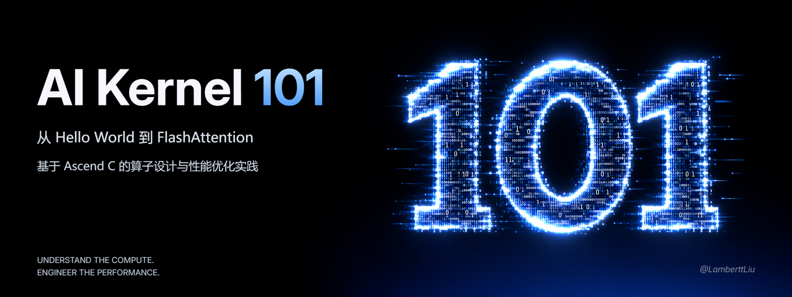

# AI Kernel 101 · 品牌素材

| 层级 | 统一文案 | 使用位置 |
| --- | --- | --- |
| 系列品牌 | AI Kernel 101 | GitHub、社交账号、封面主视觉 |
| 完整系列名称 | AI Kernel 101：从 Hello World 到 FlashAttention | README、知乎专栏 |
| 技术副标题 | 基于 Ascend C 的算子设计与性能优化实践 | 课程介绍、微信公众号 |

`FlashAttention` 始终连写。完整系列名称与技术副标题分开使用。

当前 GitHub 品牌横幅采用数字粒子 101 的 v2 定稿：左侧为代码生成的文字，右侧为固定粒子基底。

- [当前 VI 规范](VI-Specification.md)
- [横幅 PNG、SVG、字体与构建脚本](digital-banner/README.md)
- [无字母图、竖幅海报与生成记录](visual-bases/README.md)

项目首页直接引用本目录的正式横幅 PNG。旧矩阵网格方案与旧 `github-banner/` 目录已清理。
