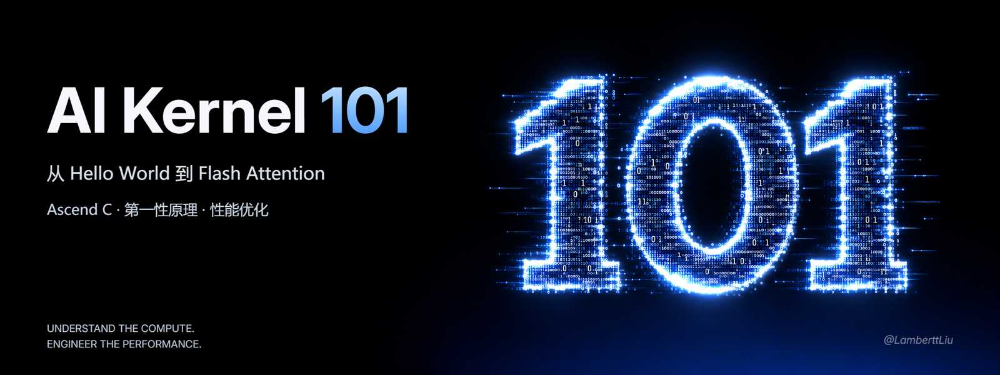

# AI Kernel 101 · 品牌视觉规范

**VI 2.0 · GitHub 数字粒子横幅定稿**

确认日期：2026-11-18。当前方案为数字粒子 101 横幅 v2，取代此前矩阵网格横幅及其红青双色视觉规范。本文记录已确认的 GitHub 横幅，不把其他平台封面或正文技术插图自动归入同一模板。



## 1. 主视觉与表达

- 主体是大号 `101`：由细小二进制字符、粒子和短扫描线构成，采用冷白蓝光。
- 背景为近黑色，右侧保留少量深蓝氛围光。左侧留白承担品牌文案，右侧粒子轮廓保持完整并留出安全空间。
- 图形表达计算与数据组织的艺术意象，不映射某种真实芯片、具体算法路径或实测性能。
- 不添加矩阵数字面板、红色执行块、粗箭头、芯片图标、其他主题色或第三方品牌标识。
- 已认可的[竖幅海报](visual-bases/ai-kernel-101-digital-poster-v1.png)保留作同一视觉语言的素材；微信公众号、知乎等平台的实际版式尚需独立适配。

## 2. 分层与文件职责

| 层 | 权威文件 | 修改方式 |
| --- | --- | --- |
| 粒子基底 | [2048 × 768 母图 v2](visual-bases/ai-kernel-101-digital-banner-base-master-v2.png) | 需要移动、缩放或修改粒子时，在无文字原图层处理，另存版本并记录提示词。 |
| 文字排版 | [layout.json](digital-banner/layout.json) | 文案、位置、字号、颜色在代码配置中修改。 |
| 构建逻辑 | [build.cjs](digital-banner/build.cjs) | 渲染透明文字层后叠加到固定母图；不在脚本中重画或变形粒子。 |
| GitHub 发布资产 | [1600 × 600 PNG v2](digital-banner/ai-kernel-101-digital-banner-1600x600-v2.png) | 项目根 README 直接引用此文件，不另存图片副本。 |
| 可编辑合成源 | [SVG v2](digital-banner/ai-kernel-101-digital-banner-1600x600-v2.svg) | 内嵌位图基底，文字与渐变保持可编辑；背景不宣称为纯矢量。 |

粒子基底一经选定，文字排版不得调用 AI 重新生成它。不能通过提示词再次生成来保证像素一致，应引用固定 PNG。原始生成与编辑提示词保存在 [visual-bases](visual-bases/README.md)，选定文件的 SHA-256 记录在 `assets.json`。

## 3. 固定文案

```text
AI Kernel 101
从 Hello World 到 Flash Attention
Ascend C · 第一性原理 · 性能优化

UNDERSTAND THE COMPUTE.
ENGINEER THE PERFORMANCE.

@LamberttLiu
```

大小写、空格、标点和作者署名中的双 `t` 保持准确。项目独立品牌名称为 `AI Kernel 101`，Ascend C 是实践载体，不添加厂商 Logo 或官方背书声明。

## 4. 文字颜色与字体

颜色配置以 `digital-banner/layout.json` 为机器可读来源，构建时写入 SVG，不依赖旧 `tokens/colors.json`。

| 用途 | 色值 / 方式 |
| --- | --- |
| 标题 `AI Kernel` | 冷白 `#F5F7FC` |
| 标题 `101` | 纵向渐变 `#E6F4FF → #77B7FF → #3C8DF5`；停靠点 0%、58%、100% |
| 中文定位语 | `#DBE1EA` |
| 技术关键词 | `#C9D3E1` |
| 两行英文标语 | `#B8C4D3` |
| 作者水印 | `#A6ADB8`、72% 不透明度、真实斜体 |

基底含粒子发光与自然色阶，不将其中的每种合成颜色定义为新 Token，也不按纯色块替换基底。当前配色不再沿用旧版红色 / 青色 Tile 的语义映射。

英文使用 Inter 4.001：主标题 700，其余 400；作者水印使用 Inter Italic 400。中英混排定位语和关键词使用 Microsoft YaHei 6.31、400。Inter 正体与斜体属于同一字体家族。

Inter 字体与 [SIL OFL 1.1 许可证](digital-banner/fonts/Inter-OFL.txt)随项目保存；Microsoft YaHei 使用系统字体，不重新分发。SVG 打开时需具备相应字体；PNG 不依赖查看端字体。

## 5. 画布与排版

原生合成画布为 **2048 × 768**，默认 GitHub 输出为 **1600 × 600**，均为 8:3。字号和坐标以原生画布为基准，发布尺寸等比缩小，不拉伸或裁切基底。

| 文字 | x | 基线 y | 字号 px |
| --- | --- | --- | --- |
| 主标题 | 96 | 272 | 128 |
| 中文定位语 | 96 | 368 | 36 |
| 技术关键词 | 96 | 440 | 30 |
| 英文标语第一行 | 96 | 680 | 21 |
| 英文标语第二行 | 96 | 712 | 21 |
| 作者水印 | 1952，右对齐 | 704 | 22 |

标题的 `101` 只改变填色，不单独变形、拉伸或加入阴影。文字不得侵入粒子主体。安全留白已经在 v2 母图中处理，排版时不得通过裁切、遮罩或背景涂黑来补边。

## 6. 构建与验收

从仓库根目录运行：

```powershell
node docs/assets/brand/digital-banner/build.cjs
```

环境和固定依赖见[构建说明](digital-banner/README.md)。代码检查文案、字体回退、真实斜体、文字边界和母图 SHA-256；原尺寸合成中，透明文字层未覆盖的像素必须与母图完全一致。记录见 [validation.json](digital-banner/validation.json) 和 [repeatability.json](digital-banner/repeatability.json)。

定稿已检查原尺寸及 320 px 缩略图。辅助小字不保证缩略图可读，项目名称和定位仍应在 README 正文中保留。PNG 使用实色背景，1600 × 600 版内嵌 sRGB ICC。后续发布前仍需在 GitHub 页面实际检查；当前本地定稿与链接更新不代表已经推送。

## 7. 本次替换范围

旧 `github-banner/` 目录、旧颜色 Token 和旧 VI 正文已清理或替换。当前权威路径为 `digital-banner/` 与 `visual-bases/`。不再将旧网格横幅作为后续品牌方案，正文插图继续遵循其独立的[绘图规范](../figures/README.md)。

本次不改变仓库许可证，不提交、推送或自动发布。
