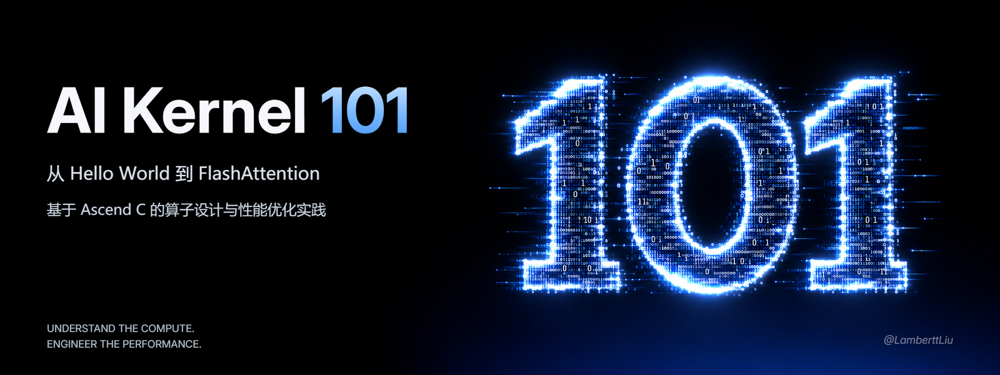

# AI Kernel 101 · 数字粒子横幅排版

当前正式采用 v2，作为项目 GitHub 品牌横幅，见[当前 VI 规范](../VI-Specification.md)。以 [2048 × 768 安全留白母图](../visual-bases/ai-kernel-101-digital-banner-base-master-v2.png) 为固定背景，使用代码添加文字。内容逐项依据 [竖幅海报](../visual-bases/ai-kernel-101-digital-poster-v1.png)。粒子位置调整已在无字基底层通过图像编辑完成，排版脚本不重画、不移动、不缩放粒子图案。



## 文件与编辑

- [1600 × 600 PNG](ai-kernel-101-digital-banner-1600x600-v2.png)：默认评审尺寸，sRGB。
- [2048 × 768 PNG](ai-kernel-101-digital-banner-2048x768-v2.png)：按母图原尺寸叠加文字。
- [可编辑 SVG](ai-kernel-101-digital-banner-1600x600-v2.svg)：文字、渐变定义与图层均可编辑，内嵌原始 PNG 背景。它是“固定位图基底 + 矢量文字”的合成源，不把背景伪称为纯矢量图。
- `layout.json`：文案、位置、字号与颜色。坐标以 2048 × 768 母图为基准。
- `build.cjs`：加载母图，仅渲染透明文字层，再将文字层叠加到母图，导出 PNG 与 SVG。
- `preview-320.png`、`preview-160.png`：等比缩略检查图。
- `validation.json`：母图 SHA-256、实际字体来源、文案与边界检查、原尺寸像素保留检查和输出 SHA-256。
- `repeatability.json`：同一环境重复构建的输出比较。

标题 `AI Kernel` 为冷白色，`101` 使用 `#E6F4FF → #77B7FF → #3C8DF5` 的纵向渐变，与粒子主视觉的冷白蓝光衔接。作者署名保留浅灰色真实斜体。母图和竖幅原文件不作修改；项目首页直接引用本版 1600 × 600 PNG。

v2 的文字调整全部记录在 `layout.json`：主标题基线上移 24 px；副标题基线上移 8 px；关键词基线下移 8 px，使副标题至关键词的基线距离从 56 px 增至 72 px；关键词由 `#B7C2D0` 提亮为 `#C9D3E1`；两行英文标语均下移 24 px。以上为 2048 × 768 母图坐标，1600 px 版等比缩小。

此前 v1 PNG、SVG 与 `layout-v1.json`、`validation-v1.json`、`repeatability-v1.json` 保留作本次微调对照。默认构建使用 v2；运行 `node build.cjs layout-v1.json` 可重建 v1。脚本根据配置中的 `exportVersion` 选择输出版本，不覆盖另一版图片；通用预览与 `validation.json` 表示最近一次构建。

## 文字内容

主视觉使用短品牌 `AI Kernel 101`；第二行保留系列路线，第三行使用技术副标题。完整系列名称为《AI Kernel 101：从 Hello World 到 FlashAttention》，命名层级见 [VI 规范](../VI-Specification.md#3-品牌命名与固定文案)。本次仅更新文字，沿用 v2 的粒子母图、位置、字号与颜色；v1 配置及对照素材保留历史文案。

```text
AI Kernel 101
从 Hello World 到 FlashAttention
基于 Ascend C 的算子设计与性能优化实践

UNDERSTAND THE COMPUTE.
ENGINEER THE PERFORMANCE.

@LamberttLiu
```

## 构建与字体

在具备 Node.js、Microsoft Edge 和 Microsoft YaHei 字体的 Windows 环境中，安装 `package.json` 固定依赖后运行：

```powershell
node build.cjs
```

也可从项目根目录运行 `node docs/assets/brand/digital-banner/build.cjs`。Codex 捆绑环境可将 `NODE_PATH` 指向其 `dependencies/node/node_modules`，无需重复安装。

本次使用 Node.js 24.22.1、Playwright 1.62.1、Sharp 0.35.5、Edge 157.0.4341.60。英文使用 Inter 4.001，作者署名使用同系列 Inter Italic，中文混排使用 Microsoft YaHei 6.31。Inter 正体、斜体和 SIL OFL 1.1 许可证随附于 `fonts/`，沿用项目已有开源字体；Microsoft YaHei 使用系统安装，不重新分发。

SVG 中的文字保留可编辑状态，打开时需要相应字体；PNG 已完成排版，不依赖查看端字体。导出页面从随附文件加载 Inter，逐段核对实际字体，缺字或回退视为失败。无随机过程、无远程网络资源。

## 验证 · 2026-11-18

已核对完整图片和 320 px 缩略图：标题与粒子 101 可辨，没有文字溢出或相互遮挡。辅助小字不保证在缩略图中可读。

原尺寸输出与母图逐像素对比：透明文字层 alpha 为 0 的位置，合成后的背景像素必须与母图完全相同；本次检查结果 `changedOutsideText = 0`。母图文件 SHA-256 也必须保持不变。1600 × 600 PNG 是整张合成结果的等比缩小，不裁切、不拉伸母图，不声称经过缩小的像素仍与原尺寸逐字节相同。

作者已确认采用本版，项目首页本地引用已更新；本次替换没有提交、推送或对外发布。
