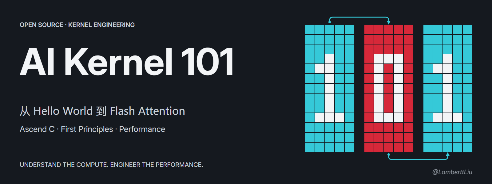

# GitHub 横幅 · C 统一网格版



依据 [VI 规范](../VI-Specification.md)，画布保持 1600 × 600。已采用 2 px 网格间隙；当前目录为 `docs/assets/brand/github-banner`，SVG / PNG 文件名不附版本号。

最终方案采用 2 px 网格间隙与方案 1 的圆角折线数据流。水印基线固定为 y=568，底部距画布底边约 27 px；这是作者明确指定的位置，不使用默认 48 px 底部安全边距。

延续的设计：

- 水印 `@LamberttLiu` 使用真实 Inter Italic 字体、Steel `#C9D1DA` 和 65% 不透明度，保留浅灰、淡化的效果。
- 三个面板都使用 32 px 网格步距，每框 5 列、13 行；色块及白色数字像素统一为 30 × 30 px，块间留出 2 px 间隙。101 使用同一网格上的 3 × 7 字模，无描边，填色为 Mist `#F3F5F7`。这是作者已采纳的网格样式。
- 第一框顶部连接第二框顶部；第二框底部连接第三框底部。每条青色流线采用 3 px 线宽、10 px 圆角转折，有一个圆形起点与一个实心锐角三角箭头终点。流线位于面板外侧，不穿过数字。
- 页眉、定位语、关键词和英文标语保持不变；不显示“概念示意”，SVG 可访问性描述保留其品牌概念属性。

## 文件

- `ai-kernel-101_github-hero_brand-c_1600x600.svg`：文字可编辑，背景、计算面板、数字、网格、数据流、品牌与辅助文案有语义分组 ID。
- 同名 `.png`：1600 × 600、实色背景、内嵌 sRGB ICC。
- `preview-c-320.png`：最新 320 × 120 缩略预览。
- `build.cjs`：当前生成和导出脚本；无随机参数、位图、外链 SVG 资源或新增主题色。
- `validation.json`：文案、字体及 SHA-256、实际字体来源、像素尺寸与网格对齐、无像素描边、水印斜体、流线数量、文字边界、PNG 配置与结果校验和。
- `repeatability.json`：同一渲染环境重复构建的一致性检查。

主 PNG、SVG 与 `build.cjs` 均对应已确认的最终方案；其他候选文件和候选生成脚本已清理。

## 字体与渲染

字体为 Inter 4.001（品牌 700、页眉 600、正文 400）、Inter Italic（水印 400）和 VI 中文回退 Microsoft YaHei 6.31（400）。Inter 的正体和斜体属于同一字体家族。本地字体文件、准确版本和校验和见 `fonts/` 与 `validation.json`。

Inter 来源于 [Google Fonts Inter](https://github.com/google/fonts/tree/main/ofl/inter)，随附 SIL OFL 1.1 许可证。Microsoft YaHei 使用本机 Windows 字体，不重新分发。SVG 不嵌入字体，编辑器中应安装相应字体；PNG 不依赖查看端字体。

使用 Node.js 24.22.1、Playwright 1.62.1、Sharp 0.35.5、Microsoft Edge 157.0.4341.46。安装 `package.json` 中的依赖后运行：

```powershell
node build.cjs
```

Codex 捆绑环境可将 `NODE_PATH` 指向其 `dependencies/node/node_modules`，无需重复安装。导出时将随附 Inter 字体加载到临时内存页面；色值来自 `../tokens/colors.json`。从项目根目录也可直接运行 `node docs/assets/brand/github-banner/build.cjs`，输入输出路径始终以脚本所在目录为准。

## 检查记录 · 2026-11-16

已查看原尺寸和 320 px 预览：品牌、101 与双色可辨；没有文字遮挡、溢出或裁切。水印与下方流线分开，字体实测无回退。文案逐项、像素大小、网格对齐、无描边、斜体及两条流线的圆点数量均自动检查。

按作者本轮要求移除数字描边后，Mist 与 Cyan 的直接对比度约为 1.83:1，低于原 VI 承载含义图形的 3:1 条款；本版如实保留这一由明确设计指令产生的差异，不声明 VI 所有条款均通过。数字仍通过大尺寸与完整像素轮廓识别，原尺寸和缩略图已人工检查。水印使用浅灰透明度叠加，不新增 HEX Token。

项目首页直接引用本目录的[最终 PNG](ai-kernel-101_github-hero_brand-c_1600x600.png)，不另存公开副本。生成脚本更新本文件后，文档引用同步生效。最终设计、VI 规范、字体及许可证、生成脚本和依赖说明均纳入 Git 版本管理。
