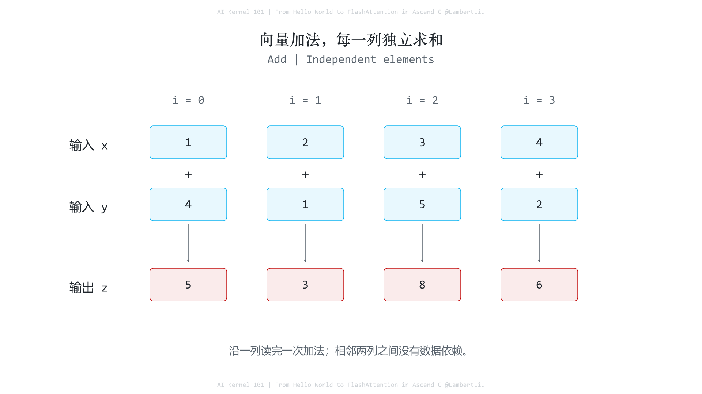
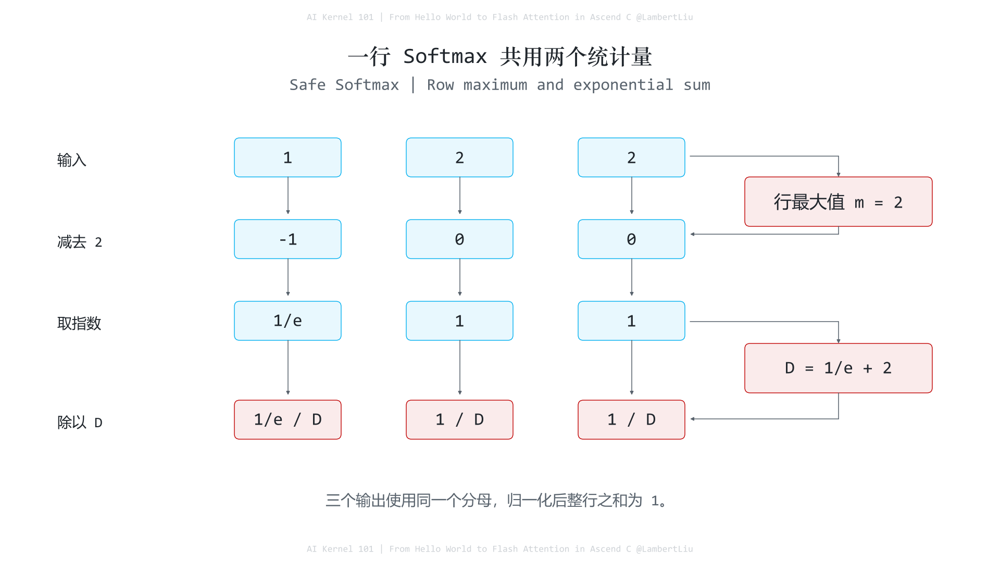
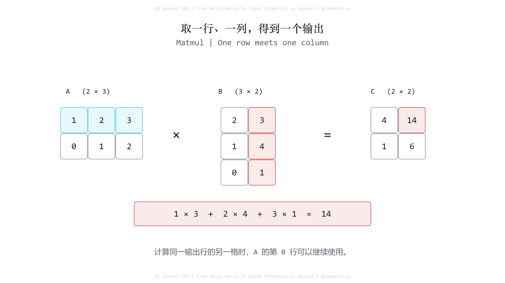
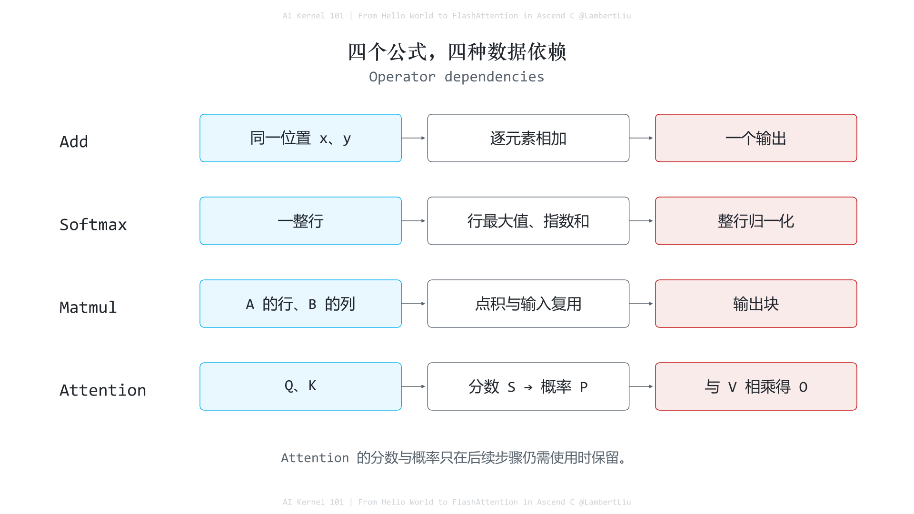
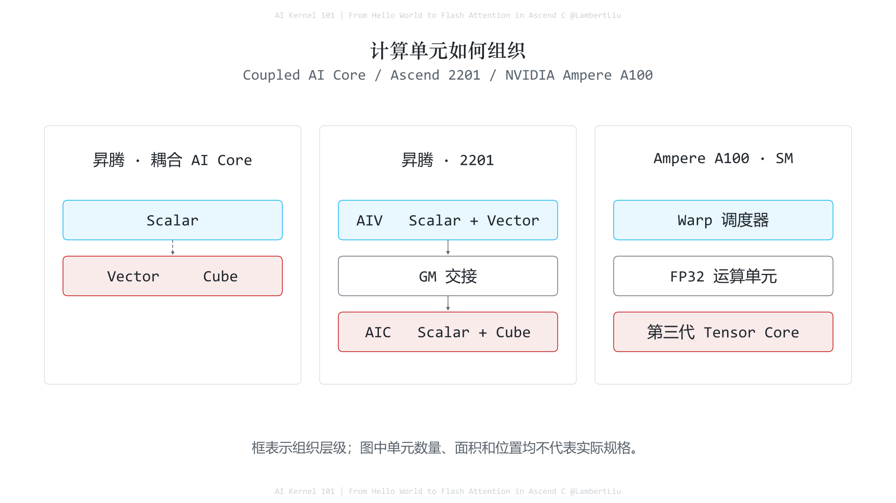
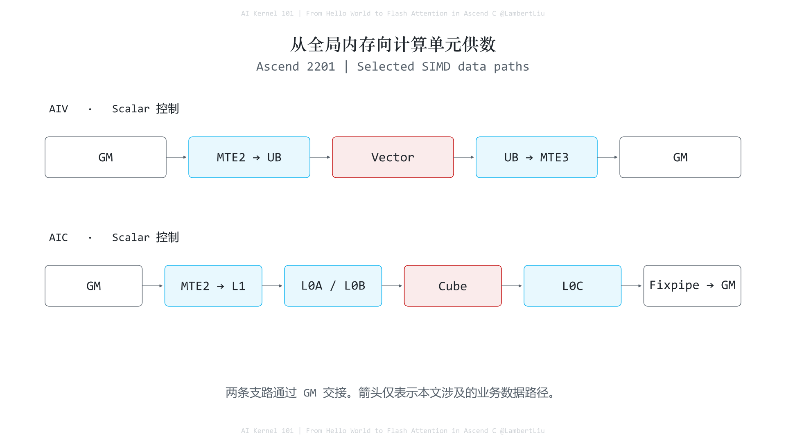
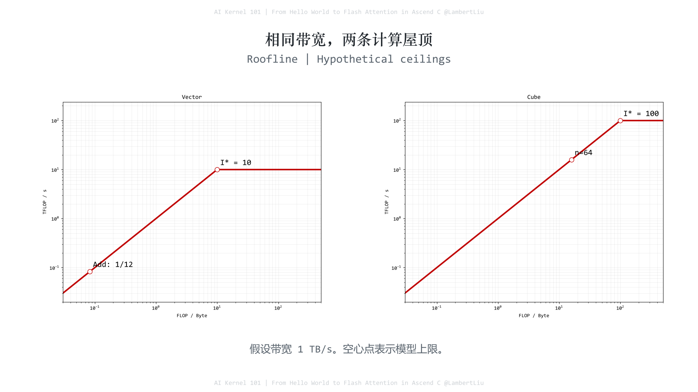

# 打印之后，计算在哪里发生？

[上一篇](../articles/hello-world.md)把 Hello World 送到了设备上：Host 发起任务，Device 执行 Kernel，最后等到程序结束。这条链路跑通之后，很容易顺着往下想：接下来把打印换成加法，是不是就开始做真正的算子了？

数学上确实只有一行：

$$z_i=x_i+y_i.$$

但打开[最小向量加的源码](../../lab/vector-add/src/00_basic/add.cpp)，会发现计算前要绑定地址、申请局部空间、搬入两个输入，计算后还要写回输出，并处理执行阶段之间的依赖。加法只是其中一步。

问题再复杂一点，矩阵乘，情况又变了，公式仍然很短：

$$c_{ij}=\sum_{k=0}^{K-1}a_{ik}b_{kj}.$$

其中， $a_{ik}$ 和 $b_{kj}$ 分别是输入矩阵 $A$ 和 $B$ 的元素， $c_{ij}$ 是输出矩阵 $C=AB$ 的元素， $K$ 是两矩阵相乘时的公共维度。一个输出由 $A$ 的一行与 $B$ 的一列逐项相乘、再求和得到。

然而，计算的数据却不能照搬向量加的组织方式，文档开始出现 Cube、L1、L0A、L0B，以及矩阵的分块和布局。都是乘加计算，为什么需要另一套资源？

我们先把 API 放在一边，追问一个更具体的问题：**一个输出依赖哪些输入，这些输入还能被多少个输出重复使用？** 依赖决定哪些计算必须等待，复用决定哪些数据值得留下；再往下，才是用什么硬件完成它们。

# 四个公式，四种组织数据的场景

## Add：每个输出都可以独立完成

设三个向量长度都是 $L$ ，且输出不覆盖输入。对任意位置 $i$ ，计算 $z_i$ 只需要 $x_i$ 和 $y_i$ ，不需要知道相邻位置的结果。

*图 1　Add 按索引配对，每列独立产生一个输出。*

因此，可以把输出划成互不重叠的区间，分别交给不同执行任务。只要区间覆盖完整，各任务就不必在加法过程中交换数据。

这种计算称为逐元素运算（Element-wise Operation）。它给出了一个很好的起点：大量位置做相同操作，位置之间没有归约依赖，适合成批计算。麻烦主要出现在数据怎样送到计算单元、一次处理多少，以及结果何时可以写回。

这里暂时看不到值得跨输出保留的输入： $x_i$ 用完以后，计算 $z_{i+1}$ 并不需要它。稍后我们会看到，这种复用特征会直接反映在运算量与搬运量的比例上。

## Softmax：一个位置的输出，要等整行信息

把一行输入记为 $s_0,\ldots,s_{L-1}$ 。稳定 Softmax（Safe Softmax）可以写成：

$$
m=\max_j s_j,\qquad
p_i=\frac{\exp(s_i-m)}{\sum_j\exp(s_j-m)}.
$$

减去同一个最大值，不改变归一化结果，同时让指数的输入不大于零。这里先讨论有限输入和非空行，浮点误差与特殊边界留到 Softmax 篇展开。

*图 2　Safe Softmax 的三个输出共用行最大值和指数和。*

与 Add 不同， $p_i$ 虽然对应一个位置，却依赖整行的最大值与指数和。最大值和求和都是归约（Reduction）：将一组输入合并成更少的统计量。

如果把这一行切成两半，分别做 Softmax，再拼接起来，两半的概率和都会是 1，拼接后的总和就成了 2，显然不再是原来的 Softmax。分块处理可以做，但必须解决统计量如何合并、如何在各位置之间共享的问题。

这不意味着整个 Softmax 只能串行执行。不同的行可以分别处理，行内归约也可以采用分层合并。真正改变的是任务之间的关系：哪些步骤能独立做，哪些步骤需要先等到统计量。

因此，即使 Add 与 Softmax 都可以主要使用向量计算资源，它们需要的调度和临时存储也会明显不同。

## Matmul：算一块输出，输入才有机会反复使用

设 $A\in\mathbb R^{M\times K}$ 、 $B\in\mathbb R^{K\times N}$ ，输出 $C=AB\in\mathbb R^{M\times N}$ 。一个输出元素是：

$$c_{ij}=\sum_{k=0}^{K-1}a_{ik}b_{kj}.$$

只看一个 $c_{ij}$ ，这是两组数相乘再求和。但把视线移到一块输出，复用就出现了：同一行的多个输出会用到同一行 $A$ ，同一列的多个输出会用到同一列 $B$ 。

*图 3　矩阵乘法中，一行和一列的点积决定一个输出。*

接着算 $c_{00}$ 时，只需把选中的列换成 $B$ 的第 0 列， $A$ 的第 0 行仍然用得上。

例如，同时计算 $c_{00},c_{01},c_{10},c_{11}$ 时， $a_{0k}$ 会同时参与第一行的两个输出， $b_{k0}$ 会同时参与第一列的两个输出。若每算一个输出都重新装载全部操作数，已经装入的输入数据就没有重复使用，造成了极大的资源浪费。

但这些机会有条件：输入块要按计算单元可接受的格式组织，相关数据在复用期间要留得住，输出部分和也不能提前丢掉。输入送入专用矩阵计算资源之后，硬件才有机会以规整的矩阵乘加方式处理它们。

所以，矩阵乘的设计重点不只是“并行执行更多乘法”，还包括**用一批已装载的数据持续产生更多有效计算**。

## Attention：计算步骤之间也存在数据生命周期

再把前面几类计算接起来。对单个 head，设 $Q,K\in\mathbb R^{L\times d}$ ， $V\in\mathbb R^{L\times d_v}$ ，一个基本的 Attention 前向计算是：

$$
\begin{aligned}
S &= \frac{QK^{\mathsf{T}}}{\sqrt{d}}, \\[0.6em]
P &= \operatorname{softmax}_{\mathrm{row}}(S), \\[1em]
O &= PV.
\end{aligned}
$$

这里有两次矩阵乘、按行归约，以及缩放、指数和归一化等逐元素处理。 $S$ 和 $P$ 都是 $L\times L$ ，最终输出则是 $L\times d_v$ 。

即使每一步分别算对，组合实现仍然要决定：矩阵乘的结果放在哪里，Softmax 怎么读它，下一次矩阵乘什么时候能使用处理后的数据？如果应用只需要 $O$ ，完整保存 $S$ 和 $P$ 是否必要？

这就进入多阶段融合（Multi-stage Fusion）问题：围绕多个步骤共同组织数据和执行，而不是只优化各自的算式。至于哪些中间结果可以消去、如何跨块保持正确语义，留到第 14 篇推导。这里先记住，**省掉一个完整中间张量的保存，与步骤间完全不发生内存中转，是不同的目标**。整理上述的典型计算结构分类得出下列这张表。

| 计算结构             | 输出之间的关系    | 主要资源需求与设计问题          |
| ---------------- | ---------- | -------------------- |
| Add 等逐元素运算       | 各位置可独立     | 成批向量计算、连续搬运、区间覆盖     |
| Softmax 等归约组合    | 一行输出共享统计量  | 归约、逐行广播、临时空间与阶段依赖    |
| Matmul           | 共享输入并累加部分和 | 矩阵计算、输入复用、布局与分块      |
| Attention 等多阶段组合 | 后一步消费前一步结果 | 多类计算资源协作、交接与中间数据生命周期 |

*图 4　四种算子的输入依赖与中间结果。*

注意，以上四个算子不是四个互斥的类别。Matmul 自身包含求和，Softmax 也包含逐元素运算；“融合”描述的是步骤如何组织。算子的名字给出计算结构，具体形状、数据类型和实现才决定它最终消耗什么资源。

# 打开 NPU：计算资源和存储并不是一整块

## 耦合与分离，分的是哪一层？

为简化逻辑，[上一篇](../articles/hello-world.md)的 Host／Device 图把 Vector 与 Cube 画在同一个 AI Core 内，用于说明主机与设备的关系。这里需要把图继续拆开：**耦合与分离，说的是 Vector 与 Cube 是否同核部署，不是 CPU 与 NPU 是否在同一颗芯片上。** [官方基本架构说明](https://www.hiascend.com/doc_center/source/zh/canncommercial/80RC3/developmentguide/opdevg/Ascendcopdevg/atlas_ascendc_10_0008.html)以此区分两类组织方式；该页属于 CANN 8.0.RC3 文档，仅用于解释术语。

耦合架构将两类计算单元放在同一个 AI Core 内；分离架构则分别部署在矩阵核 AIC 与向量核 AIV 上。分开以后，开发者面对的就不只是“调用哪条计算指令”，还包括计算任务由哪类核承接，以及跨核结果怎样交接。分离本身不能推出更快：供数、任务配比与同步仍然可能限制效率。

后文限定在 **NPU 架构版本 2201 的 SIMD 路径**。单指令多数据（Single Instruction, Multiple Data，SIMD）在这里可以先理解为：一条计算指令对一批数据执行同类操作。官方 2201 文档给出的 AIC∶AIV 核数配比为 1∶2，各核有自己的 Scalar 控制并可加载代码，二者经 GM 传递数据。**核数配比不是浮点算力配比**，也不表示每次 Kernel 都按这个比例使用全部资源。[2201 架构说明](https://asc.gitcode.com/guide/programming_guide/advanced_programming/hardware_implementation/architecture_spec/npu_arch_2201.html)

架构号不能代替完整产品型号。本文不从 `dav-2201` 推断实测设备的整卡核数、容量与峰值；本次真机的 SoC、软件版本和可见资源已分别记入[实验报告](../../lab/hardware-dataflow/reports/npu-report.md)，接口适用范围与整卡理论峰值仍需按对应资料核对。

## 与 NVIDIA GPU 对照：矩阵计算能力相似，组织方式要分别看

华为廖恒博士在[访谈](https://www.bilibili.com/video/BV1nB3u6tERu/)中说：“我们就讲 Vector 算力和 Cube 算力，他们称之为 Tensor Core”。这句话为理解两类计算能力提供了入口：这里可以把 Cube 与 Tensor Core 放在专用矩阵乘加能力这一层比较。

但从能力名称跳到硬件组织，还差了一步。以 NVIDIA Ampere 的 A100 为例，流式多处理器（Streaming Multiprocessor，SM）内包含常规算术执行资源与 Tensor Core，并围绕线程束（warp）组织执行；它不是把昇腾 AIV、AIC 换个名字得到的结构。[A100 架构白皮书，第 20—23 页](https://images.nvidia.com/aem-dam/en-zz/Solutions/data-center/nvidia-ampere-architecture-whitepaper.pdf)

| 比较的问题 | 本文限定的昇腾 2201 SIMD 路径 | NVIDIA Ampere A100 对照 |
| --- | --- | --- |
| 计算能力 | Vector 处理向量步骤，Cube 处理矩阵乘加 | 常规算术执行资源与 Tensor Core 承担相应计算 |
| 核内组织 | AIV 与 AIC 分离，各自带 Scalar 控制 | 常规算术资源与 Tensor Core 位于 SM 内 |
| 数据怎样到达计算位置 | 显式管理 UB、L1、L0 等空间及其搬运 | 使用寄存器、共享内存等资源，细节依矩阵指令而定 |
| 编程时必须交代什么 | 核类型、局部 Tensor、搬运与跨核依赖 | 线程／warp 协作、操作数组织与同步 |

NVIDIA 的 [Ampere 调优指南](https://docs.nvidia.com/cuda/ampere-tuning-guide/index.html)分别说明了 Tensor Core 指令和全局内存到共享内存的异步复制。对照的价值是提出共同问题——操作数在哪里、如何供数、由谁等待——而不是把 Vector 等同于 CUDA Core、把 Cube 等同于整个 SM，或把 UB 等同于共享内存。

*图 5　耦合 AI Core、2201 分离架构与 Ampere A100 SM 的组织层级。*

> 引语核对说明：以上引语由作者提供，视频页面本轮读取受限，原句上下文与时间点待人工核对。它不作为目标设备规格或算力配比的证据。

## Scalar 安排工作，Vector 与 Cube 执行不同形态的计算

标量单元（Scalar）处理控制流、地址计算等工作，例如当前处理哪块输入、循环何时结束。它位于设备核（AI Core）内，不能与发起整个任务的 Host CPU 混为一谈。

向量计算单元（Vector）适合表达批量算术、比较、指数、类型转换和归约等操作。Add 和 Softmax 的基本步骤能够沿着这条路径展开。这里的“向量”并不要求输入只能是一维；矩阵的一行或一块数据，也可以按向量操作处理。[Vector 编程说明](https://asc.gitcode.com/guide/programming_guide/programming_model/ai_core_simd_programming/c_pointer_programming/c_programming_overview.html)

矩阵计算单元（Cube）面向规整的矩阵乘加。Matmul 的块级复用关系与这类计算形态相匹配，但实际效率还取决于形状、布局、数据类型和供数方式。小矩阵或不合适的分块，仍可能让这部分资源利用不足。

从计算结构看，Vector 保留了处理不同逐元素及归约步骤的灵活性，Cube 承接规整矩阵乘加。Attention 同时包含两类需求，自然也就产生了二者如何协作的问题。

## 数据必须进入对应计算资源能够使用的位置

先区分两类空间：全局内存（Global Memory，GM）保存核之间可访问的输入、输出和中间数据；片上存储（Local Buffer）位于芯片内部，容量有限，并按计算用途进一步划分。

其中，统一缓冲区（Unified Buffer，UB）为 Vector 保存数据；L1 为矩阵计算缓存输入，L0A、L0B 分别保存矩阵操作数，L0C 保存矩阵乘的结果及中间累计。它们不是一份空间的不同别名，也不能把 UB 直接等同于普通 CPU 上由硬件透明管理的缓存。[官方存储单元说明](https://asc.gitcode.com/api/SIMD-API/c_api/general_description_and_constraints.html)

用一张简化图把计算与存储接起来。图中只画与后续文章相关的主要业务数据路径，不表示芯片布局、完整通路或执行时序；AIV 支路仅展开一份，1∶2 配比不意味着每个 Kernel 都自动使用全部资源。

*图 6　2201 向量侧与矩阵侧的主要供数和写回路径。*

图中没有画 UB 与矩阵侧存储的直接连线。2201 架构说明中的 AIC／AIV 数据交接经过 GM；不能从“两个 Buffer 都在片上”，推导出它们可以任意直接互访。高阶接口把结果交给一个局部 Tensor，也不等于其内部搬运没有经过 GM。[2201 架构与交接说明](https://asc.gitcode.com/guide/programming_guide/advanced_programming/hardware_implementation/architecture_spec/npu_arch_2201.html)

## 搬运与计算是不同的执行工作

数据搬运由相应的搬运单元执行，常见名称是内存传输引擎（Memory Transfer Engine，MTE）。Add 路径中，MTE2 将 GM 数据搬入 UB，MTE3 将 UB 结果搬出；矩阵侧的 MTE1 负责 L1 到 L0A／L0B 的输入搬运；结果侧还涉及 Fixpipe，用于结果输出相关的格式转换或随路处理，具体支持范围以目标接口为准。计算与搬运可以使用不同流水，但能否重叠，取决于依赖和缓冲安排。[搬运与同步说明](https://asc.gitcode.com/guide/programming_guide/programming_model/ai_core_simd_programming/c_pointer_programming/c_programming_overview.html)

这带来一个容易忽略的区别：代码先写搬运调用，再写计算调用，不能仅凭 C++ 语句的排列，就断定两个异步执行阶段已经满足数据就绪条件。

我们至少需要保证：输入搬完之后再使用，计算完成之后再写回，旧数据不再被读取之后才复用那块缓冲。同步机制就是将这些依赖落实为执行顺序。具体 API 各自保证什么，下一篇再结合代码核对；这里先不把某一种屏障当作所有依赖的通用解法。

# 用计算量与搬运量比较两条数据路径

前面从依赖关系解释了硬件映射。现在进一步问：做这些计算，至少要搬多少数据？先限定输入输出精度、数清逻辑读写，再用已运行的实验观察执行时间。模型描述复用机会，实验记录具体实现，两者需要对照，但不能相互替代。

## Add：每次加法需要读入两个数，写回一个数

### 数学语义怎样变成数据路径

向量加法按相同位置配对两个输入，结果写入独立的输出数组。每个任务负责其中一段，先把 GM 中的两个输入片段搬入 UB，交给 Vector 相加，再把结果从 UB 写回 GM。

任务在 UB 中分别准备输入缓冲和结果缓冲。输入搬完才能计算，计算完成才能写回；当前数据使用完毕后，这些缓冲可以继续处理下一段。向量较长时，任务通过分块循环完成计算，搬运、计算和缓冲复用之间的依赖由同步保证。具体怎样划分任务，留到第 04 篇展开。

### 流量计数与理论值

设向量长度为 $L$ ，输入输出均为 FP32，每个元素占 4 字节。假设两个输入各读一次、结果写一次，没有额外复制。每个输出对应一次加法、两次读取和一次写入，因此整个向量的浮点运算量与逻辑 GM 字节量为：

$$F_{\mathrm{add}}=L,\qquad Q_{\mathrm{logical,add}}=(4+4+4)L=12L\quad[\mathrm{Byte}].$$

把浮点运算次数（FLOPs，单位 FLOP）除以所选存储边界的搬运字节数（Bytes），得到算术强度（Arithmetic Intensity）：

$$I=\frac{F}{Q}\quad[\mathrm{FLOP/Byte}],\qquad I_{\mathrm{logical,add}}=\frac1{12}\ \mathrm{FLOP/Byte}.$$

这个比例很低：搬运 12 字节，只完成一次加法。把向量加长，计算量和逻辑流量一起增加，比例不变。这里数的是全程读写量，不能据此要求 UB 一次装下整个向量。

| 用例 | 浮点运算量 | 逻辑 GM 字节量 |
| --- | ---: | ---: |
| $L=16384$ | $16384$ FLOP | $196608$ Byte（192 KiB） |
| $L=1048576$ | $1048576$ FLOP | $12582912$ Byte（12 MiB） |

### 场景 1：Add 数据流的实验验证

Lab02 已在 NPU 真机上完成七项实验，本篇从 A1、A2、M0、M1 选取结果，组成 Add 数据流、Matmul 数据流和 Vector／Cube 对照三个场景。设备记录为 Ascend910_9362，可见资源为 20 AIC、40 AIV，编译目标为 dav-2201。所选配置、原始记录与证据限制见[第 02 篇实验报告](../../lab/hardware-dataflow/reports/article-02.md)。

下列耗时均采用报告中的**事件折算时间**：预热后测五组、每组 50 次，先计算各组单次平均时间，再取五组的中位数。输入上传、输出回传和主机校验不在计时区间内，但事件间仍可能包含主机提交间隙，不能直接当作 profiler 记录的内核执行时间。

- **A1：改变长度。** 固定 40 个任务，观察数据量增加后耗时怎样变化。
- **A2：改变任务数。** 固定长度与每次处理的片段大小，观察同一份工作如何受任务组织影响。

两项实验均使用 FP32 输入输出，每个任务一次处理 2048 个元素。配置的任务数不等于实际有数据可处理的任务数，短向量会有空闲任务。所有配置通过与主机参考结果的逐位比较。这里只摘录代表性结果：

| 实验 | 向量长度 | 任务数 | 事件折算中位耗时（微秒） |
| --- | ---: | ---: | ---: |
| A1 | 2048 | 40 | 6.564 |
| A1 | 65536 | 40 | 6.578 |
| A1 | 4194304 | 40 | 25.268 |
| A2 | 4194304 | 1 | 848.394 |
| A2 | 4194304 | 40 | 25.459 |

A1 中，前两个长度相差 32 倍，时间却几乎不变；更大的输入才表现出明显增长。由此可见，直接把数据量的倍数当成耗时倍数并不成立。固定开销可能影响短向量，但这组计时尚不能分离启动、提交与计算各自占多少。

A2 中，数学运算量和逻辑流量都没变，增加任务数后明显变快。这说明**公式还没有描述工作如何分给硬件**。结果支持当前实现受益于更多任务，不能据此认定 HBM 带宽已经用满。完整扫描与地址轮换实验留给第 04、11 篇分析。

## Matmul：一次装入的输入，可以贡献给多个输出

### 从输出元素到部分和的存储位置

仍以两个 128 行、128 列的矩阵相乘为例。计算左上角的输出，需要左矩阵第一行与右矩阵第一列的 128 对元素相乘求和。接着计算右侧的输出，左矩阵这一行仍然有用；计算下方的输出，右矩阵这一列仍然有用。把相邻输出放在一起组织计算，就有机会保留这些输入，减少重新装载。

在本文限定的矩阵路径中，输入经 GM、L1 分别送入 L0A 和 L0B，供 Cube 做矩阵乘加；L0C 保存输出的累计结果，完成后再写回。如果一次只处理求和维度的一部分，已有部分和就必须保留，后续贡献继续加到同一输出上。实际布局转换、缓冲安排及写回行为由所选接口约束，不能只从数学公式确定。[Matmul 缓存与调度配置](https://asc.gitcode.com/api/SIMD-API/adv_api/cube_compute/Matmul_Kernel/MatmulConfig.html)

这里先抓住与 Add 的差别：为输入和部分和保留空间，是为了让已经送到片上的数据继续参与计算。怎样切输出、每轮取多少输入，以及这些空间是否够用，留到第 09 篇系统讨论。

### 先算充分复用时的必要流量

设 $A$ 的形状为 $M\times K$ ， $B$ 为 $K\times N$ ，输出 $C=AB$ 为 $M\times N$ 。采用 FP16 输入、FP32 累计和输出的模型，且不读取旧的 $C$ 。按一次乘加计两次浮点操作，运算量主项为：

$$F_{\mathrm{mm}}\approx2MKN.$$

先假设每个输入只从 GM 读一次、每个输出只写一次。两个输入每个元素占 2 字节，输出每个元素占 4 字节，必要字节量为：

$$Q_{\min}=2MK+2KN+4MN\quad[\mathrm{Byte}].$$

对边长为 $n$ 的方阵，运算量随三次方增长，输入输出的数据量只随平方增长，因此：

$$Q_{\min}=8n^2,\qquad I_{\mathrm{ideal}}=\frac{F_{\mathrm{mm}}}{Q_{\min}}\approx\frac n4\quad[\mathrm{FLOP/Byte}].$$

| 用例 | 约定运算量 | 理想逻辑流量 | 理想强度 |
| --- | ---: | ---: | ---: |
| $n=64$ | $524288$ FLOP | $32768$ Byte | $16$ FLOP/Byte |
| $n=512$ | $268435456$ FLOP | $2097152$ Byte | $128$ FLOP/Byte |

与 Add 相比，Matmul 的输入有更多机会反复参与运算，规模增长时这种潜力还会增加。但表中的字节量是充分复用假设下的计数，**没有证明某个实现能做到每份输入只读一次**。片上空间有限、任务分别取数或布局转换都可能增加流量。第 09 篇将从具体分块重新计数。

### 场景 2：Matmul 数据流的实验验证

**M0 检查接口与结果。** 本篇选用输出块 64、64／128 阶方阵的零矩阵、单位阵和随机输入检查，均已通过。纯 Cube 模式的实现使用 FP16 输入、FP32 输出，这为所选接口能够完成这些用例提供了执行证据，不等于逐次观测了所有片上搬运。

M0 的实际 K 基础块覆盖整个求和维度，本篇不据此判断多段累计或完整内部累计精度。扩展正确性与精度探针留到第 09 篇解释。

**M1 观察矩阵规模。** 固定 20 个任务和输出块设置，使用同一计时口径。随机参考结果由实际 FP16 输入提升到 FP64 后计算，按实验设计的绝对加相对误差判据检查。本篇选用的两组均通过，最大绝对误差分别约为 $1.90\times10^{-7}$ 和 $1.84\times10^{-6}$ ：

| 方阵边长 | 事件折算中位耗时（微秒） |
| ---: | ---: |
| 64 | 7.118 |
| 512 | 13.724 |

边长增大 8 倍，约定运算量增大 512 倍，事件时间却只增长约 1.93 倍。这表明小规模时间不能按运算量直接外推到大规模。与此同时，可分配的输出块与接口内部配置也发生了变化，因此不能仅凭这两点就把收益归因于输入复用，更不能宣称 Cube 已被充分利用。配置、误差判据与完整结果见 [场景 2 的配置与证据](../../lab/hardware-dataflow/reports/article-02.md#scene-2)。

## Roofline：计算能力与供数能力共同限制上界

现在有了两种算术强度，可以进一步问：计算单元每秒能处理很多运算，但搬运能否供得上？设所选精度与计算路径的吞吐上限为 $P_{\max}$ ，单位 FLOP/s；对应存储边界的带宽上限为 $B_{\max}$ ，单位 Byte/s。

一次执行需要完成 $F$ 次运算、搬运 $Q$ 字节。即使计算与搬运理想重叠，也至少需要其中较长的一段时间。将实际吞吐写为 $P=F/t$ ，得到屋顶线模型（Roofline Model）的基本关系：

$$t\ge\max\left(\frac{F}{P_{\max}},\frac{Q}{B_{\max}}\right),\qquad P\le\min(P_{\max},B_{\max}I).$$

在强度与吞吐的双对数图上，带宽项是一条向右上方延伸的斜线，计算项是一条水平线。两者中较低的那条，构成模型允许的性能上界；图中的 $I_*$ 标记两线相交时的强度。[Berkeley Lab 的模型说明](https://amcr.lbl.gov/departments/computer-science-department/ppan/roofline-performance-model/)与[原始技术报告](https://www2.eecs.berkeley.edu/Pubs/TechRpts/2008/EECS-2008-134.html)给出了这一建模方法。

为读图方便，假设带宽为 $1\ \mathrm{TB/s}$ ，Vector FP32 上限为 $10\ \mathrm{TFLOP/s}$ ，Cube 的 FP16 输入、FP32 累计上限为 $100\ \mathrm{TFLOP/s}$ ，均按十进制单位计。**这些只是示意参数，不是本次设备规格或实测值。**

*图 7　两幅面板使用相同的算术强度刻度，分别采用对应计算路径的屋顶；模型还假设所计逻辑读写全部形成对应 HBM 流量。*

按这个假设，Add 每搬运 12 字节只能完成一次运算，带宽允许的吞吐约为：

$$B_{\max}I=10^{12}\times\frac1{12}\approx83.3\ \mathrm{GFLOP/s}.$$

它远低于假设的 Vector 计算上限。Matmul 的理想强度可以随规模向右移动，更有机会用上一份数据完成更多计算。这正是算术强度对两种计算结构的解释价值。

使用这张图时，仍须守住三个边界。首先，**理想流量不等于实际流量，逻辑 GM 请求量也不等于物理 HBM 字节量**；重读、缓存和传输粒度都会影响两者关系。若采用 HBM 带宽屋顶，强度也必须使用相匹配的 HBM 字节量，本篇没有完成这一实测校准。

其次，Roofline 给出上界，不给实际速度。高强度仍可能遇到任务不足、同步等待或供数不及时，测得的吞吐可以远低于屋顶。Add 和 Matmul 还使用不同精度与计算路径，不能套用同一个“整卡峰值”。

最后，Roofline 解释计算与搬运的约束，**不足以证明硬件必须采用 Vector／Cube 分工**。这项分工还与操作形态、指令和硬件组织有关：Vector 灵活处理逐元素与归约步骤，Cube 承接规整的矩阵乘加。完整的上界校准、物理流量测量和瓶颈判断，留到第 11 篇。

# 场景 3：对照 Vector 与 Cube，回到硬件分工

最后一个场景综合前面的模型、执行路径与结果，不新增 Kernel，也不按两种算子的耗时给硬件排名。Add 与 Matmul 都能写成短公式，硬件面对的工作却不同。一条路径按位置取数、计算、写回；另一条路径值得把输入与部分和留下来，持续完成规整的矩阵乘加。计算资源与存储层次要一起匹配这种结构。

| 维度 | Add | Matmul |
| --- | --- | --- |
| 输出依赖 | 各位置相互独立 | 每个输出沿 K 维累计，不同输出可独立组织 |
| 数据复用 | 跨输出复用少 | 输入可被多个输出复用 |
| 本文使用的计算单元 | Vector | Cube |
| 简化供数路径 | GM → UB → Vector | GM → L1 → L0A／L0B → Cube |
| 结果位置 | UB，再写回 GM | L0C 保存累计结果，再经输出路径写回 |
| 性能分析起点 | 数据搬运与任务划分 | 计算密度与数据复用 |

上表只概括本文限定的 2201 SIMD 路径，省略布局转换、同步及具体接口细节，不代表所有 NPU 的通用拓扑，也不表示每个同名算子只能采用这一种实现。

Softmax 进一步要求各位置共享归约统计量；Attention 又把不同计算阶段接在一起，要求管理中间结果的生命周期。判断怎样映射硬件，可以从同一组问题出发：一个输出等什么，哪些输入值得保留，结果下一步由谁使用？理论计数给出机会，执行记录确认实现走通，性能测量再检验具体实现的表现。

# 下一步，让一次加法的数据流真正跑起来

现在再看 $z_i=x_i+y_i$ ，已经能对实现提出具体要求：输出之间独立，可以划分区间；Vector 完成批量加法；输入先进入 UB，输出再回到 GM；搬运、计算和缓冲复用之间必须满足依赖。

下一篇[《只做一次加法，为什么还要搬来搬去？》](vector-add.md)就沿着真实 Vector Add 代码，追踪地址、局部存储、搬运和计算结果。我们要核对的是：**这几段数据，是否在正确的时刻，出现在执行单元能够使用的位置。**

<!-- 状态范围：历史真机报告保留七项实验归档时的“结果待分析”与图 12 待办。本篇现已完成 A1/A2/M0/M1 的限定分析；A3/M2/M3、HBM 计量和完整性能图转入第 09/11 篇，不修改原报告或提高其证据等级。 -->
