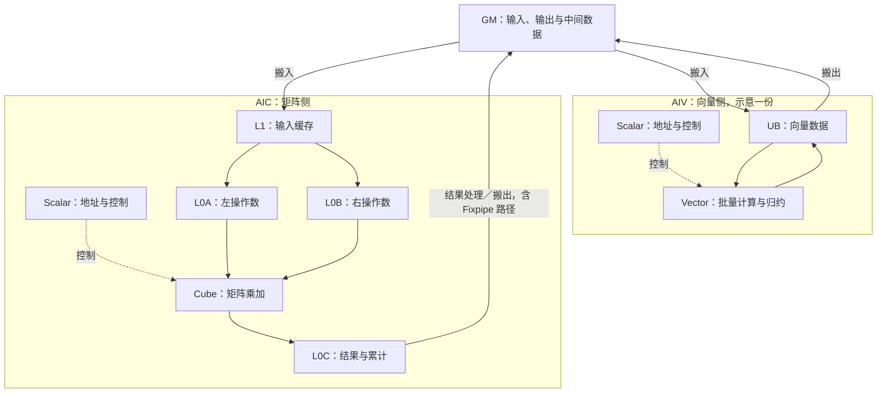

# 打印之后，计算在哪里发生？

[上一篇](../articles/hello-world.md)把 Hello World 送到了设备上：Host 发起任务，Device 执行 Kernel，最后等到程序结束。这条链路跑通之后，很容易顺着往下想：接下来把打印换成加法，是不是就开始做真正的算子了？

数学上确实只有一行：

$$z_i=x_i+y_i.$$

但打开[最小向量加的源码](../../src/vector_add/00_basic/add.cpp)，会发现计算前要绑定地址、申请局部空间、搬入两个输入，计算后还要写回输出，并处理执行阶段之间的依赖。加法只是其中一步。

问题再复杂一点，矩阵乘，情况又变了，公式仍然很短：

$$c_{ij}=\sum_{k=0}^{K-1}a_{ik}b_{kj}.$$

其中， $a_{ik}$ 和 $b_{kj}$ 分别是输入矩阵 $A$ 和 $B$ 的元素， $c_{ij}$ 是输出矩阵 $C=AB$ 的元素， $K$ 是两矩阵相乘时的公共维度。一个输出由 $A$ 的一行与 $B$ 的一列逐项相乘、再求和得到。

然而，计算的数据却不能照搬向量加的组织方式，文档开始出现 Cube、L1、L0A、L0B，以及矩阵的分块和布局。都是乘加计算，为什么需要另一套资源？

我们先把 API 放在一边，追问一个更加具体问题：**一个输出依赖哪些输入，这些输入还能被多少个输出重复使用？** 依赖决定哪些计算必须等待，复用决定哪些数据值得留下；再往下，才是用什么硬件完成它们。

# 四个公式，四种组织数据的场景

## Add：每个输出都可以独立完成

设三个向量长度都是 $L$ ，且输出不覆盖输入。对任意位置 $i$ ，计算 $z_i$ 只需要 $x_i$ 和 $y_i$ ，不需要知道相邻位置的结果。

> 【图 1 占位】Add 的逐元素加法。两个输入向量按索引对齐，每个输出 $z_i$ 只依赖同一位置的 $x_i$ 和 $y_i$ 。

因此，可以把输出划成互不重叠的区间，分别交给不同执行任务。只要区间覆盖完整，各任务就不必在加法过程中交换数据。

这种计算称为逐元素运算（Element-wise Operation）。它给出了一个很好的起点：大量位置做相同操作，位置之间没有归约依赖，适合成批计算。麻烦主要出现在数据怎样送到计算单元、一次处理多少，以及结果何时可以写回。

这里暂时看不到值得跨输出保留的输入： $x_i$ 用完以后，计算 $z_{i+1}$ 并不需要它。稍后我们会看到，这种复用特征会直接反映在运算量与搬运量的比例上。

## Softmax：一个位置的输出，要等整行信息

把一行输入记为 $s_0,\ldots,s_{L-1}$ 。稳定 Softmax（Safe Softmax）可以写成：

$$
m=\max_j s_j,\qquad
p_i=\frac{\exp(s_i-m)}{\sum_j\exp(s_j-m)}.
$$

减去同一个最大值，不改变归一化结果，同时让指数的输入不大于零。这里先讨论有限输入和非空行，浮点误差与特殊边界留到 Softmax 篇展开。

> 【图 2 占位】Safe Softmax 的行内归一化。以输入 $(1,2,2)$ 为例，各元素先减去行最大值 2，再取指数，最后分别除以整行共用的指数和 $e^{-1}+2$ 。

与 Add 不同， $p_i$ 虽然对应一个位置，却依赖整行的最大值与指数和。最大值和求和都是归约（Reduction）：将一组输入合并成更少的统计量。

如果把这一行切成两半，分别做 Softmax，再拼接起来，两半的概率和都会是 1，拼接后的总和就成了 2，显然不再是原来的 Softmax。分块处理可以做，但必须解决统计量如何合并、如何在各位置之间共享的问题。

这不意味着整个 Softmax 只能串行执行。不同的行可以分别处理，行内归约也可以采用分层合并。真正改变的是任务之间的关系：哪些步骤能独立做，哪些步骤需要先等到统计量。

因此，即使 Add 与 Softmax 都可以主要使用向量计算资源，它们需要的调度和临时存储也会明显不同。

## Matmul：算一块输出，输入才有机会反复使用

设 $A\in\mathbb R^{M\times K}$ 、 $B\in\mathbb R^{K\times N}$ ，输出 $C=AB\in\mathbb R^{M\times N}$ 。一个输出元素是：

$$c_{ij}=\sum_{k=0}^{K-1}a_{ik}b_{kj}.$$

只看一个 $c_{ij}$ ，这是两组数相乘再求和。但把视线移到一块输出，复用就出现了：同一行的多个输出会用到同一行 $A$ ，同一列的多个输出会用到同一列 $B$ 。

> 【图 3 占位】Matmul 的行列点积。取 $A$ 的第 0 行与 $B$ 的第 1 列，沿 $k$ 配对相乘并求和，得到 $c_{01}$ 。

接着算 $c_{00}$ 时，只需把选中的列换成 $B$ 的第 0 列， $A$ 的第 0 行仍然用得上。

例如，同时计算 $c_{00},c_{01},c_{10},c_{11}$ 时， $a_{0k}$ 会同时参与第一行的两个输出， $b_{k0}$ 会同时参与第一列的两个输出。若每算一个输出都重新装载全部操作数，已经装入的输入数据就没有重复使用，造成了极大的资源浪费。

选择一块 $B_M\times B_N$ 的输出，并沿求和维度取长度为 $B_K$ 的输入片段，需要配套的两块输入分别为 $B_M\times B_K$ 和 $B_K\times B_N$ 。在这一块计算中，一个左矩阵元素可参与 $B_N$ 个输出，一个右矩阵元素可参与 $B_M$ 个输出。

但这些机会有条件：输入块要按计算单元可接受的格式组织，相关数据在复用期间要留得住，输出部分和也不能提前丢掉。输入送入专用矩阵计算资源之后，硬件才有机会以规整的矩阵乘加方式处理它们。

所以，矩阵乘的设计重点不只是“并行执行更多乘法”，还包括**用一批已装载的数据持续产生更多有效计算**。

## Attention：计算步骤之间也存在数据生命周期

再把前面几类计算接起来。对单个 head，设 $Q,K\in\mathbb R^{L\times d}$ ， $V\in\mathbb R^{L\times d_v}$ ，一个基本的 Attention 前向计算是：

$$
\begin{aligned}
S &= \frac{QK^{\mathsf{T}}}{\sqrt{d}}, \\[0.6em]
P &= \operatorname{softmax}_{\mathrm{row}}(S), \\[1em]
O &= PV.
\end{aligned}
$$

这里有两次矩阵乘、按行归约，以及缩放、指数和归一化等逐元素处理。 $S$ 和 $P$ 都是 $L\times L$ ，最终输出则是 $L\times d_v$ 。

即使每一步分别算对，组合实现仍然要决定：矩阵乘的结果放在哪里，Softmax 怎么读它，下一次矩阵乘什么时候能使用处理后的数据？如果应用只需要 $O$ ，完整保存 $S$ 和 $P$ 是否必要？

这就进入融合（Fusion）问题：围绕多个步骤共同组织数据和执行，而不是只优化各自的算式。至于哪些中间结果可以消去、如何跨块保持正确语义，留到第 08 篇推导。这里先记住，**省掉一个完整中间张量的保存，与步骤间完全不发生内存中转，是不同的目标**。整理上述的典型计算结构分类得出下列这张表。

| 计算结构             | 输出之间的关系    | 主要资源需求与设计问题          |
| ---------------- | ---------- | -------------------- |
| Add 等逐元素运算       | 各位置可独立     | 成批向量计算、连续搬运、区间覆盖     |
| Softmax 等归约组合    | 一行输出共享统计量  | 归约、逐行广播、临时空间与阶段依赖    |
| Matmul           | 共享输入并累加部分和 | 矩阵计算、输入复用、布局与分块      |
| Attention 等多阶段组合 | 后一步消费前一步结果 | 多类计算资源协作、交接与中间数据生命周期 |

> 配图待补：用四个小面板集中比较独立位置、整行统计、矩阵输入复用与中间数据生命周期，见 [配图规划](../../lab/hardware-dataflow/experiment-plan.md#配图规划)。

注意，以上四个算子不是四个互斥的类别。Matmul 自身包含求和，Softmax 也包含逐元素运算；“融合”描述的是步骤如何组织。算子的名字给出计算结构，具体形状、数据类型和实现才决定它最终消耗什么资源。

# 打开 NPU：计算资源和存储并不是一整块

## 耦合与分离，分的是哪一层？

为简化逻辑，[上一篇](../articles/hello-world.md)的 Host／Device 图把 Vector 与 Cube 画在同一个 AI Core 内，用于说明主机与设备的关系。这里需要把图继续拆开：**耦合与分离，说的是 Vector 与 Cube 是否同核部署，不是 CPU 与 NPU 是否在同一颗芯片上。** [官方基本架构说明](https://www.hiascend.com/doc_center/source/zh/canncommercial/80RC3/developmentguide/opdevg/Ascendcopdevg/atlas_ascendc_10_0008.html)以此区分两类组织方式；该页属于 CANN 8.0.RC3 文档，仅用于解释术语。

耦合架构将两类计算单元放在同一个 AI Core 内；分离架构则分别部署在矩阵核 AIC 与向量核 AIV 上。分开以后，开发者面对的就不只是“调用哪条计算指令”，还包括计算任务由哪类核承接，以及跨核结果怎样交接。分离本身不能推出更快：供数、任务配比与同步仍然可能限制效率。

后文限定在 **NPU 架构版本 2201 的 SIMD 路径**。单指令多数据（Single Instruction, Multiple Data，SIMD）在这里可以先理解为：一条计算指令对一批数据执行同类操作。官方 2201 文档给出的 AIC∶AIV 核数配比为 1∶2，各核有自己的 Scalar 控制并可加载代码，二者经 GM 传递数据。**核数配比不是浮点算力配比**，也不表示每次 Kernel 都按这个比例使用全部资源。[2201 架构说明](https://asc.gitcode.com/guide/programming_guide/advanced_programming/hardware_implementation/architecture_spec/npu_arch_2201.html)

架构号不能代替完整产品型号。本文不从 `dav-2201` 推断实测设备的整卡核数、容量与峰值；运行环境需重新记录实际 SoC、软件版本和可见资源，再决定哪些接口与模型适用。

> 配图待补：耦合与分离架构的并列概念图。左侧画一个含 Vector、Cube 的 AI Core，右侧画分别带 Scalar 的 AIC／AIV，并标明 GM 交接；框的数量只表示组织关系，不代表实测设备物理核数。详细画法见 [配图规划](../../lab/hardware-dataflow/experiment-plan.md#配图规划)。

## 与 NVIDIA GPU 对照：矩阵计算能力相似，组织方式要分别看

华为廖恒博士在[访谈](https://www.bilibili.com/video/BV1nB3u6tERu/)中说：“我们就讲 Vector 算力和 Cube 算力，他们称之为 Tensor Core”。这句话为理解两类计算能力提供了入口：这里可以把 Cube 与 Tensor Core 放在专用矩阵乘加能力这一层比较。

但从能力名称跳到硬件组织，还差了一步。以 NVIDIA Ampere 的 A100 为例，流式多处理器（Streaming Multiprocessor，SM）内包含常规算术执行资源与 Tensor Core，并围绕线程束（warp）组织执行；它不是把昇腾 AIV、AIC 换个名字得到的结构。[A100 架构白皮书，第 20—23 页](https://images.nvidia.com/aem-dam/en-zz/Solutions/data-center/nvidia-ampere-architecture-whitepaper.pdf)

| 比较的问题 | 本文限定的昇腾 2201 SIMD 路径 | NVIDIA Ampere A100 对照 |
| --- | --- | --- |
| 计算能力 | Vector 处理向量步骤，Cube 处理矩阵乘加 | 常规算术执行资源与 Tensor Core 承担相应计算 |
| 核内组织 | AIV 与 AIC 分离，各自带 Scalar 控制 | 常规算术资源与 Tensor Core 位于 SM 内 |
| 数据怎样到达计算位置 | 显式管理 UB、L1、L0 等空间及其搬运 | 使用寄存器、共享内存等资源，细节依矩阵指令而定 |
| 编程时必须交代什么 | 核类型、局部 Tensor、搬运与跨核依赖 | 线程／warp 协作、操作数组织与同步 |

NVIDIA 的 [Ampere 调优指南](https://docs.nvidia.com/cuda/ampere-tuning-guide/index.html)分别说明了 Tensor Core 指令和全局内存到共享内存的异步复制。对照的价值是提出共同问题——操作数在哪里、如何供数、由谁等待——而不是把 Vector 等同于 CUDA Core、把 Cube 等同于整个 SM，或把 UB 等同于共享内存。

> 引语核对说明：以上引语由作者提供，视频页面本轮读取受限，原句上下文与时间点待人工核对。它不作为目标设备规格或算力配比的证据。

## Scalar 安排工作，Vector 与 Cube 执行不同形态的计算

标量单元（Scalar）处理控制流、地址计算等工作，例如当前处理哪块输入、循环何时结束。它位于设备核（AI Core）内，不能与发起整个任务的 Host CPU 混为一谈。

向量计算单元（Vector）适合表达批量算术、比较、指数、类型转换和归约等操作。Add 和 Softmax 的基本步骤能够沿着这条路径展开。这里的“向量”并不要求输入只能是一维；矩阵的一行或一块数据，也可以按向量操作处理。[Vector 编程说明](https://asc.gitcode.com/guide/programming_guide/programming_model/ai_core_simd_programming/c_pointer_programming/c_programming_overview.html)

矩阵计算单元（Cube）面向规整的矩阵乘加。Matmul 的块级复用关系与这类计算形态相匹配，但实际效率还取决于形状、布局、数据类型和供数方式。小矩阵或不合适的分块，仍可能让这部分资源利用不足。

从计算结构看，Vector 保留了处理不同逐元素及归约步骤的灵活性，Cube 承接规整矩阵乘加。Attention 同时包含两类需求，自然也就产生了二者如何协作的问题。

## 数据必须进入对应计算资源能够使用的位置

先区分两类空间：全局内存（Global Memory，GM）保存核之间可访问的输入、输出和中间数据；片上存储（Local Buffer）位于芯片内部，容量有限，并按计算用途进一步划分。

其中，统一缓冲区（Unified Buffer，UB）为 Vector 保存数据；L1 为矩阵计算缓存输入，L0A、L0B 分别保存矩阵操作数，L0C 保存矩阵乘的结果及中间累计。它们不是一份空间的不同别名，也不能把 UB 直接等同于普通 CPU 上由硬件透明管理的缓存。[官方存储单元说明](https://asc.gitcode.com/api/SIMD-API/c_api/general_description_and_constraints.html)

用一张简化图把计算与存储接起来。图中只画与后续文章相关的主要业务数据路径，不表示芯片布局、完整通路或执行时序；AIV 支路仅展开一份，1∶2 配比不意味着每个 Kernel 都自动使用全部资源。

图中没有画 UB 与矩阵侧存储的直接连线。2201 架构说明中的 AIC／AIV 数据交接经过 GM；不能从“两个 Buffer 都在片上”，推导出它们可以任意直接互访。高阶接口把结果交给一个局部 Tensor，也不等于其内部搬运没有经过 GM。[2201 架构与交接说明](https://asc.gitcode.com/guide/programming_guide/advanced_programming/hardware_implementation/architecture_spec/npu_arch_2201.html)

## 搬运与计算是不同的执行工作

数据搬运由相应的搬运单元执行，常见名称是内存传输引擎（Memory Transfer Engine，MTE）。Add 路径中，MTE2 将 GM 数据搬入 UB，MTE3 将 UB 结果搬出；矩阵侧的 MTE1 负责 L1 到 L0A／L0B 的输入搬运；结果侧还涉及 Fixpipe，用于结果输出相关的格式转换或随路处理，具体支持范围以目标接口为准。计算与搬运可以使用不同流水，但能否重叠，取决于依赖和缓冲安排。[搬运与同步说明](https://asc.gitcode.com/guide/programming_guide/programming_model/ai_core_simd_programming/c_pointer_programming/c_programming_overview.html)

这带来一个容易忽略的区别：代码先写搬运调用，再写计算调用，不能仅凭 C++ 语句的排列，就断定两个异步执行阶段已经满足数据就绪条件。

我们至少需要保证：输入搬完之后再使用，计算完成之后再写回，旧数据不再被读取之后才复用那块缓冲。同步机制就是将这些依赖落实为执行顺序。具体 API 各自保证什么，下一篇再结合代码核对；这里先不把某一种屏障当作所有依赖的通用解法。

# 从公式到性能：用 Add 和 Matmul 走完一条验证链

现在把计算资源和数据路径放回两个算子。我们先从公式数出工作量与数据量，再用硬件约束推算边界，最后设计实验判断哪些假设成立。下面的数值均为模型推导，**本篇实验尚未运行**；验证部分写的是对照与判据，结果不会预先填入。

## 先建立共同的性能尺度：Roofline 怎样读？

把一次 Kernel 的浮点运算次数记为 $F$ ，单位 FLOP；选定存储边界的搬运量记为 $Q$ ，单位 Byte。每次加法计一次浮点运算，乘加计两次；算术强度（Arithmetic Intensity）是：
$$I=F/Q\quad[\mathrm{FLOP/Byte}].$$

这里必须先问清“字节从哪里经过”。源码中对 GM 发起的逻辑读写，与外部高带宽内存（High Bandwidth Memory，HBM）实际传输的物理字节量，不是同一个数；缓存命中、重复读取、事务粒度和布局转换都会造成差别。后文用 $Q_{\mathrm{logical}}$ 表示逻辑计数， $Q_{\mathrm{HBM}}$ 表示需要计数器核对的物理流量，不把二者混用。

设所选精度和计算路径的吞吐上限为 $P_{\max}$ ，单位 FLOP/s；选定边界的带宽上限为 $B_{\max}$ ，单位 Byte/s。即使搬运与计算能够理想重叠，执行时间仍有下界：

$$t\ge\max\left(\frac{F}{P_{\max}},\frac{Q}{B_{\max}}\right).$$

代入 $P=F/t$ ，得到屋顶线模型（Roofline Model）的基本形式：

$$P\le\min(P_{\max},B_{\max}I).$$

这是一条性能上界，而不是运行时间的等式。Roofline 将数据局部性、带宽与计算吞吐放在一起考察；模型背景见 [Berkeley Lab 的 Roofline 说明](https://amcr.lbl.gov/departments/computer-science-department/ppan/roofline-performance-model/)，原始推导见 [Williams、Waterman 与 Patterson 的技术报告](https://www2.eecs.berkeley.edu/Pubs/TechRpts/2008/EECS-2008-134.html)。

在横轴为 $I$ 、纵轴为 $P$ 的双对数图上， $P=B_{\max}I$ 是向右上方延伸的带宽斜线， $P=P_{\max}$ 是水平的计算屋顶。两线交点对应的强度为：

$$I_* = P_{\max}/B_{\max}.$$

当 $I<I_*$ ，带宽项给出的上界更低，减少字节数或提高有效带宽更值得关注；当 $I>I_*$ ，计算项的上界更低，需要关注计算资源利用。但一个点远低于两条线，可能是启动、同步、并行度或供数问题，不能仅凭它在交点哪边就宣布找到了实测瓶颈。

为便于手算，**假设**某设备对应边界的带宽为 $1\ \mathrm{TB/s}$ ，Vector FP32 路径上限为 $10\ \mathrm{TFLOP/s}$ ，Cube 的 FP16 输入、FP32 累计路径上限为 $100\ \mathrm{TFLOP/s}$ ，均按十进制单位计。两个交点分别是 $10$ 与 $100\ \mathrm{FLOP/Byte}$ 。

> [!NOTE]
> 注意，以上这组数字只用于方便计算和读图，既不是昇腾规格，也不是本文测量真实值。

因此，Add 与 Matmul 不能共用一个未经区分的“整卡峰值”。核数范围、精度、稠密／稀疏模式、计算路径及带宽读写口径必须匹配。HBM 带宽屋顶只能配 HBM 流量；若只有逻辑字节计数，就先报告逻辑有效吞吐，不能把它当成物理 HBM 带宽利用率。

> 配图待补：两张共享横轴尺度的 Roofline 子图，分别标出 Vector 与 Cube 的屋顶、交点及算术强度位置；所有曲线注明“假设参数／模型”，待实验后另加实测点，不预画测量曲线。

## Add：从一行公式，推到容量与搬运约束

### 数学语义怎样变成数据路径

对 $z_i=x_i+y_i$ ，设长度为 $L$ ，两个输入与输出均为 FP32，且互不覆盖。一个任务每次处理 $T$ 个元素：GM 中的两个输入片段搬入 UB，Vector 完成加法，再把结果从 UB 写回 GM。数据就绪与缓冲复用仍需同步保证。

> 【图 8 占位】Add 的数据搬运与缓冲。两段输入分别从 GM 搬入 UB，Vector 完成加法后，输出从 UB 写回 GM。图中分别标出每个任务的缓冲容量与整个向量的读写量。

每个任务在 UB 中分配三块缓冲区，两块存输入，一块存结果，每块容纳 $T$ 个 FP32 元素。

$$C_{\mathrm{UB}}=3T\times4=12T\ \mathrm{Byte}.$$

[现有基础样例](../../src/vector_add/00_basic/add.cpp)每个任务取 $T=2048$ ，三块缓冲合计 $24576$ Byte，即 $24\ \mathrm{KiB}$ 。这是源码申请量，不是设备 UB 总容量，也未包括框架预留。总长继续增大时，不应无限增大每个任务的缓冲，而应分块循环；具体实现留给后续 Tiling 篇。

### 流量计数与理论值

假设输入各读一次、输出写一次，没有额外复制，则：
$$F_{\mathrm{add}}=L,\qquad Q_{\mathrm{logical,add}}=12L,\qquad I_{\mathrm{logical,add}}=\frac1{12}\ \mathrm{FLOP/Byte}.$$

每个任务一次处理 $T$ 个元素，三块 UB 缓冲区共占 $12T$ 字节。算完整个长度为 $L$ 的向量，所有任务合计从 GM 读入 $8L$ 字节、写回 $4L$ 字节。固定分块大小时，向量越长，要处理的块越多，每个任务所需的 UB 容量不变。每个输出仍对应一次加法和 12 字节读写，所以算术强度不变。

| 手算用例 | 浮点运算量 | 逻辑 GM 字节量 | 三块 UB 缓冲 |
| --- | ---: | ---: | ---: |
| $L=16384,\ T=2048$ | $16384$ FLOP | $196608$ Byte | $24576$ Byte／任务 |
| $L=1048576,\ T=2048$ ，分块循环 | $1048576$ FLOP | $12582912$ Byte | $24576$ Byte／任务 |

每次 FP32 加法读入两个数、写回一个数，共读写 12 字节。假设这 12 字节都经过 HBM，按前面设定的带宽 $1\ \mathrm{TB/s}$ 计算，每秒可传输 $10^{12}$ 字节。将带宽乘以算术强度，就得到带宽所允许的加法吞吐上限。

$$P_{\mathrm{BW}}=B_{\max}I=10^{12}\ \mathrm{Byte/s}\times\frac{1\ \mathrm{FLOP}}{12\ \mathrm{Byte}}\approx 8.33\times10^{10}\ \mathrm{FLOP/s}=83.3\ \mathrm{GFLOP/s}.$$

假设的 Vector 计算上限为 $10\ \mathrm{TFLOP/s}=10\,000\ \mathrm{GFLOP/s}$ 。两者取较低值，因此模型给出的上限约为 $83.3\ \mathrm{GFLOP/s}$ 。对于大向量，实际吞吐能否接近这条带宽屋顶，还要通过实验验证。

### 向量长度翻倍，加法会慢多少？

先固定任务数，每个任务每次处理 2048 个元素，只改变向量长度。长度翻倍，加法次数和读写量也翻倍。如果短向量的耗时几乎没变，可能是启动一次 Kernel 本身就花了不少时间。如果长向量的耗时也接近翻倍，就用程序应读写的 $12L$ 字节除以实测耗时，看看每秒能处理多少数据。

接着用同一个长向量增加任务数。如果时间明显缩短，说明之前还有并行处理的余地。要判断显存带宽是否已经用足，还要看设备实际从 HBM 读写了多少字节，并和同一设备上单独测得的连续读写速度比较。反复使用同一组输入时，一部分数据可能直接来自缓存。

> 实验结果待补：Add 正确性、长度与任务数扫描、计时分布及可用的访存证据。完整输入、计时和反例判据见 [实验设计 A1—A3](../../lab/hardware-dataflow/experiment-plan.md#add验证容量流量与并行度)。

## Matmul：复用机会怎样改变模型，又怎样被实现限制

### 从输出元素到部分和的存储位置

对 $C=AB$ ， $A$ 为 $M\times K$ 、 $B$ 为 $K\times N$ ，输入用 FP16，累计与输出用 FP32，不读取旧 $C$ 。一个输出元素要沿 $K$ 求和；实际实现可按 $B_M\times B_N$ 输出块组织任务，每次装入长度为 $B_K$ 的输入片段：

$$C_{\mathrm{tile}}=\sum_t A_{\mathrm{tile},t}B_{t,\mathrm{tile}}.$$

这里的 $t$ 枚举 $K$ 维片段。在本文限定的数据路径中，输入经 GM、L1，再送入 L0A／L0B 供 Cube 使用，部分和保存在 L0C，完成全部 $K$ 维后再输出。输入可以换块，未完成的部分和不能重新清零。实际输出与格式转换需按所选接口核对。[Matmul 缓存与调度配置](https://asc.gitcode.com/api/SIMD-API/adv_api/cube_compute/Matmul_Kernel/MatmulConfig.html)

只算单级输入缓冲与一块 FP32 累计，逻辑有效负载分别为：

$$C_{\mathrm{L1,input}}=2B_MB_K+2B_KB_N,\qquad C_{\mathrm{L0C}}=4B_MB_N\quad[\mathrm{Byte}].$$

L0A 与 L0B 还分别需要对应操作数空间。各存储层级必须分别满足容量、布局和对齐要求，不能把这些数加起来与一个“片上总容量”比较。双缓冲、填充、临时空间及框架预留都要另计。

### 先算理想流量，再算具体分块的流量

若每个输入只从 GM 读一次、输出只写一次，常用乘加计数给出：

$$F_{\mathrm{mm}}\approx2MKN,\qquad Q_{\min}=2MK+2KN+4MN.$$

 $2MKN$ 按每次乘加计两次操作，不扣除从零初始化等细节。对方阵 $M=N=K=n$ ，有 $Q_{\min}=8n^2$ ，于是 $I_{\mathrm{ideal}}\approx n/4$ 。

| 手算方阵 | 约定运算量 | 理想逻辑流量 $Q_{\min}$ | 理想强度 |
| --- | ---: | ---: | ---: |
| $n=64$ | $524288$ FLOP | $32768$ Byte | $16$ FLOP/Byte |
| $n=128$ | $4194304$ FLOP | $131072$ Byte | $32$ FLOP/Byte |

这个模型表达的是复用机会，尚未证明某种分块能实现它。假设 $M,N$ 分别整除 $B_M,B_N$ ，每个输出块独立装入所需输入，块间没有显式复用，且部分和不写回 GM，则代码层面的逻辑流量是：

$$Q_{\mathrm{tile}}=2MK\frac{N}{B_N}+2KN\frac{M}{B_M}+4MN.$$

第一项表示同一块 $A$ 被不同输出列块重新读取，第二项对应 $B$ 在输出行块间的重读。对方阵和方形输出块 $B_M=B_N=b$ ：

$$Q_{\mathrm{tile}}=\frac{4n^3}{b}+4n^2,\qquad I_{\mathrm{tile}}\approx\frac{nb}{2(n+b)}.$$

当 $b$ 固定、 $n$ 增大，强度趋近 $b/2$ ，不会像理想模型那样无限按 $n/4$ 增长。例如 $n=128,b=32$ 时， $Q_{\mathrm{tile}}=327680$ Byte，强度为 $12.8$ FLOP/Byte；若只报理想值 $32$ ，就掩盖了实现中的重读。缓存可能降低实际 HBM 流量，所以这仍是逻辑请求模型，不是物理传输实测。

回到假设的 Cube 屋顶， $I_*=100$ FLOP/Byte。 $n=64,128$ 的理想强度仍在该交点左侧，说明“用了 Cube”并不自动意味着计算受限。即使理想方阵模型在 $n=400$ 到达交点，具体分块、并行规模和供数也可能让实测点远低于屋顶；不能把 $n=400$ 当成真实设备的性能转折点。

### 把输出块做大，矩阵乘法就会更快吗？

用同一对边长 512 的方阵做两次乘法。第一次每块算 $32\times32$ 个输出，第二次改成 $64\times64$ ，两次做的乘加总数一样。假设每块都单独读取所需输入，手算的读写量会从 17 MiB 降到 9 MiB。先数实际实现为各块读取了多少数据，再测两次各花多长时间。

大块让输入有更多机会重复使用，但可分给各个核的输出块也从 256 个减到了 64 个。若程序确实少读了数据，耗时却没有下降，就要看实际有多少核在工作、缓存替两种实现各省了多少次显存读取。再换几个矩阵尺寸重复比较，就能看出这种现象出现在哪些规模上。

> 实验结果待补：Matmul 接口可行性、数值误差、实际分块与字节计数、形状扫描和复用对照。完整方案见 [实验设计 M0—M3](../../lab/hardware-dataflow/experiment-plan.md#matmul验证理想复用与分块重读)。

## 两条验证链最后要回答什么？

Add 的强度在假设下固定为 $1/12$ ；Matmul 能让一份输入贡献给多个输出，但复用程度取决于分块、容量与任务组织。这解释了为什么要选择不同的计算资源和数据路径，尚不能替代对某台设备瓶颈的测量。

实验后应分别回答：数学结果是否正确，逻辑流量模型是否符合实现，HBM 证据是否支持带宽判断，实测吞吐为什么低于相应屋顶。缺少物理计数器时，结论就停在逻辑字节量与耗时趋势，不补写“已达到带宽上限”。

同样的区分也适用于 Attention：不保存完整中间张量减少的是某些存储需求，不保证总搬运量线性。dtype 又同时影响容量、流量、数值误差和可用计算路径；比较时必须逐项注明，不能把全部步骤统一按一个元素字节数记账。

# 下一步，让一次加法的数据流真正跑起来

现在再看 $z_i=x_i+y_i$ ，已经能对实现提出具体要求：输出之间独立，可以划分区间；Vector 完成批量加法；输入先进入 UB，输出再回到 GM；搬运、计算和缓冲复用之间必须满足依赖。

向量加适合作为第一个数值 Kernel，正因为它把复杂的归约与矩阵布局暂时拿开，却保留了算子开发必须面对的数据路径。等这条路径解释清楚，输入放不下、尾块不整齐、搬运能否与计算重叠，才有可讨论的基础。

[下一篇](vector-add.md)就沿着现有最小 Add 源码，追踪一个 Block 的地址、局部存储、真实搬运和计算结果。我们要核对的不是加法公式，而是：**这几段数据，是否在正确的时刻，出现在执行单元能够使用的位置。**

<!-- 内部审核：正文中的参数示例均为假设，实验与配图均待完成；资料版本、引语核对及配图设计集中记录在 lab/hardware-dataflow/experiment-plan.md，不因本轮文档修改提升验证状态。 -->
