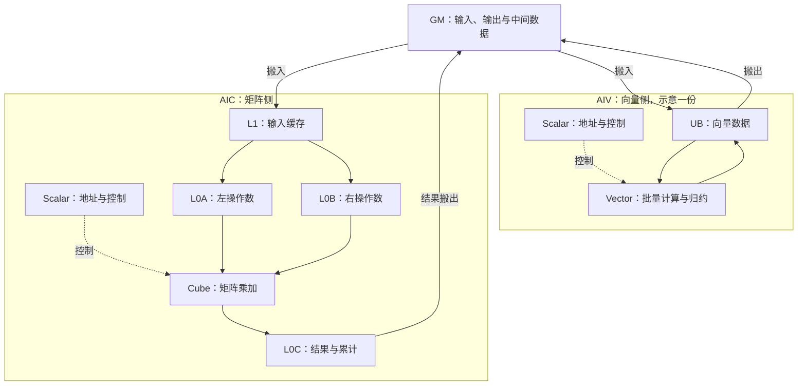

# 打印之后，计算在哪里发生？

[上一篇](hello-world.md)把 Hello World 送到了设备上：Host 发起任务，Device 执行 Kernel，最后等到程序结束。这条链路跑通之后，很容易顺着往下想：接下来把打印换成加法，是不是就开始做真正的算子了？

数学上确实只多了一行：

$$z_i=x_i+y_i.$$

但打开[最小向量加的源码](../../src/vector_add/00_basic/add.cpp)，会发现计算前要绑定地址、申请局部空间、搬入两个输入，计算后还要写回输出，并处理执行阶段之间的依赖。加法只是其中一步。

再看矩阵乘，情况又变了。公式仍然很短，数据却不能照搬向量加的组织方式。文档开始出现 Cube、L1、L0A、L0B，以及矩阵的分块和布局。都是乘加计算，为什么需要另一套资源？

我更愿意先把 API 名称放在一边，追问一个具体问题：**一个输出依赖哪些输入，这些输入还能被多少个输出重复使用？** 依赖决定哪些计算必须等待，复用决定哪些数据值得留下；再往下，才是用什么硬件完成它们。

# 四个公式，四种组织数据的难题

## Add：每个输出都可以独立完成

设三个向量长度都是 $L$，且输出不覆盖输入。对任意位置 $i$，计算 $z_i$ 只需要 $x_i$ 和 $y_i$，不需要知道相邻位置的结果。

因此，可以把输出划成互不重叠的区间，分别交给不同执行任务。只要区间覆盖完整，各任务就不必在加法过程中交换数据。

这种计算称为逐元素运算（Element-wise Operation）。它给出了一个很好的起点：大量位置做相同操作，位置之间没有归约依赖，适合成批计算。麻烦主要出现在数据怎样送到计算单元、一次处理多少，以及结果何时可以写回。

这里暂时看不到值得跨输出保留的输入：$x_i$ 用完以后，计算 $z_{i+1}$ 并不需要它。稍后我们会看到，这种复用特征会直接反映在运算量与搬运量的比例上。

## Softmax：一个位置的输出，要等整行信息

把一行输入记为 $s_0,\ldots,s_{L-1}$。稳定 Softmax 可以写成：

$$
m=\max_j s_j,\qquad
p_i=\frac{\exp(s_i-m)}{\sum_j\exp(s_j-m)}.
$$

减去同一个最大值，不改变归一化结果，同时让指数的输入不大于零。这里先讨论有限输入和非空行，浮点误差与特殊边界留到 Softmax 篇展开。

与 Add 不同，$p_i$ 虽然对应一个位置，却依赖整行的最大值与指数和。最大值和求和都是归约（Reduction）：将一组输入合并成更少的统计量。

如果把这一行切成两半，分别做 Softmax，再拼接起来，两半的概率和都会是 1，拼接后的总和就成了 2，显然不再是原来的 Softmax。分块处理可以做，但必须解决统计量如何合并、如何在各位置之间共享的问题。

这不意味着整个 Softmax 只能串行执行。不同的行可以分别处理，行内归约也可以采用分层合并。真正改变的是任务之间的关系：哪些步骤能独立做，哪些步骤需要先等到统计量。

因此，即使 Add 与 Softmax 都可以主要使用向量计算资源，它们需要的调度和临时存储也会明显不同。

## Matmul：算一块输出，输入才有机会反复使用

设 $A\in\mathbb R^{M\times K}$、$B\in\mathbb R^{K\times N}$，输出 $C=AB\in\mathbb R^{M\times N}$。一个输出元素是：

$$c_{ij}=\sum_{k=0}^{K-1}a_{ik}b_{kj}.$$

只看一个 $c_{ij}$，这是两组数相乘再求和。但把视线移到一块输出，复用就出现了：同一行的多个输出会用到同一行 $A$，同一列的多个输出会用到同一列 $B$。

例如，同时计算 $c_{00},c_{01},c_{10},c_{11}$ 时，$a_{0k}$ 会同时参与第一行的两个输出，$b_{k0}$ 会同时参与第一列的两个输出。若每算一个输出都重新装载全部操作数，就放弃了这些复用机会。

选择一块 $B_M\times B_N$ 的输出，并沿求和维度取长度为 $B_K$ 的输入片段，需要配套的两块输入分别为 $B_M\times B_K$ 和 $B_K\times B_N$。在这一块计算中，一个左矩阵元素可参与 $B_N$ 个输出，一个右矩阵元素可参与 $B_M$ 个输出。

但这些机会有条件：输入块要按计算单元可接受的格式组织，相关数据在复用期间要留得住，输出部分和也不能提前丢掉。输入送入专用矩阵计算资源之后，硬件才有机会以规整的矩阵乘加方式处理它们。

所以，矩阵乘的设计重点不只是“并行执行更多乘法”，还包括**用一批已装载的数据持续产生更多有效计算**。

## Attention：计算步骤之间也存在数据生命周期

再把前面几类计算接起来。对单个 head，设 $Q,K\in\mathbb R^{L\times d}$，$V\in\mathbb R^{L\times d_v}$，一个基本的 Attention 前向计算是：

$$
S=QK^{\mathsf T}/\sqrt d,\qquad
P=\operatorname{softmax}_{\mathrm{row}}(S),\qquad
O=PV.
$$

这里有两次矩阵乘、按行归约，以及缩放、指数和归一化等逐元素处理。$S$ 和 $P$ 都是 $L\times L$，最终输出则是 $L\times d_v$。

即使每一步分别算对，组合实现仍然要决定：矩阵乘的结果放在哪里，Softmax 怎么读它，下一次矩阵乘什么时候能使用处理后的数据？如果应用只需要 $O$，完整保存 $S$ 和 $P$ 是否必要？

这就进入融合（Fusion）问题：围绕多个步骤共同组织数据和执行，而不是只优化各自的算式。至于哪些中间结果可以消去、如何跨块保持正确语义，留到第 08 篇推导。这里先记住，**省掉一个完整中间张量的保存，与步骤间完全不发生内存中转，是不同的目标**。

| 计算结构 | 输出之间的关系 | 主要资源需求与设计问题 |
| --- | --- | --- |
| Add 等逐元素运算 | 各位置可独立 | 成批向量计算、连续搬运、区间覆盖 |
| Softmax 等归约组合 | 一行输出共享统计量 | 归约、逐行广播、临时空间与阶段依赖 |
| Matmul | 共享输入并累加部分和 | 矩阵计算、输入复用、布局与分块 |
| Attention 等多阶段组合 | 后一步消费前一步结果 | 多类计算资源协作、交接与中间数据生命周期 |

这张表按计算结构分类，不是四个互斥的硬件类别。Matmul 自身包含求和，Softmax 也包含逐元素运算；“融合”描述的是步骤如何组织。算子的名字给出线索，具体形状、数据类型和实现才决定它最终消耗什么资源。

# 打开 NPU：计算资源和存储并不是一整块

下面限定在 **NPU 架构版本 2201 的 SIMD 路径**讨论。单指令多数据（Single Instruction, Multiple Data，SIMD）在这里可以先理解为：一条计算指令对一批数据执行同类操作。

官方架构资料将 Atlas A2、A3 系列列在 2201 架构下，描述了分离的矩阵核 AIC 与向量核 AIV，以及 1∶2 的配比；每个核有自己的标量控制单元。架构号不是完整产品型号，不能仅凭 `dav-2201` 判断具体 SoC、整卡核数或峰值性能。本文引用的是在线架构说明，既有实验环境的产品与软件对应关系仍需单独核对。[官方架构说明](https://asc.gitcode.com/guide/programming_guide/advanced_programming/hardware_implementation/architecture_spec/npu_arch_2201.html)

## Scalar 安排工作，Vector 与 Cube 执行不同形态的计算

标量单元（Scalar）处理控制流、地址计算等工作，例如当前处理哪块输入、循环何时结束。它位于设备核内，不能与发起整个任务的 Host CPU 混为一谈。

向量计算单元（Vector）适合表达批量算术、比较、指数、类型转换和归约等操作。Add 和 Softmax 的基本步骤能够沿着这条路径展开。这里的“向量”并不要求输入只能是一维；矩阵的一行或一块数据，也可以按向量操作处理。[Vector 编程说明](https://asc.gitcode.com/guide/programming_guide/programming_model/ai_core_simd_programming/c_pointer_programming/c_programming_overview.html)

矩阵计算单元（Cube）面向规整的矩阵乘加。Matmul 的块级复用关系与这类计算形态相匹配，但实际效率还取决于形状、布局、数据类型和供数方式。小矩阵或不合适的分块，仍可能让这部分资源利用不足。

从计算结构看，Vector 保留了处理不同逐元素及归约步骤的灵活性，Cube 承接规整矩阵乘加。Attention 同时包含两类需求，自然也就产生了二者如何协作的问题。

## 数据必须进入对应计算资源能够使用的位置

先区分两类空间：全局内存（Global Memory，GM）保存核之间可访问的输入、输出和中间数据；片上存储位于芯片内部，容量有限，并按计算用途进一步划分。

其中，统一缓冲区（Unified Buffer，UB）为 Vector 保存数据；L1 为矩阵计算缓存输入，L0A、L0B 分别保存矩阵操作数，L0C 保存矩阵乘的结果及中间累计。它们不是一份空间的不同别名，也不能把 UB 直接等同于普通 CPU 上由硬件透明管理的缓存。[官方存储单元说明](https://asc.gitcode.com/api/SIMD-API/c_api/general_description_and_constraints.html)

用一张简化图把计算与存储接起来。图中只画与后续文章相关的主要业务数据路径，不表示芯片布局、完整通路或执行时序；AIV 支路仅展开一份，1∶2 配比不意味着每个 Kernel 都自动使用全部资源。



图中没有画 UB 与矩阵侧存储的直接连线。2201 架构说明中的 AIC／AIV 数据交接经过 GM；不能从“两个 Buffer 都在片上”，推导出它们可以任意直接互访。高阶接口把结果交给一个局部 Tensor，也不等于其内部搬运没有经过 GM。[2201 架构与交接说明](https://asc.gitcode.com/guide/programming_guide/advanced_programming/hardware_implementation/architecture_spec/npu_arch_2201.html)

## 搬运与计算是不同的执行工作

数据搬运由相应的搬运单元执行，常见名称是内存传输引擎（Memory Transfer Engine，MTE）。Add 路径中，MTE2 将 GM 数据搬入 UB，MTE3 将 UB 结果搬出；矩阵侧还涉及 L1 到 L0 的搬运和结果输出路径。计算与搬运可以使用不同流水，但能否重叠，取决于依赖和缓冲安排。[搬运与同步说明](https://asc.gitcode.com/guide/programming_guide/programming_model/ai_core_simd_programming/c_pointer_programming/c_programming_overview.html)

这带来一个容易忽略的区别：代码先写搬运调用，再写计算调用，不能仅凭 C++ 语句的排列，就断定两个异步执行阶段已经满足数据就绪条件。

我们至少需要保证：输入搬完之后再使用，计算完成之后再写回，旧数据不再被读取之后才复用那块缓冲。同步机制就是将这些依赖落实为执行顺序。具体 API 各自保证什么，下一篇再结合代码核对；这里先不把某一种屏障当作所有依赖的通用解法。

# 沿着数据走一遍，硬件分工才落到实处

## 向量加：把一段数据送入 UB，算完再写回

回到 $z_i=x_i+y_i$。假设一个任务负责连续的 $T$ 个元素，两个输入和一个输出都使用 FP32，分别占 4 字节。

在最直接的实现中，为这三段数据各准备一块 UB 空间：从 GM 读入两段输入，等它们就绪后执行向量加，再把输出写回 GM。只计算这三块显式缓冲，所需容量为：

$$C_{\mathrm{UB}}=3\times T\times4=12T\ \mathrm{Byte}.$$

例如，下一篇基础样例取 $T=2048$，三块数据共需 $24576$ 字节，即 $24\ \mathrm{KiB}$。这是由源码申请量推导的容量预算，不是实测峰值，也没有包含所有框架预留或其他临时空间。

```text
GM 中的 x 片段 ──搬入──> UB 中的 x ─┐
                                  ├─ Vector Add ─> UB 中的 z ──搬出──> GM 输出
GM 中的 y 片段 ──搬入──> UB 中的 y ─┘
```

现在可以区分代码里经常挤在一起的三件事：绑定 GM 地址，是说明“数据在哪里”；申请 UB 空间，是准备“放数据的位置”；真正搬运，才会把数据送到那里。地址绑定不会自动搬入输入，申请空间也不会自动让输入就绪。

如果输入比一次可用的 UB 空间大，就要分批处理。同一块缓冲什么时候能接收下一批，又取决于上一批是否已经用完。后面的 Tiling 与流水讨论，都会从这条最小路径继续生长。

## 矩阵乘：保存的不只是输入，还有尚未完成的部分和

对一块输出，矩阵乘通常需要沿 $K$ 维反复装入输入块，并累计贡献：

$$
C_{\mathrm{tile}}=\sum_t A_{\mathrm{tile},t}B_{t,\mathrm{tile}}.
$$

这里的 $t$ 枚举求和维度的分段。同一块输出尚未覆盖完整 $K$ 维时，已有结果只是部分和。输入块用完可以换下一块，但部分和必须保留或按明确策略保存，不能每换一次输入就重新清零。

前面讨论的 L1、L0A／L0B 和 L0C，分别为输入缓存、计算操作数和结果累计提供了对应位置。真实接口可能进一步拆分或调度这些步骤；完整的生命周期要按所用接口核对。

同时，数学上按行排列的矩阵，不代表硬件一定按同样方式读取。行主序便于我们写地址，矩阵计算却可能要求分形布局，也就是把元素按小矩阵块重新组织。高阶 Matmul 接口可以承担部分转换，但转换和额外存储的成本仍然存在。[Matmul 缓存与调度配置](https://asc.gitcode.com/api/SIMD-API/adv_api/cube_compute/Matmul_Kernel/MatmulConfig.html)

因此，不能直接把“GM→UB→Vector→GM”里的 Vector 换成 Cube：两者的操作数位置、输入组织和累计生命周期都不同。

# 有了数据路径，才有办法讨论快慢

## 先数一次计算究竟需要多少数据

对长度为 $L$ 的 FP32 Add，假设两个输入各读一次，输出写一次，没有额外复制，则：

$$
F_{\mathrm{add}}=L\ \mathrm{FLOPs},\qquad
Q_{\mathrm{add}}=(4+4+4)L=12L\ \mathrm{Byte}.
$$

FLOPs 在这里表示浮点运算次数，每次加法计一次。$Q$ 是上述假设下跨 GM 边界的逻辑读写量，不是 profiler 测得的物理访存量；也不包含 Host 与 Device 之间的传输。

定义算术强度（Arithmetic Intensity）为每搬运一个字节能完成多少浮点运算：

$$I=F/Q.$$

因此该 Add 模型的 $I=1/12\ \mathrm{FLOP/Byte}$。把向量拉长，运算和读写同步增加，这个比值并不会自动提高。

再构造一个矩阵乘的理想计数模型：$A$、$B$ 都是 $n\times n$ 的 FP16 矩阵，输出为 FP32，计算 $C=AB$，不读取旧的 $C$。乘加按两次浮点运算计，主项为 $2n^3$；若输入各从 GM 读一次、输出写一次，则：

$$
F_{\mathrm{mm}}\approx2n^3,\qquad
Q_{\mathrm{mm}}=2n^2+2n^2+4n^2=8n^2\ \mathrm{Byte},
$$

$$I_{\mathrm{mm}}\approx n/4\ \mathrm{FLOP/Byte}.$$

这个读写模型假设输入复用充分，不是任何分块实现都能达到。片上容量不足、跨任务重复读取、布局转换或中间结果中转，都可能增加实际流量。

| 理论例子 | 运算量 | 逻辑 GM 字节量 | 算术强度 |
| --- | ---: | ---: | ---: |
| FP32 Add，$L=16384$ | $16384$ FLOPs | $196608$ B | $1/12$ FLOP/B |
| FP16 输入、FP32 输出 Matmul，$n=64$ | 约 $524288$ FLOPs | $32768$ B | 约 $16$ FLOP/B |
| 同上，$n=128$ | 约 $4194304$ FLOPs | $131072$ B | 约 $32$ FLOP/B |

表中全部是手算估计，没有测量耗时。它比较的是计算结构在给定假设下提供的复用机会；不同 dtype 和执行单元的峰值不同，不能把算术强度的倍数直接解释成速度倍数。

## 算力和带宽，需要在同一口径下比较

设 $P_{\max}$ 是所选计算路径与精度对应的计算吞吐上限，单位 FLOP/s；$B_{\max}$ 是所考察存储边界的带宽上限，单位 Byte/s。忽略其他开销时，计算至少要花 $F/P_{\max}$ 秒，搬运至少要花 $Q/B_{\max}$ 秒。

即使两者理想重叠，执行时间也不应小于二者较大值。换成吞吐形式，就得到 Roofline 模型的基本约束：

$$P\le\min(P_{\max},B_{\max}I).$$

其中 $P$ 是实际浮点吞吐。这一模型用计算上限和带宽上限帮助识别资源约束，不是对运行时间的精确预测。[Roofline 原始技术报告，第 3 节](https://www2.eecs.berkeley.edu/Pubs/TechRpts/2008/EECS-2008-134.pdf)

对 Add，单位数据对应的工作很少。若输入足够大、任务分发充分，读写可能先成为约束；对复用充分的矩阵乘，同样搬入一批数据可以完成更多计算，计算吞吐就更值得关注。这里的“可能”需要保留：如果只有少量任务、布局不合适或数据根本没有被有效复用，实际表现会偏离这个简化判断。

尤其是小输入。一次任务的启动、地址与循环管理、同步等待，都需要时间；任务还可能不足以覆盖足够多的执行资源。此时减少运算次数，未必能按比例减少耗时。我们要用后续实验确认主导因素，不能直接给“Add”贴上带宽受限、“Matmul”贴上计算受限的永久标签。

## 容量、流量和精度，要分开记账

容量看的是某一时刻要同时留下多少数据，流量看的是整个执行期间累计读写多少。前面的 $12T$ 是一个任务的三块 UB 缓冲容量，$12L$ 是整个向量的逻辑 GM 流量；它们恰好有相似形式，计量的对象却不同。

分块 Attention 可以不保存完整的 $L\times L$ 中间矩阵，但不同 Q 块仍可能重复读取 K/V。这说明中间存储变小，并不直接意味着总搬运量变成线性，更不自动意味着实际速度提高。

数据类型（Data Type，dtype）又同时影响这两本账。FP16 每个元素占 2 字节，FP32 占 4 字节；在读写次数不变时，改变 dtype 会改变容量和字节量。但计算路径、支持形状、转换开销和数值误差也会随之变化。FP16 输入配 FP32 累计时，要分别按各阶段类型计算，不能把整条路径都当成每元素 2 字节。

量化也是这种关系的延伸：数据可能更小，但还涉及表示范围、缩放、误差和接口能力。这里不展开量化算子，只强调一个判断习惯：讨论资源时，shape、dtype、布局和计算路径需要一起说明。

# 下一步，让一次加法的数据流真正跑起来

现在再看 $z_i=x_i+y_i$，已经能对实现提出具体要求：输出之间独立，可以划分区间；Vector 完成批量加法；输入先进入 UB，输出再回到 GM；搬运、计算和缓冲复用之间必须满足依赖。

向量加适合作为第一个数值 Kernel，正因为它把复杂的归约与矩阵布局暂时拿开，却保留了算子开发必须面对的数据路径。等这条路径解释清楚，输入放不下、尾块不整齐、搬运能否与计算重叠，才有可讨论的基础。

[下一篇](vector-add.md)就沿着现有最小 Add 源码，追踪一个 Block 的地址、局部存储、真实搬运和计算结果。我们要核对的不是加法公式，而是：**这几段数据，是否在正确的时刻，出现在执行单元能够使用的位置。**

<!-- 内部审核备注，不进入发布正文：
1. 架构来源：官方在线《NPU架构版本2201》，页脚 master 提交 84d194f07059，构建于 2026/11/09 21:52:29，包含未提交修改。它是资料声明，不冒称已固定为 CANN 9.1.0 安装文档；发布前需保存可追溯版本并核对目标环境。其余在线 API 页面同属持续开发资料。
2. 图为依据上述资料自行编排的 Mermaid 简化数据路径，不复制官方图片，不提供未核实的容量、整卡核数、时序或峰值。未引入其他架构的片上直达通路。
3. Add 缓冲与逻辑字节数来自现有 src/vector_add/00_basic/add.cpp 的静态分析；矩阵乘字节数为输入各读一次、输出写一次的理想计数。本篇没有新增 CPU/SIM/NPU 实验，也不引用旧五次耗时推断硬件瓶颈。
4. 待审：确认段落密度、Mermaid 在发布平台的呈现方式、架构引用固定版本；01 与 03 既有环境和同步声明不因本稿产生而获得验证。
-->
