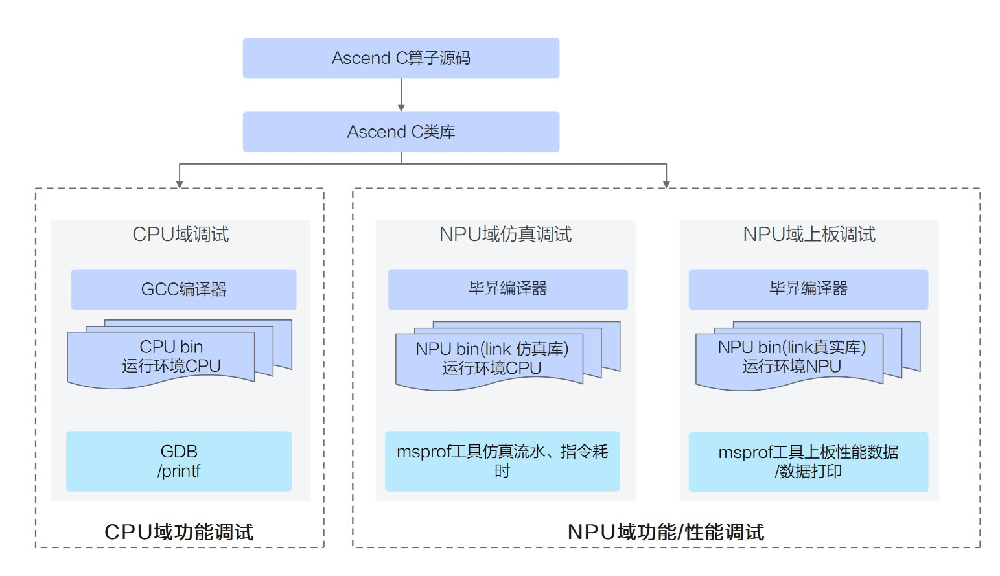
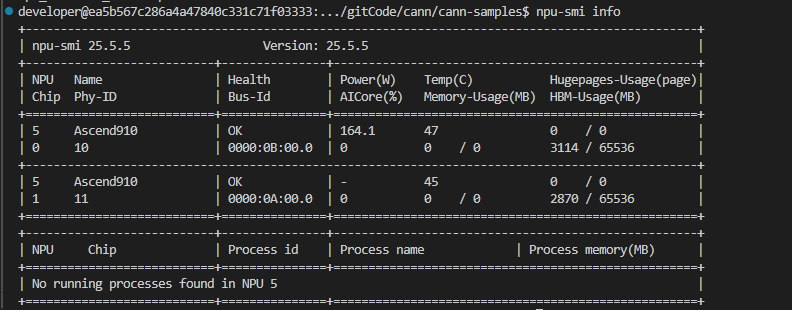

> 时间：2026-11-01  
> 简介：主要介绍 Ascend C 运行环境问题，跑通第一个 "Hello World" 程序。分清 CPU 调试、NPU 仿真和 NPU 实际运行的区别。

# 写在最前面

作为一名从事 AI 高性能计算的工程师，我日常面向昇腾 NPU 做算子开发和性能优化。结合过去在 CUDA 和 Ascend C 中的学习与实践，我想把一些反复遇到的问题整理下来：一个张量公式怎样变成设备上执行的程序？为什么计算本身只有几行，实现却需要安排搬运、存储和同步？程序跑对之后，又该怎样判断性能受什么限制？

查阅文档和运行示例，是学习中必要的起点。但在实际使用中，相关说明有时分散在不同章节，接口能力还需要结合版本与目标设备核对。知道一个 API 怎样调用之后，我更关心它为什么这样设计，以及换了输入规模、数据类型或数据布局，原先的判断是否还成立。本系列也会保留真实的疑问、踩坑和失败，尝试把它们整理成能够解释其他 Kernel 的工程案例。

这就是《AI Kernel 101：从 Hello World 到 Flash Attention 的 Ascend C 实践》的出发点：**以 Ascend C 为实践载体，从第一性原理理解 AI Kernel 的设计与性能优化。** 这里的第一性原理，是从数学语义、数据依赖、硬件资源、存储层级、访存量与性能约束出发，解释实现为什么这样选择，再用实验检验判断。

十篇主线从最小的 Hello World 开始，先建立程序执行与硬件数据流的认识，再通过向量加讨论分块（Tiling）、尾块和流水；随后分别处理 Softmax 的归约依赖、矩阵乘的数据复用，最终汇合到范围明确的 Flash Attention 前向实现。终点除了得到正确输出，还包括用模型与测量解释性能变化、误差和适用边界。具体支持范围以实际验证为准，提速与退化都需要如实记录。各篇入口与当前状态见[文章目录](../README.md)。

内容主要面向初步接触 Kernel 的 C/C++ 工程师、使用 Ascend C／CUDA／Triton 的算子开发者，以及希望理解性能瓶颈的推理与部署工程师。具备基本 C/C++、矩阵运算和编程经验即可；异构执行、存储层级和 Roofline 等必要前提，会在具体问题出现时解释，不要求预先掌握完整的体系结构或 GPU 性能优化知识。希望进入 AI 系统性能领域的学生和工程师，也可以沿这条路线开始。

这是我长期研究 AI Kernel 与推理系统性能工程的一个系列。本期聚焦 Ascend C，后续研究可以扩展到 CUDA、Triton 和推理系统中的其他性能问题，当前十篇先把这条实践路线走清楚。

正文保留支撑解释所需的公式、图示、代码与实验结果；完整实现、构建配置和复现记录放在[同一仓库](../../README.md)的 src 与 lab 中。引用资料、理论估算和实际测量会分别说明，方便读者核对每个判断的依据。

先从最实际的一步开始：如果本地没有昇腾 NPU，我们怎样把第一个 Kernel 跑起来，又能从运行结果中确认什么？

# 首要的环境问题

“巧妇难为无米之炊”。学习一门面向专用硬件的编程语言，环境，往往是开发者遇到的第一个问题。对于普通开发者，如果手边没有昇腾 NPU，能不能开始学 Ascend C？答案是肯定的。**可以先在本地开发和调试，再借助云端带 NPU 设备完成实测验证**。

为方便演示，本文使用同一份 Hello World 样例，先在 WSL 中分别通过 CPU 调试和 SIM 仿真模式运行，再在 CANNLab 提供的 A3（910C）设备上进行 NPU 真机验证。三种模式下，程序均能完成打印并正常结束。

需要说明的是，标题中的“没有 NPU”，指的是**本地电脑没有昇腾 NPU 硬件**，并不意味着整个学习过程完全不使用真实设备。本文的实验分别在本地 WSL 和 CANNLab A3（910C）上完成，涉及 CPU 调试、SIM 仿真和 NPU 真机运行三种模式，其区别如下。

| 模式       | 作用                       | 能说明什么                        |
| -------- | ------------------------ | ---------------------------- |
| CPU 调试模式 | 模拟 Ascend C Kernel 的功能语义 | 基本启动与打印逻辑在 CPU 调试路径上成立       |
| NPU 仿真模式 | 模拟目标 NPU 架构的执行行为         | 样例在仿真路径上可执行，仿真时间不是芯片耗时       |
| NPU 运行模式 | 直接执行 NPU 程序              | 同个 Kernel 在真实 NPU 上完成了基础功能验证 |

# 最小的 Kernel

为验证 Ascend C 的基本编译与运行流程，本文选择一个最简单的 Hello World Kernel。它没有输入张量，也不执行数值计算。Host 侧完成运行时初始化并创建 Stream 后，启动 8 个 Block，每个 Block 分别打印一次：

```cpp
__global__ __vector__ void hello_world()
{
    printf("[Block (%ld/%ld)]: Hello World!!!\n",
           AscendC::GetBlockIdx(), AscendC::GetBlockNum());
}

// Host 侧完成初始化、创建 Stream 后
hello_world<<<8, 0, stream>>>();
```

实际运行中，程序成功完成编译，8 个 Block 均有输出，进程正常结束。由于不同 Block 的执行调度及输出时序不保证一致，打印顺序并不固定。本例仅验证基本的编译和运行流程，不涉及数值精度或性能测试。

本文使用个人实验仓库中的 [`hello_world.cpp`](../../src/hello_world/hello_world.cpp) 和同目录的 `CMakeLists.txt`。以下实验统一使用 **CANN 9.1.0**，目标架构为 `dav-2201`。该代码来源自CANN 官方开源的代码样例 [CANN Samples](https://gitcode.com/cann/cann-samples/blob/3a85e824537feaef646bd89eb4d0e799cc2886b5/Samples/0_Introduction/01_simd_cpp_api/00_quickstart/hello_world/hello_world.asc)。

# 环境区分

## 本地 WSL：开发、CPU 调试和 SIM 仿真

本机是 WSL2 中的 Ubuntu 24.04（`x86_64`），安装了 CANN Toolkit 9.1.0 和 910B ops 9.1.0；没有昇腾 NPU，也没有 NPU 驱动。这里可以编写、编译 Ascend C 程序，并分别尝试 **CPU 调试** 和 **SIM 仿真** 模式。

官方文章对 [Ascend C孪生调试](https://www.hiascend.com/zh/developer/techArticles/20231215-2) 做出说明：**CPU 调试**让 Kernel 在 Host CPU 的调试运行时执行； **SIM 仿真** 使用 CANN 的 NPU 架构仿真器。两者的编译与链接路径不同，下文将使用独立构建和运行目录。两者关注点不同：**CPU 模式通过 CPU 调测库执行 Kernel，适合验证程序逻辑与计算结果；SIM 模式通过目标 NPU 架构仿真器执行程序，可进一步分析硬件指令、数据搬运与计算流水等行为**。不过，二者均不能代替真实 NPU 的最终性能测试。



由于 Hello World 不涉及实际的向量计算和流水依赖，仅凭本例的运行结果，还无法充分体现两种模式的差异。后续介绍向量计算和流水优化时，我们将结合数据验证、同步控制和性能分析，进一步展示 SIM 模式的作用。

在这个案例中，SIM 的主要意义不是证明了更多的计算正确性，而是验证了目标 NPU 架构仿真路径可以正常执行。

## CANNLab：验证真实设备行为

真机实验使用 CANNLab A3（910C、`aarch64`），云端预装 CANN 9.1.0。进入环境后应先核对设备型号和 CANN 版本，本次设备信息见下图。



CANNLab 可通过 WebIDE 或者 VSCode 的方式使用。连接方式和配额规则可能调整，本次编辑未重新核对现行规则，请以 [CANNLab 用户手册](https://gitcode.com/cann/infrastructure/blob/main/docs/CANNLab/CANNLab%E7%94%A8%E6%88%B7%E6%89%8B%E5%86%8C.md)为准。


本文的真机结果只证明这个最小 Kernel 已在 A3 上可以编译通过，并且完成打印。

# 复现过程

下面的命令假设本地 CANN 已安装；安装记录放在附录。仓库位于 `~/github-codes/ai-kernel-101`，首次获取时从 GitHub 克隆：

```bash
repo="$HOME/github-codes/ai-kernel-101"
mkdir -p "$HOME/github-codes"
if [ ! -d "$repo/.git" ]; then
  git clone https://github.com/LamberttLiu/ai-kernel-101 "$repo"
fi

source "$HOME/Ascend/cann/set_env.sh"
sample="$repo/src/hello_world"
work="/tmp/ai-kernel-101-910/hello-world"
```

## CPU 调试

```bash
cmake -S "$sample" -B "$work/build-cpu" \
  -DCMAKE_ASC_RUN_MODE=cpu -DCMAKE_ASC_ARCHITECTURES=dav-2201
cmake --build "$work/build-cpu" -j 4
mkdir -p "$work/run-cpu"
(cd "$work/run-cpu" && timeout 30s "$work/build-cpu/demo")
echo "exit=$?"
```

`cmake -S` 指向样例，`-B` 指向构建目录；配置成功后还要编译并执行 `demo`。原记录中编译末尾为 `[100%] Built target demo`，Block 0 至 7 各打印一次，8 个调试 Core 均报告成功，退出码为 0。以下仅摘录开头、结尾几行：

```text
[Block (1/8)]: Hello World!!!
...
[Block (0/8)]: Hello World!!!
[SUCCESS][CORE_0][pid 178277] exit success!
...
[SUCCESS][CORE_7][pid 178284] exit success!
```

这些输出证明的是 **CPU 调试路径执行了 Kernel**，没有使用本地不存在的昇腾 NPU。

## SIM 仿真

复用前面定义的 `sample` 和 `work`，但使用单独的构建与运行目录：

```bash
cmake -S "$sample" -B "$work/build-sim" \
  -DCMAKE_ASC_RUN_MODE=sim -DCMAKE_ASC_ARCHITECTURES=dav-2201
cmake --build "$work/build-sim" -j 4
mkdir -p "$work/run-sim"
(cd "$work/run-sim" && timeout 60s "$work/build-sim/demo")
echo "exit=$?"
```

原记录中同样完成编译，8 个 Block 都有输出，仿真模型正常停止，退出码为 0。日志节选：

```text
[AIV Block 0/8] ... [AIV Block 7/8] [Block (0/8)]: Hello World!!!
[Block (1/8)]: Hello World!!!
...
[Block (7/8)]: Hello World!!!
[INFO] Model stopped successfully.
exit=0
```

`[AIV Block ...]` 来自仿真运行时，`[Block (...)]` 是 Kernel 自己打印的。仿真器报告的模型时间只描述此次仿真，**不是 910B 真机耗时**。

由于本机没有 `/dev/davinci0`，本机的 `npu` 模式无法把 Kernel 跑在真实设备上。可以使用 `-DCMAKE_ASC_RUN_MODE=npu` 模式编译成可执行二进制，但是在无 NPU 环境中运行没有任何运行输出。

## 在 CANNLab 跑 NPU

登录 CANNLab 云端环境后，可参考以下命令复现实验。本次真机测试使用的样例源码和 CMake 文件与个人仓库中的版本一致。

```bash
repo=/mnt/workspace/ai-kernel-101
if [ ! -d "$repo/.git" ]; then
  git clone https://github.com/LamberttLiu/ai-kernel-101 "$repo"
fi

source /home/developer/Ascend/ascend-toolkit/set_env.sh
cmake -S "$repo/src/hello_world" \
  -B /mnt/workspace/hello-world-npu-910/build \
  -DCMAKE_ASC_RUN_MODE=npu \
  -DCMAKE_ASC_ARCHITECTURES=dav-2201 \
  -DCMAKE_PREFIX_PATH="$ASCEND_HOME_PATH"
cmake --build /mnt/workspace/hello-world-npu-910/build --parallel 4
timeout 30s /mnt/workspace/hello-world-npu-910/build/demo
echo "exit=$?"
```

在 CANNLab A3 的环境中，Block 0 至 7 各输出一次，进程退出码为 0：

```text
[AIV Block 0/8] [Block (0/8)]: Hello World!!!
...
[AIV Block 7/8] [Block (7/8)]: Hello World!!!
exit=0
```

这是本文的**真实 NPU 运行证据**。结合 WSL 中的两次实验，可以得出结论：没有本地 NPU 并不妨碍开始学习和调试 Ascend C，但要验证 Kernel 在真实设备上的执行行为，仍然需要使用 NPU 环境。

# 总结

到这里，我们验证了最小 Kernel 的启动、8 个 Block 的打印，以及 `cpu`、`sim`、`npu` 三条运行路径各自的基础功能。它没有输入输出张量，也没有数值精度或性能数据，三种模式的结果不能互相替代。

打印确认了程序能够沿这条路径执行，却还没有回答真实计算中的问题：张量存在哪里，由哪些单元计算，数据又怎样到达这些单元？同样是一行数学公式，向量加和矩阵乘为什么需要不同的数据组织？

[第02篇：同样是计算，NPU 为什么要区分 Vector 和 Cube？](hardware-dataflow.md)将从算子的依赖与复用出发，打开 NPU 内部，把计算需求与硬件资源、存储和搬运路径联系起来。有了这层认识，[第03篇](vector-add.md)再沿着最小向量加的代码，追踪一次从 GM 搬入 UB、完成计算并写回的过程。

后续每项实验都会明确标注 CPU、SIM 或 NPU 模式，并区分功能验证、性能测量、模型预测和待验证假设；不再依赖“未标注就默认为真机”的规则。本篇已有运行记录和范围保持原样，具体设备与版本关联仍需按实验规范补齐。

# 附录：本次 WSL 的 CANN 9.1.0 安装记录

本机使用 Ubuntu 24.04（`x86_64`）、普通用户安装的 CANN Toolkit 9.1.0 与 910B ops 9.1.0，没有安装 NPU 驱动。安装包来自 [昇腾 CANN 9.1.0 下载页](https://www.hiascend.com/cann/download?versionId=796&ids=d803%2Ch0502%2Ch0601%2Ch0702&currentTab=0)。下面为环境安装的关键命令，其他前提见 [CANN 9.1.X 安装说明](https://www.hiascend.com/document/detail/zh/CANNCommunityEdition/910/softwareinst/instg/instg_0054.html)。

```bash
sudo apt-get update
sudo apt-get install -y gcc g++ make cmake git curl python3 python3-pip gdb

mkdir -p "$HOME/Ascend/install-cache"
cd "$HOME/Ascend/install-cache"
curl -fL -C - -o Ascend-cann-toolkit_9.1.0_linux-x86_64.run \
  'https://ascend-repo.obs.cn-east-2.myhuaweicloud.com/CANN/CANN%209.1.0/Ascend-cann-toolkit_9.1.0_linux-x86_64.run'
curl -fL -C - -o Ascend-cann-910b-ops_9.1.0_linux-x86_64.run \
  'https://ascend-repo.obs.cn-east-2.myhuaweicloud.com/CANN/CANN%209.1.0/Ascend-cann-910b-ops_9.1.0_linux-x86_64.run'

bash ./Ascend-cann-toolkit_9.1.0_linux-x86_64.run --check
bash ./Ascend-cann-910b-ops_9.1.0_linux-x86_64.run --check
bash ./Ascend-cann-toolkit_9.1.0_linux-x86_64.run --install
bash ./Ascend-cann-910b-ops_9.1.0_linux-x86_64.run --install

source "$HOME/Ascend/cann/set_env.sh"
grep '^version=' "$HOME/Ascend/cann/x86_64-linux/ascend_toolkit_install.info"
grep '^version=' "$HOME/Ascend/cann/x86_64-linux/ascend_ops_install.info"
```

环境中执行两个安装包的 `--check` 均返回 `SHA256 checksums are OK`，安装器报告 `install success`；安装时按提示阅读并接受许可协议。两份安装信息的 `version` 均为 `9.1.0`，`ccec` 也能显示版本。CANNLab 环境由平台预装，无需再修改，只需要在容器环境启动的时候指定 9.1.0 版本镜像即可。

CANNLab 的算力资源和使用额度以平台当前规则为准。如果需要更多的算力资源，也可以参考 [极智算](https://www.jygpu.com/markets)与[共绩算力](https://suanli.cn/product/server/)等平台。本文未在这些平台上进行实验，具体机型、价格和软件环境请以平台实际信息为准。
