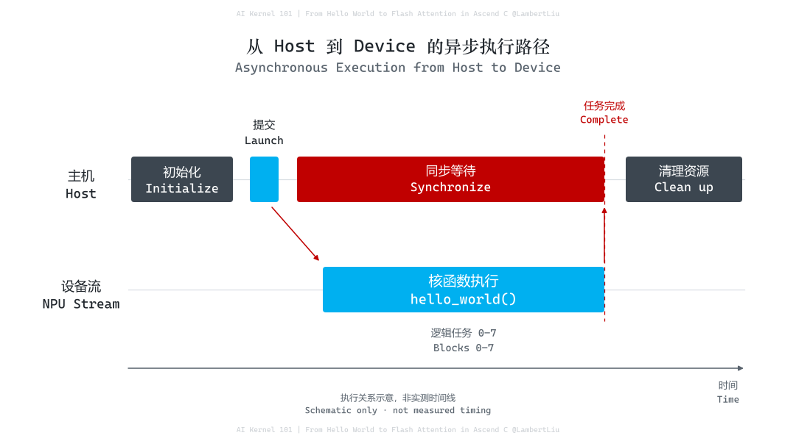
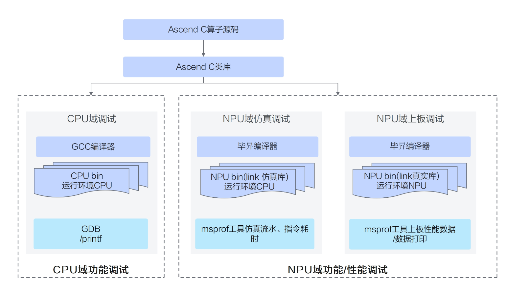
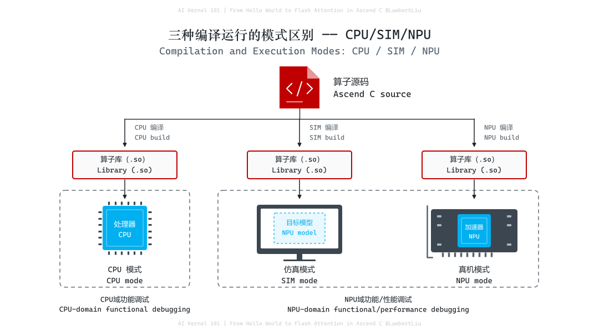
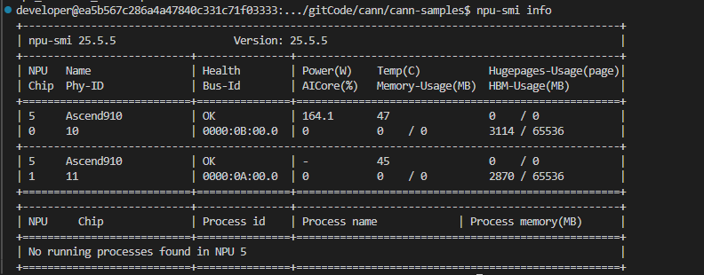

> 草稿状态：本次修订沿用历史运行叙述。标有“待补证据”“待核对”或“插图占位”的位置，需要补齐后再做发布审核。

# 写在最前面

作为一名从事 AI 高性能计算的工程师，我日常主要面向昇腾 NPU 做算子开发和性能优化。在 Ascend C 和 CUDA 的学习与实践中，我时常遇到几个问题。**一个张量（Tensor）的计算公式，怎样变成设备上执行的程序？为什么计算本身只有几行，实现却需要安排搬运、存储和同步？程序跑对之后，又该怎样判断性能受什么限制？**

一般都是从查阅文档和运行示例开始学习一门新特定领域语言（DSL）。实际使用时可能会出现以下场景：相关说明有时分散在不同章节，API 接口能力跟软件版本、设备强耦合；知道一个 API 怎样调用之后，当换了输入规模、数据类型或数据布局，原先的判断是否还成立。本系列会保留这些真实的疑问，以及学习过程中的踩坑和失败，尝试把它们整理成能够解释其他 Kernel 的工程案例。

我相信，这些也是 AI Kernel 开发者会共同面对的问题。《AI Kernel 101：从 Hello World 到 Flash Attention 的 Ascend C 实践》由此开始，这一系列将**以 Ascend C 为实践载体，从第一性原理理解 AI Kernel 的设计与性能优化。** 这里的第一性原理，是从数学语义、数据依赖、硬件资源、存储层级、访存量与性能约束出发，解释实现为什么这样选择，再用实验检验判断。

系列从最小的 Hello World 开始，先建立程序执行与硬件数据流的认识，再通过向量加讨论分块（Tiling）、尾块和流水。随后分别处理 Softmax 的归约依赖、矩阵乘的数据复用，最终汇合到范围明确的 Flash Attention 前向实现。我希望沿着这条路线，把实现选择、误差和性能变化解释清楚。具体支持范围以实际验证为准，提速与退化都需要有可核对的记录。各篇入口与当前状态见[文章目录](../README.md)。

本系列主要面向初步接触 Kernel 的 C/C++ 工程师、使用 Ascend C/CUDA/Triton 的算子开发者，以及希望理解性能瓶颈的推理与部署工程师。读者具备基本 C/C++、矩阵运算和编程经验，就可以开始阅读。异构执行、存储层级和 Roofline 等前提会在具体问题出现时解释。希望进入 AI 系统性能领域的学生和工程师，也可以沿这条路线逐步建立认识。

这是本人长期研究 AI Kernel 与推理系统性能工程的一个系列。本期聚焦 Ascend C，后续研究可以扩展到 CUDA、Triton 和推理系统中的其他性能问题。

正文保留支撑解释所需的公式、图示、核心代码片段与实验结果。完整实现、构建配置和复现记录放在[同一仓库](https://github.com/LamberttLiu/ai-kernel-101)的 src 与 lab 中。引用资料、理论估算和实际测量都会注明依据，方便读者核对。

# 首要的问题

学习面向专用硬件的编程语言，最先遇到的问题往往很实际。如果本地没有昇腾 NPU，还能把第一个 Ascend C Kernel 跑起来吗？答案是可以的，我们可以先在本地开发和调试，再借助云端设备完成真机验证。

这里需要把“跑起来”说得具体一些。首先满足编译通过，说明程序在所选工具链下生成了构建产物。其次，程序能够启动并打印，进一步说明相应运行路径执行到了 Kernel。等到后面开始处理张量，还要检查输出数值。若要判断优化有没有收益，则需要另做目标设备上的性能测量。

第一篇先从没有输入张量的 Hello World 开始，让执行路径尽可能简单，观察代码怎样从 Host 的一次调用进入 Kernel，再回到 Host。

本篇实验记录了同一份 Hello World 样例的三种运行方式：本地 WSL 中的 CPU 调试、SIM 仿真，以及 CANNLab 云端的 NPU运行（A3，910C） 。三种模式均记录了完成打印并正常结束的结果。

需要注意的是，标题中的“没有 NPU”指本地电脑没有这块设备。本地 CPU 调试和 SIM 仿真承担开发与调测，云端设备承担真机执行检查。先明确每一步想取得什么证据，再选择运行方式，环境问题就有了可以逐步推进的路径。

三种模式的差异，首先在于 Kernel 由什么执行，表中最后一列限定了本篇的检查范围。

| 模式       | Kernel 怎样执行                        | 主要用途                         | 本篇 Hello World 检查范围            |
| -------- | ---------------------------------- | ---------------------------- | ------------------------------ |
| CPU 调试模式 | 编译为 CPU 域程序，链接 CPU 调测库，在主机 CPU 上执行 | 检查程序逻辑、中间数据与数值结果，可配合 gdb 调试  | CPU 调测路径能够启动，Block 0—7 的打印完整出现 |
| SIM 仿真模式 | 设备侧程序通过目标 NPU 的仿真模型执行              | 检查目标执行路径，辅助分析模型支持的指令、同步与流水行为 | 仿真程序能够执行打印，并正常结束               |
| NPU 真机模式 | 设备侧程序在物理 NPU 上执行                   | 核验真实设备上的功能、数值结果，并测量实际性能      | 在对应设备环境中执行 Kernel，检查打印及运行状态    |

CPU 调试和 SIM 仿真可以在没有物理 NPU 的开发环境中开展。真机既可以在本地，也可以通过云端访问。本篇采用本地 WSL 与云端 NPU，是这次实验的环境安排。

对于后续分析性能时，需要区分仿真器运行所花的时间、模型报告的周期或时间，以及真实设备测得的耗时。SIM 可以提供模型条件下的性能观察，最终性能结论需要真机测量支持。三种模式的历史输出节选在后面会详细列出。

# 最小的 Kernel

在真机运行语境下，Host 是运行控制程序的主机 CPU 一侧，Device 是执行 Kernel 的 NPU 一侧。核函数（Kernel）是设备执行的入口，一次启动可以让多个逻辑任务执行同一段代码。本例中的任务用 Block 编号区分。

Host 先初始化运行时（runtime）、选择设备并创建流（Stream）。Stream 用于组织异步任务的执行顺序，Host 将 Kernel 提交进去，再在需要完成结果的位置等待。对这个样例，任务内容就是打印。

下面的 Kernel 没有输入张量，也没有数值计算。Host 启动 8 个 Block，每个 Block 各打印一次自己的编号与 Block 总数。

```cpp
__global__ __vector__ void hello_world()
{
    printf("[Block (%ld/%ld)]: Hello World!!!\n",
           AscendC::GetBlockIdx(), AscendC::GetBlockNum());
}

// Host 侧完成初始化、创建 Stream 后
hello_world<<<8, 0, stream>>>();
```

`__global__` 标记核函数入口，`__vector__` 声明这个样例采用 Vector Core 路径执行。`GetBlockIdx()` 和 `GetBlockNum()` 分别取得当前逻辑任务的编号与本次任务总数。这里的 8 是启动配置，不能据此推断整台设备的物理核数。语言修饰符与启动配置的说明可详见[Ascend C SIMD 关键字文档](https://asc.gitcode.com/guide/programming_guide/language_extension/simd_builtin_keywords.html)。

后面的复现日志中，Block 0 至 7 均有输出。检查时应关注这组编号是否完整出现，打印先后只记录观察到的输出顺序。这个样例没有任务间的数据交换，单凭打印顺序无法推导设备调度或并行效率。

沿着源码往下看，Kernel 提交之后紧接着调用 `aclrtSynchronizeStream(stream)`，随后才销毁 Stream、重置设备并结束运行时。同步调用让 Host 等待该 Stream 中已提交的任务完成，否则仅凭 Host 执行过启动语句，还无法确认设备任务已经结束。[官方 Runtime 文档](https://www.hiascend.com/document/detail/zh/CANNCommunityEdition/910/others/acldevg/runtime_doc_dev_0014.html) 给出了相关的显式同步的语义。



> **待补充**
> 当前样例源码没有逐项检查 ACL 调用返回码，并在 `main` 末尾直接返回 0。因此，进程退出码、完整打印和运行时错误信息要一起检查。后续补测还需记录初始化、设备选择、任务提交与同步各阶段的实际状态。

本文使用个人实验仓库中的 [`hello_world.cpp`](../../src/hello_world/hello_world.cpp) 和同目录的 `CMakeLists.txt`。实验记录中的 CANN 版本为 **9.1.0**，编译目标为 `dav-2201`，两套执行环境的字段仍需分别核对。样例的上游来源记录见 [CANN Samples 固定提交](https://gitcode.com/cann/cann-samples/blob/3a85e824537feaef646bd89eb4d0e799cc2886b5/Samples/0_Introduction/01_simd_cpp_api/00_quickstart/hello_world/hello_world.asc)。

源码虽然使用 `.cpp` 扩展名，构建配置仍通过 `LANGUAGE ASC` 指定 Ascend C 编译流程。同一文件包含 Host 控制和 Kernel 定义，工具链需要处理两侧代码，以及中间的启动调用。扩展名和源码排在同一文件里，都不足以判断程序实际在哪一侧执行。

# 环境区分

## 本地 WSL：开发、CPU 调试和 SIM 仿真

本机是 WSL2 中的 Ubuntu 24.04（`x86_64`），安装了 CANN Toolkit 9.1.0 和 910B ops 9.1.0；没有昇腾 NPU，也没有 NPU 驱动。这里可以编写、编译 Ascend C 程序，并分别尝试 **CPU 调试** 和 **SIM 仿真** 模式。

CPU 调试模式让 Kernel 在主机 CPU 的调测环境中执行。后面有了数值计算，可以利用这条路径检查逻辑、观察中间数据，逐步定位问题。本例先检查最基础的入口与打印是否能执行。

SIM 仿真模式使用目标 NPU 的架构仿真器，适合进一步观察目标执行路径及工具支持的搬运、指令或流水行为。具体可观察内容取决于目标和工具版本。官方孪生调试文章介绍了两条调测路径的用途，文中的环境配置和接口应另按本系列使用的版本核对。[Ascend C 孪生调试](https://www.hiascend.com/zh/developer/techArticles/20231215-2)





图中的 `.so` 表示按模式分别构建的算子库形态；本篇 Hello World 的 CMake 实际定义的是可执行程序 `demo`。SIM 侧的性能观察受仿真模型限制，真实设备耗时仍需在 NPU 上实测。

上方既有孪生调试图片暂作参考，其确切来源、版本和使用许可仍需核对。两张自绘图的源码与生成方式见[绘图工作流](../figures/README.md)。

两种模式需要各自的构建与运行目录。源码相同，构建产物却对应不同运行路径，切换模式时如果沿用旧缓存或旧二进制，就难以解释当前输出来自哪里。后文用 `build-cpu`、`build-sim` 区分它们，也分别保存运行结果。

Hello World 的代码很少，也没有向量数据和流水依赖，因此两种模式都打印成功，并不能充分展示它们在数值调试和执行行为分析上的差别。后续向量加、分块与流水实验会逐步加入这些观察。当前 CPU／SIM 结果只支持各自路径上的基础功能判断，真实设备的性能仍要在 NPU 上测量。

## CANNLab：验证真实设备行为

此前记录的真机环境为 CANNLab A3（910C、`aarch64`），云端预装 CANN 9.1.0。这里的 `aarch64` 描述云端主机的 CPU 架构，NPU 产品、运行时 SoC 名称和编译目标还要分别记录。下面是当时的设备信息截图，具体关联待补核。



> **【待核对／插图占位 01-图3｜设备与软件版本记录】**
> 核对现有截图所属运行批次，补充同次实验的运行时 SoC、产品／板卡信息、驱动、固件、CANN、编译器版本及编译目标。截图裁剪需保留支撑这些字段的内容。字段暂缺时写“未知”，不要用 A3、910C 或 `dav-2201` 互相反推。

CANNLab 可通过 WebIDE 或者 VSCode 的方式使用。连接方式和配额规则可能调整，本次编辑未重新核对现行规则，请以 [CANNLab 用户手册](https://gitcode.com/cann/infrastructure/blob/main/docs/CANNLab/CANNLab%E7%94%A8%E6%88%B7%E6%89%8B%E5%86%8C.md)为准。


> **【待核对插图 01-图4｜云端实验入口】**
> 现有平台截图待核对公开裁剪范围与界面时效。如需保留，图注只说明它是当时使用的入口，并在发布前检查账号信息与配额内容。平台当前使用规则另行核对。

真机运行需要把设备环境、实际执行、输出与退出状态对应起来。即使 CPU 调试和 SIM 仿真都正常，NPU 一侧的运行时、驱动和目标匹配仍需要单独检查。云端与本地记录的待补字段列在下表，便于后续核验。

| 环境                  | 历史记录                                             | 需要补核的信息                            |
| ------------------- | ------------------------------------------------ | ---------------------------------- |
| 本地 WSL，CPU/SIM 分开记录 | Ubuntu 24.04、x86_64、CANN 9.1.0、910B ops、dav-2201 | 工具链完整版本、每种模式的构建与运行日志、对应源码版本        |
| CANNLab，NPU         | A3（910C）、aarch64、CANN 9.1.0、dav-2201             | 具体 SoC 与产品对应、驱动／固件、编译器、源码版本与同次运行证据 |

# 复现过程

下面是此前使用的复现命令，安装记录放在附录。阅读时先关注两个参数，`CMAKE_ASC_RUN_MODE` 选择运行路径，`CMAKE_ASC_ARCHITECTURES` 选择编译目标。二者分别回答“用哪种方式运行”和“为哪个架构生成代码”。实验目录及环境变量路径需按实际机器调整。

复现还需要记录源码版本。同一仓库持续更新后，只记下仓库地址无法定位原实验使用的代码。尚未补齐的运行日志和版本信息分别标在各模式之后，后续补测应另建新记录。

下面的命令假设本地 CANN 已安装。仓库位于 `~/github-codes/ai-kernel-101`，首次获取时从 GitHub 克隆：

```bash
repo="$HOME/github-codes/ai-kernel-101"
mkdir -p "$HOME/github-codes"
if [ ! -d "$repo/.git" ]; then
  git clone https://github.com/LamberttLiu/ai-kernel-101 "$repo"
fi

source "$HOME/Ascend/cann/set_env.sh"
sample="$repo/src/hello_world"
work="/tmp/ai-kernel-101-910/hello-world"
```

## CPU 调试

```bash
cmake -S "$sample" -B "$work/build-cpu" \
  -DCMAKE_ASC_RUN_MODE=cpu -DCMAKE_ASC_ARCHITECTURES=dav-2201
cmake --build "$work/build-cpu" -j 4
mkdir -p "$work/run-cpu"
(cd "$work/run-cpu" && timeout 30s "$work/build-cpu/demo")
echo "exit=$?"
```

`cmake -S` 指向样例，`-B` 指向构建目录；配置成功后还要编译并执行 `demo`。原记录中编译末尾为 `[100%] Built target demo`，Block 0 至 7 各打印一次，8 个调试 Core 均报告成功，退出码为 0。以下仅摘录开头、结尾几行：

```text
[Block (1/8)]: Hello World!!!
...
[Block (0/8)]: Hello World!!!
[SUCCESS][CORE_0][pid 178277] exit success!
...
[SUCCESS][CORE_7][pid 178284] exit success!
```

CPU 调试中仍然会出现 Block、Core 等与 Kernel 执行有关的标记，要结合构建模式和调测环境理解它们。判断依据包括 `cpu` 构建选项、实际启动的二进制及调测日志，打印格式本身无法证明使用了 NPU。

> **【待补证据 01-01｜CPU 调试记录】**
> 已有 [2026-11-05 CPU 历史摘要](../../lab/verification-2026-11-05.md)记载 Hello World 编译成功、8 个 Block 打印和退出码 0，原始日志未随仓库归档，精确源码版本待补。后续补齐 configure／build／run 日志和源码标识，并核对它们与上方历史节选是否属于同一批运行。若重新执行，单独记为新结果。

## SIM 仿真

复用前面定义的 `sample` 和 `work`，但使用单独的构建与运行目录：

```bash
cmake -S "$sample" -B "$work/build-sim" \
  -DCMAKE_ASC_RUN_MODE=sim -DCMAKE_ASC_ARCHITECTURES=dav-2201
cmake --build "$work/build-sim" -j 4
mkdir -p "$work/run-sim"
(cd "$work/run-sim" && timeout 60s "$work/build-sim/demo")
echo "exit=$?"
```

原记录中同样完成编译，8 个 Block 都有输出，仿真模型正常停止，退出码为 0。日志节选：

```text
[AIV Block 0/8] ... [AIV Block 7/8] [Block (0/8)]: Hello World!!!
[Block (1/8)]: Hello World!!!
...
[Block (7/8)]: Hello World!!!
[INFO] Model stopped successfully.
exit=0
```

已有记录将 `[AIV Block ...]` 记为运行时前缀，`[Block (...)]` 与 Kernel 中的格式字符串对应。前缀的确切来源需结合完整日志核对。这里先检查 8 个逻辑 Block 的打印和仿真正常结束，模型报告的时间保留为仿真观察，真机耗时需要另测。

另一次本地尝试中，当时没有 `/dev/davinci0`，使用 `-DCMAKE_ASC_RUN_MODE=npu` 生成构建产物后，运行时没有观察到 Kernel 打印。缺少同次 ACL 返回码和完整错误日志，目前只能保留这一现象，失败发生在哪一步仍待补查。前面所述样例直接返回 0 的写法，也使单看进程退出状态难以定位问题。

> **【待补证据 01-02｜SIM 成功与本地 NPU 尝试】**
> 分别补齐 SIM 的构建日志、仿真启动命令、完整输出、退出状态，以及本地 NPU 尝试的错误输出和初始化／设备选择／同步返回状态。核对模拟目标和工具版本。当前没有可据此补写的耗时或故障原因，先保留上述历史节选与待查现象。

## 在 CANNLab 跑 NPU

登录 CANNLab 云端环境后，可参考以下命令复现实验。已有记录记载使用了同一份样例源码和构建配置，具体对应提交与文件校验信息仍待归档。云端 CPU 架构与本地不同，构建产物需在对应环境中生成。

```bash
repo=/mnt/workspace/ai-kernel-101
if [ ! -d "$repo/.git" ]; then
  git clone https://github.com/LamberttLiu/ai-kernel-101 "$repo"
fi

source /home/developer/Ascend/ascend-toolkit/set_env.sh
cmake -S "$repo/src/hello_world" \
  -B /mnt/workspace/hello-world-npu-910/build \
  -DCMAKE_ASC_RUN_MODE=npu \
  -DCMAKE_ASC_ARCHITECTURES=dav-2201 \
  -DCMAKE_PREFIX_PATH="$ASCEND_HOME_PATH"
cmake --build /mnt/workspace/hello-world-npu-910/build --parallel 4
timeout 30s /mnt/workspace/hello-world-npu-910/build/demo
echo "exit=$?"
```

此前 CANNLab A3 环境的记录中，Block 0 至 7 各输出一次，进程退出码为 0，节选如下。

```text
[AIV Block 0/8] [Block (0/8)]: Hello World!!!
...
[AIV Block 7/8] [Block (7/8)]: Hello World!!!
exit=0
```

这段输出来自此前的 NPU 运行记录。要让读者复核“确实在目标设备上执行”，还需要同次运行的设备信息、构建选项、二进制标识和运行时状态。CPU、SIM 与 NPU 可能出现相近的打印文本，因此结果要与产生它的环境一起保存。

> **【待补证据 01-03｜NPU 真机运行】**
> 补齐设备、SoC、驱动／固件、CANN、编译器、编译目标、源码提交／文件校验、构建与运行日志，记录实际二进制路径及 ACL 调用、Stream 同步状态。检查 Block 0—7 是否完整出现，并核对进程退出状态。现有节选按历史叙述保留，暂缺字段明确写“待补”或“未知”。

# 总结

回到开头的问题，没有本地昇腾 NPU，仍然可以从开发环境和最小 Kernel 开始。CPU 调试承担本地逻辑调测，SIM 提供目标架构的仿真执行路径，真机再检验程序在实际设备上的行为。本篇已有三条路径的基础打印记录，尚待补齐的日志、版本和环境字段也已标在相应位置。

Hello World 的工作到打印就结束了。现在把任务换成向量加 $z_i=x_i+y_i$，Host 需要准备输入，Kernel 需要读取两个数并写回结果，运行后还要与参考值比较。数学表达只有一行，实现已经开始涉及数据放在哪里、交给谁计算，以及何时可以使用结果。

这时如果直接打开向量加源码，会先遇到局部存储、搬运和同步调用。要解释这些代码，需要把视线从“程序怎样提交到设备”移到“数据怎样送到计算单元”。再把加法换成矩阵乘，输入复用和硬件分工又会改变。同样简短的公式，为什么需要不同的数据组织？

下一篇就沿着这个问题打开 NPU 内部，从算子的计算依赖与数据复用，解释 Vector、Cube、存储和搬运资源的分工。带着这层认识，第03篇再把向量加写成一条完整数据流，追踪输入进入局部存储、参与计算并写回输出的过程。[第02篇：同样是计算，NPU 为什么要区分 Vector 和 Cube？](hardware-dataflow.md) · [第03篇：只做一次加法，为什么还要搬来搬去？](vector-add.md)

后续实验将继续标注 CPU、SIM 或 NPU 模式，并说明对应的源码、输入和测量口径。数值是否正确、性能如何变化，会在具备相应计算与测量的篇章中逐项回答。

# 附录：本次 WSL 的 CANN 9.1.0 安装记录

本机使用 Ubuntu 24.04（`x86_64`）、普通用户安装的 CANN Toolkit 9.1.0 与 910B ops 9.1.0，没有安装 NPU 驱动。安装包来自 [昇腾 CANN 9.1.0 下载页](https://www.hiascend.com/cann/download?versionId=796&ids=d803%2Ch0502%2Ch0601%2Ch0702&currentTab=0)。下面为环境安装的关键命令，其他前提见 [CANN 9.1.X 安装说明](https://www.hiascend.com/document/detail/zh/CANNCommunityEdition/910/softwareinst/instg/instg_0054.html)。

```bash
sudo apt-get update
sudo apt-get install -y gcc g++ make cmake git curl python3 python3-pip gdb

mkdir -p "$HOME/Ascend/install-cache"
cd "$HOME/Ascend/install-cache"
curl -fL -C - -o Ascend-cann-toolkit_9.1.0_linux-x86_64.run \
  'https://ascend-repo.obs.cn-east-2.myhuaweicloud.com/CANN/CANN%209.1.0/Ascend-cann-toolkit_9.1.0_linux-x86_64.run'
curl -fL -C - -o Ascend-cann-910b-ops_9.1.0_linux-x86_64.run \
  'https://ascend-repo.obs.cn-east-2.myhuaweicloud.com/CANN/CANN%209.1.0/Ascend-cann-910b-ops_9.1.0_linux-x86_64.run'

bash ./Ascend-cann-toolkit_9.1.0_linux-x86_64.run --check
bash ./Ascend-cann-910b-ops_9.1.0_linux-x86_64.run --check
bash ./Ascend-cann-toolkit_9.1.0_linux-x86_64.run --install
bash ./Ascend-cann-910b-ops_9.1.0_linux-x86_64.run --install

source "$HOME/Ascend/cann/set_env.sh"
grep '^version=' "$HOME/Ascend/cann/x86_64-linux/ascend_toolkit_install.info"
grep '^version=' "$HOME/Ascend/cann/x86_64-linux/ascend_ops_install.info"
```

此前安装记录中，两个安装包的 `--check` 均返回 `SHA256 checksums are OK`，安装器报告 `install success`，安装时按提示阅读并接受许可协议。两份安装信息的 `version` 均为 `9.1.0`，`ccec` 也能显示版本。云端记录为预装 CANN 9.1.0 环境。实际镜像、安装位置和工具版本应在复现时重新核对。

> **【待补证据 01-04｜安装与资料版本】**
> 补存本地安装信息、完整编译器版本及安装检查记录，并核对上游样例固定提交与当前源码的对应关系。下载地址、安装说明和在线文档的适用版本需在发布前复查，本段命令保留为历史安装流程。

CANNLab 的算力资源和使用额度以平台当前规则为准。如果需要更多的算力资源，也可以参考 [极智算](https://www.jygpu.com/markets)与[共绩算力](https://suanli.cn/product/server/)等平台。本文未在这些平台上进行实验，具体机型、价格和软件环境请以平台实际信息为准。
