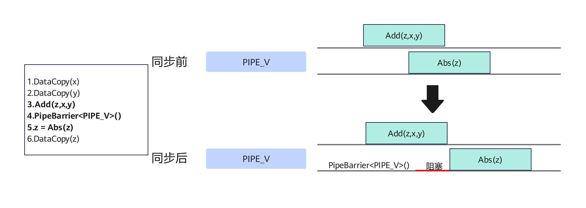

> 时间：2026-11-02
> 环境：CANNLab 云上 NPU 环境；CANN 9.1.0
> 范围：固定长度 Vector Add 的计算与存储模型；静态 Tensor 与 TPipe/TQue 两种组织方式

# 一、算子背景

在 [第01篇](hello-world.md)中，Kernel 只实现了打印这一基本功能，验证了 Ascend C 的启动与执行路径。[第02篇](hardware-dataflow.md)先梳理计算资源与数据流。本篇是第03篇，从这里开始真正处理数据，选择向量加法这一简单的 Element-wise 运算作为例子。

向量加的数学公式如下：
$$C_i = A_i + B_i, \quad i = 0, 1, \ldots, N-1$$
算式很简单，对于 Ascend C 开发而言，为什么输入不能只交给一条加法指令？为什么还需要仔细考虑划分 Block、从 GM 搬到 UB、计算后写回，并处理流水之间的依赖？接下来的内容我们将逐步拆解这些问题。

本文分析代码见本仓库 [`src/vector_add/00_basic/add.cpp`](../../src/vector_add/00_basic/add.cpp)〔1—3〕。使用同目录的 `CMakeLists.txt` 生成 `demo`，`add.cpp` 包含 Kernel实现、Host 调用和结果比较的辅助代码。

在保留这份静态 Tensor 实现的基础上，再对照 [`02_tpipe_tque/add_tpipe_tque.cpp`](../../src/vector_add/02_tpipe_tque/add_tpipe_tque.cpp)，看看同一条数据流怎样交给 `TPipe` 与队列 `TQue` 管理。两版都使用 `GlobalTensor` 和 `LocalTensor`，区别在于局部缓冲和阶段依赖的表达方式。文中简称“队列版”，对应的 C++ 类型名是 `TQue`，并非 `TQueue`。

编译和运行环境为 CANNLab A3（910C、`aarch64`）、CANN 9.1.0，目标架构 `dav-2201`。下文分别讨论代码机制、功能验证、设备任务耗时与理论工作量；这些数据对应不同的测量口径。

| 证据状态  | 本文对应内容                                          |
| ----- | ----------------------------------------------- |
| 实测可复现 | 本篇基础版 Vector Add 在真实 NPU 上完成构建、运行与结果比对。         |
| 实际采样  | 第七节的 5 次 Kernel 任务耗时，仅对应基础静态 Tensor 版。 |
| 理论推导  | 第七节的运算次数、逻辑 GM 流量、UB 申请量和 Arithmetic Intensity。 |
| 源码分析 | 新增队列版的分配、交接与释放流程；本次未执行新的 CPU/SIM/NPU 验证。 |
| 历史 CPU 功能记录 | 2026-11-05 摘要记有队列版通过；原始日志未随仓库归档，精确源码版本对应待补，不能替代队列版 NPU 或性能证据。 |

# 二、整体任务

Host 构造 $2048 × 8 = 16,384$ 个 `float` 元素，启动 8 个逻辑 Block，每个 Block 处理 $2,048$ 个元素，区间两两不重叠，每个 Block 的计算相互独立，不涉及跨 Block 合并结果。参与运算的 3 个 Global Memory (后续简称 GM) 数组分别保存 `x`、`y` 和 `z`，每个 Block，取各自对应的的 x、y 片段，载入计算 ，再写入对应的 z 片段。`block_idx` 决定各 Block 的起始位置，具体分核情况如下：

| 起始元素下标      | 0           | 2048           | ... | 14336            |
| ----------- | ----------- | -------------- | --- | ---------------- |
| Block Index | Block 0     | Block 1        | ... | Block 7          |
| x、y 的 GM    | `[0, 2048)` | `[2048, 4096)` | ... | `[14336, 16384)` |
| z 的 GM      | `[0, 2048)` | `[2048, 4096)` | ... | `[14336, 16384)` |

下面几点是 Host 侧的关键 API 调用，`<blockLength>` 是编译期模板实参，`<<<numBlocks, 0, stream>>>` 启动 8 个 Block。中间的 `0` 表示本次启动不额外指定动态 UB 空间，但是这并不代表 Kernel 中会在使用 UB 参与计算。

```cpp
constexpr uint32_t numBlocks = 8;
constexpr uint32_t blockLength = 2048;
add_custom<blockLength><<<numBlocks, 0, stream>>>(xDevice, yDevice, zDevice);
aclrtSynchronizeStream(stream);
```

`xDevice`、`yDevice`、`zDevice` 由 Host 调用用 `aclrtMalloc` 分配在 Device 侧， 对应  `x`、`y` 和 `z` 分配在 Host 侧 。由于 Kernel 启动是异步的， Host 侧发射出 Launch 命令后，具体的搬运计算交由 Device 侧执行，Host 等待 Stream 完成后，将回写 `zDevice` 的数据与 `golden` 比较。这里的 `aclrtSynchronizeStream` 是 Host 等待设备任务完成，这和后续算子分析 Kernel 内的流水同步不是一个概念。

本文基于一个固定长度的向量加法，$2048 × 8 = 16,384$ 个元素是一个设定好的参数，对于更加一般性的场景需要在后续的进阶场景中继续探讨。

# 三、Block 内的数据流向

每一个 Block 从 GM 取得自己的输入片段，先搬入 UB 的两个 `LocalTensor`，向量加法的结果放在第三个 `LocalTensor`内，最后把结果写回 GM。`GlobalTensor` 描述 GM 片段，`LocalTensor` 对应本例的 UB 片上缓存；**绑定 GM 地址**、**分配片上缓存** 与 **搬运数据** 是三件不同的事。

```text
GM: xGm - DataCopy → xLocal ----
                               |── Add  →  zLocal - DataCopy → zGm：GM
GM: yGm - DataCopy → yLocal ----
                     └─── UB / Vector 计算 ───┘
```

为什么要有 `DataCopy`？Kernel 中的 `AscendC::Add` 接收三个 `LocalTensor`，而 Host 传入的是 GM 地址；数据必须先进入本地缓存，结果再写回全局输出。`DataCopy(dst, src, count)` 中目的地在前，注意这里的 `count` 是元素个数，不是字节数〔12、13〕。

值得关注的是，基础 Kernel 在几个阶段之间还调用了同步接口：

```cpp
AscendC::PipeBarrier<PIPE_ALL>();
```

[CANN 9.1.0 官方代码说明](https://gitcode.com/cann/asc-devkit/blob/9.1.0/docs/api/SIMD-API/%E5%9F%BA%E7%A1%80API/%E5%90%8C%E6%AD%A5%E6%8E%A7%E5%88%B6/%E6%A0%B8%E5%86%85%E5%90%8C%E6%AD%A5/PipeBarrier_ISASI.md)指出，这个 API 是完成 Block 内同一流水线内部的同步控制，用于在同一流水线内部约束执行顺序。其作用是保证前序指令中所有数据的读写工作全部完成，后序指令才能执行。

上面的概述不能省略模板参数的区别：单流水屏障与 `PIPE_ALL` 的范围不同。当前在线文档进一步将 `PIPE_ALL` 说明为等待各流水先前提交的接口完成，并提醒这种等待会影响性能〔22〕。这为理解基础版的保守阶段划分提供了依据；该在线说明来自 master，安装版本的实际语义仍需核对，不能把下图中的单流水例子直接当作所有跨流水依赖的证明。



# 四、静态 Tensor：直接安排三块局部空间

以下是基础版 `add.cpp` 的 Kernel 计算路径。原代码中还包含一个由 `#if 0` 包裹的 `printf`/`DumpTensor` 示例，默认不参与编译〔1〕，此处省略。

```cpp
template <uint32_t blockLength>
__vector__ __global__ void add_custom(__gm__ float* x, __gm__ float* y, __gm__ float* z)
{
    AscendC::InitSocState();

    AscendC::GlobalTensor<float> xGm, yGm, zGm;
    xGm.SetGlobalBuffer(x + block_idx * blockLength, blockLength);
    yGm.SetGlobalBuffer(y + block_idx * blockLength, blockLength);
    zGm.SetGlobalBuffer(z + block_idx * blockLength, blockLength);

    AscendC::LocalMemAllocator<AscendC::Hardware::UB> ubAllocator;
    AscendC::LocalTensor<float> xLocal = ubAllocator.Alloc<float, blockLength>();
    AscendC::LocalTensor<float> yLocal = ubAllocator.Alloc<float, blockLength>();
    AscendC::LocalTensor<float> zLocal = ubAllocator.Alloc<float, blockLength>();

    AscendC::DataCopy(xLocal, xGm, blockLength);
    AscendC::DataCopy(yLocal, yGm, blockLength);
    AscendC::PipeBarrier<PIPE_ALL>();

    AscendC::Add(zLocal, xLocal, yLocal, blockLength);
    AscendC::PipeBarrier<PIPE_ALL>();

    AscendC::DataCopy(zGm, zLocal, blockLength);
    AscendC::PipeBarrier<PIPE_ALL>();
}
```

`SetGlobalBuffer(x + block_idx * blockLength, blockLength)` 这一过程，把当前 Block 的 `xGm` 绑定到自己的 GM 区间；`yGm`、`zGm` 同理。指针偏移以 `float` 元素为单位，注意，这里的绑定操作不会操作数据。

三个 `Alloc<float, blockLength>()` 分别准备输入 `x`、输入 `y` 和输出 `z` 的 UB 空间。每份为 $2048 × 4 = 8192$ 字节，即 8 KiB；合计申请 24 KiB，尚未计其他运行开销。这份实现采用静态 Tensor 编程，没有使用 `TPipe`、`TQue`、双缓冲或 Host 侧 Tiling。`LocalMemAllocator` 的线性分配方式可见官方静态 Tensor 文档〔5、8〕；这里是源码申请量推导，本次没有实测 UB 占用率。

两次 `DataCopy` 搬入、一次 `Add` 计算、一次 `DataCopy` 写回，正好对应上一节分析的数据流。最后一行的 `PipeBarrier` 是位于 Kernel 返回之前的核内同步，不等于 8 个 Block 之间的核间同步，也不等于 Host 的 Stream 同步。

本例每次连续搬运 $2048 × 4 = 8192$ 字节，满足该接口的 32 字节对齐约束〔12〕。这也是尾块不能只改 `count` 就认为任意长度都正确的原因。

# 五、TPipe 与 TQue：把缓冲交接写进数据流

静态版中，三个局部 Tensor 的用途很直观：两个输入、一个输出，依次搬入、计算、写回。我们可以沿代码追踪数据，但若未来要连续处理多批数据，还需要更明确地表达：哪一份缓冲已经交给下一阶段，哪一份仍在使用，哪一份可以重新申请。

队列版把这些关系放进资源管理流程。`TPipe` 管理本地内存与同步事件等资源，`TQue` 管理阶段间传递的 Tensor；`Add` 和 `DataCopy` 仍然操作 Tensor，并没有换成另一种计算语义〔16、17〕。

## 先准备缓冲，再从队列中取得 Tensor

队列版仍启动 8 个 Block，但 Kernel 改为接收全局长度，通过 `totalLength / GetBlockNum()` 计算各自工作量，再按 `GetBlockIdx()` 绑定 GM 片段。当前长度恰好整除，得到的仍是每 Block 2048 个元素。这种写法尚未处理非整除、非对齐或超过 UB 容量的情形，不能因为长度参数是运行时传入，就认为它已经支持任意长度。

下面摘录源码中的队列定义与缓冲初始化；中间的 GM 地址绑定省略：

```cpp
AscendC::TPipe pipe;
AscendC::TQue<AscendC::TPosition::VECIN, 1> inQueueX;
AscendC::TQue<AscendC::TPosition::VECIN, 1> inQueueY;
AscendC::TQue<AscendC::TPosition::VECOUT, 1> outQueueZ;

// 省略 blockLength 计算与 xGm/yGm/zGm 地址绑定
pipe.InitBuffer(inQueueX, 1, blockLength * sizeof(float));
pipe.InitBuffer(inQueueY, 1, blockLength * sizeof(float));
pipe.InitBuffer(outQueueZ, 1, blockLength * sizeof(float));
```

`VECIN` 和 `VECOUT` 是队列的逻辑位置，描述数据进入向量计算、从向量计算输出的阶段角色；本例两者对应的缓冲都位于 UB，不是两种不同的物理内存。

`InitBuffer` 的三个参数分别指定队列、缓冲块数和每块字节数。本例每个队列分配一块 $2048\times4=8192$ 字节的缓冲，三者显式数据缓冲共 24 KiB。随后调用 `AllocTensor<float>()`，从已初始化的队列资源中取得一份局部 Tensor；它不会从 GM 自动读取输入〔18〕。

这里有两个容易混淆的“1”：`TQue<..., 1>` 的模板参数是队列深度，约束连续入队而尚未出队的数量；`InitBuffer(queue, 1, bytes)` 的第二个参数是实际分配的缓冲块数。**队列深度与缓冲块数是不同参数，深度为 1 也可以配置双缓冲。** 当前样例没有双缓冲，是因为实际缓冲块数为 1，且没有跨批次循环与重叠安排〔17、18〕。

## 搬入、计算、搬出之间，交接的是哪份数据？

队列初始化之后，源码的数据处理部分如下。仍然只有两次输入搬运、一次加法和一次输出搬运：

```cpp
AscendC::LocalTensor<float> xLocal = inQueueX.AllocTensor<float>();
AscendC::LocalTensor<float> yLocal = inQueueY.AllocTensor<float>();
AscendC::DataCopy(xLocal, xGm, blockLength);
AscendC::DataCopy(yLocal, yGm, blockLength);
inQueueX.EnQue(xLocal);
inQueueY.EnQue(yLocal);

xLocal = inQueueX.DeQue<float>();
yLocal = inQueueY.DeQue<float>();
AscendC::LocalTensor<float> zLocal = outQueueZ.AllocTensor<float>();
AscendC::Add(zLocal, xLocal, yLocal, blockLength);
outQueueZ.EnQue<float>(zLocal);
inQueueX.FreeTensor(xLocal);
inQueueY.FreeTensor(yLocal);

zLocal = outQueueZ.DeQue<float>();
AscendC::DataCopy(zGm, zLocal, blockLength);
outQueueZ.FreeTensor(zLocal);
```

沿着 `xLocal` 追踪：`AllocTensor` 取得可用缓冲，`DataCopy` 提交 GM→UB 搬运；`EnQue` 将这份 Tensor 交给输入队列，计算阶段再通过 `DeQue` 接收。输入经过 `Add` 消费后，`FreeTensor` 交还它占用的队列缓冲。`yLocal` 的生命周期相同。

输出则反过来：计算阶段先申请 `zLocal`，把加法结果交给输出队列；搬出阶段取出它，写回 GM，再释放。`DeQue` 返回的是指向入队局部数据的 Tensor，不会因为出入队就在 UB 中额外复制一整份数组〔19、20〕。

可以把这些操作理解为生产者与消费者之间的交接：搬入阶段生产输入，计算阶段消费输入并生产输出，搬出阶段消费输出。`EnQue`／`DeQue` 包含队列通信和相应同步机制，建立前一阶段生产与后一阶段使用的依赖关系〔17、23〕。入队不表示 Host 已经等到数据完成，出队也不表示把数据搬到了 GM；实际搬运仍由 `DataCopy` 完成。

`FreeTensor` 与 `AllocTensor` 配对，表示结束这一份 Tensor 的使用、交还队列管理的缓冲占用，并不等于 `aclrtFree`，更不会释放整个队列初始化的 UB 空间。队列的整体内存由 `TPipe` 管理；释放以后，用户不能继续拿旧 Tensor 做读写〔18、21〕。

```text
输入缓冲：可申请 → AllocTensor → 搬入 → EnQue → DeQue → Add 消费 → FreeTensor
输出缓冲：可申请 → AllocTensor → Add 生产 → EnQue → DeQue → 搬出 → FreeTensor
```

这是局部缓冲的逻辑生命周期，不是各硬件流水的实测时间线。队列协议帮助管理阶段交接，但不会替开发者检查任意访问是否安全；仍需保证每份 Tensor 的使用顺序、分配与释放配对，以及其他未经过队列的数据依赖。

## 两种方式改变了什么，又保留了什么？

| 对照项 | 静态 Tensor 版 `00_basic` | 队列版 `02_tpipe_tque` |
| --- | --- | --- |
| 数学与硬件路径 | 向量加，GM→UB→Vector→GM | 相同 |
| 计算对象 | `GlobalTensor` / `LocalTensor` | 仍使用这两类 Tensor |
| UB 数据缓冲 | `LocalMemAllocator::Alloc` 线性安排 | `TPipe::InitBuffer` 初始化，`TQue::AllocTensor` 取得 |
| 阶段交接 | 直接使用局部变量，并显式调用 `PipeBarrier<PIPE_ALL>()` | 通过 `EnQue` / `DeQue` 表达生产与消费关系 |
| 使用结束 | 本例三块局部空间使用至 Kernel 结束 | 每份 Tensor 消费后调用对应队列的 `FreeTensor` |
| 当前显式数据缓冲量 | 每 Block 三份 8 KiB | 相同；不包含全部资源管理开销 |
| 分块与重叠 | 每 Block 一次处理完整片段，无块内循环 | 同样没有块内循环，未实现双缓冲 |
| 性能证据 | 后文保留五次历史采样 | 当前没有两版的真机性能对照 |

队列没有减少本例必须读取的两个输入，也没有减少输出元素数。因此，在相同读写假设下，两版仍是每元素一次加法、12 字节逻辑 GM 读写。它提供的是更明确的阶段交接与缓冲复用接口，而非一项已经被测量证明的加速。

更准确地说，我们是在比较“直接管理局部 Tensor”与“通过 TPipe/TQue 管理局部 Tensor”，而不是 Tensor 与队列二选一。两份独立 Kernel 分别展示两种资源管理路径，不把它们的分配器在同一份局部空间里混用。后续有了核内多轮分块，才能进一步讨论如何让不同批次的搬运与计算重叠。

# 六、NPU 上实测

本节保留的是基础静态 Tensor 版的历史真机记录；新增队列版的讲解没有新增运行证据。[2026-11-05 CPU 验证摘要](../../lab/verification-2026-11-05.md)记录 `02_tpipe_tque` 编译和默认输入检查通过，但原始日志未随仓库归档，精确对应源码版本尚需补齐；本篇不据此宣称队列版已经通过 SIM、NPU 或性能验证。队列版复现入口见[代码说明](../../src/vector_add/02_tpipe_tque/README.md)。

在 CANNLab A3 环境中，以 CANN 9.1.0、`dav-2201` 目标架构和 `npu` 模式编译运行代码，成功生成 `demo`，执行运行该程序，输出 `test pass!`，退出码为 0。

```bash
./demo

# print
Output: 0 0.3 0.6 0.9 1.2 1.5 1.8 2.1 2.4 2.7 3 3.3 3.6 3.9 4.2 4.5 4.8 5.1 5.4 5.7 ...
Golden: 0 0.3 0.6 0.9 1.2 1.5 1.8 2.1 2.4 2.7 3 3.3 3.6 3.9 4.2 4.5 4.8 5.1 5.4 5.7 ...
test pass!
```

`VerifyResult` 函数完整地比较了  $2048 × 8 = 16,384$ 个输出元素与 Golen 结果，终端只打印前 20 项。因此，这次实验支持**该固定形状输入的数值正确性**。

# 七、性能量化分析

先看代码决定的理论工作量。下表按 `N = 16384` 个 `float` 元素计算，GM 字节数只计 Kernel 的逻辑读写；不包含 Host↔Device 传输、缓存行为及其他开销，**不是访存实测**。

| 计算量      | 每个 Block | 8 个 Block 合计 | 推导                              |
| -------- | -------: | -----------: | ------------------------------- |
| 浮点加法     |  2,048 次 |     16,384 次 | 每元素 1 次加法                       |
| GM 读取    |    16 KiB |       128 KiB | `x`、`y` 各读 $2048 × 4 = 8192$ 字节 |
| GM 写入    |     8 KiB |        64 KiB | `z` 写 $2048 × 4 = 8192$ 字节      |
| GM 逻辑搬运量 |    24 KiB |       192 KiB | 读两份、写一份                         |
| UB 申请量   |    24 KiB |  UB存储空间按单核计算 | 三份 8 KiB 缓冲属于各 Block             |

在上述逻辑 GM 流量口径下，计算密度（Arithmetic Intensity） 为：

$$AI = \frac{1}{2×4+1×4} = 1/12 ≈ 0.0833 {FLOP/Byte}$$

当前两份代码都一次为每个 Block 准备完整的 2048 元素数据缓冲，没有 Block 内分片循环。若每 Block 内的数据量继续增长，UB 容量仍会约束实现；更换资源管理接口并没有消除容量上限。队列版的 24 KiB 也是三份数据缓冲的申请量，不代表已测得完整资源占用。下列耗时与 profiler 表格仅对应基础静态 Tensor 版。

设备侧耗时则来自 CANN 9.1.0 `msprof`：对同一构建产物进行 5 次独立采样，每次程序运行一个包含 8 个 Block 的 `AI_VECTOR_CORE` Kernel 任务，5 次结果均为 `test pass!`。`Task Duration` 依次为 **6.600、7.180、7.200、6.920、7.440 μs**，中位数 **7.180 μs**，范围 **6.600～7.440 μs**。这是**一次完整 Kernel 任务**的耗时，不是单个 Block 的耗时。

```bash
msprof --output="$profile_dir" --task-time=on --aic-metrics=MemoryUB "$build_dir/demo"
```

该时间在开启 profiler 的条件下取得，不包含完整程序的 ACL 初始化、内存分配、Host↔Device 拷贝和结果打印。理论上的 192 KiB 逻辑 GM 读写量不能直接视为本次测得的物理访存量；本次也没有测量 UB 实际占用量。仅凭这 5 次短任务采样，还不能确定稳定吞吐或性能瓶颈。

| Task Type      | Task Duration(us) | Task Wait Time(us) | Block Num | Mix Block Num | aicore_time(us) | aic_total_cycles | aic_ub_read_bw_scalar(GB/s) | aic_ub_write_bw_scalar(GB/s) | aiv_time(us) | aiv_total_cycles | aiv_ub_read_bw_vector(GB/s) | aiv_ub_write_bw_vector(GB/s) |
| -------------- | ----------------- | ------------------ | --------- | ------------- | --------------- | ---------------- | --------------------------- | ---------------------------- | ------------ | ---------------- | --------------------------- | ---------------------------- |
| AI_VECTOR_CORE | 7.44              | 0                  | 8         | 0             | 0               | 0                | 0                           | 0                            | 5.724        | 75554            | 0.333                       | 0.167                        |

# 八、总结

重新回顾下这份代码样例，首先使用 8 个 Block 各绑定 GM 区间；然后在每个 Block 在 UB 准备三份 Tensor，搬入两个输入、完成向量加法、最后写回输出。理论上每个元素对应一次加法和 12 字节逻辑 GM 读写。

静态版把局部空间和显式屏障直接列在代码中，队列版用 `TPipe` 初始化资源，再通过 `AllocTensor→EnQue→DeQue→FreeTensor` 组织缓冲生命周期。计算仍然落在相同的 `LocalTensor` 与 Vector 路径上。队列把后续分批处理所需的交接关系表达出来，是否能改善流水与耗时，还要等多轮分块和公平对照实验回答。

接下来的[第04篇草稿](vector-add-tail.md)从容量与数据覆盖出发，区分核间划分和核内分块，再用对齐／非对齐尾块检查方案的边界。覆盖与容量模型已形成，核内多轮代码和目标 NPU 验证仍待完成；现有尾块素材不等于完整 Tiling 实现。

# 附录 A：接口原型与参数速查

以下接口细节来源自官方网站，产品与版本约束仍以相应官方文档为准。

## 附录 A.1 `GlobalTensor` 与 `LocalTensor`

Ascend C 用 Tensor 对象描述 Kernel 访问的数据及其存储位置。`GlobalTensor<T>` 对应 GM（全局内存），`LocalTensor<T>` 对应 AI Core 的本地内存；本例的本地内存是 UB。`T` 是元素类型，这里均为 `float`〔9、10〕。

```cpp
AscendC::GlobalTensor<float> xGm, yGm, zGm;
AscendC::LocalMemAllocator<AscendC::Hardware::UB> ubAllocator;
AscendC::LocalTensor<float> xLocal = ubAllocator.Alloc<float, blockLength>();
```

`xGm` 等对象描述当前 Block 在 GM 中访问的输入、输出片段；`xLocal` 等对象描述当前 Block 在 UB 中使用的计算缓冲区。

注意：**声明 Tensor 对象与搬运数据是两件事**。

`GlobalTensor` 要先用 `SetGlobalBuffer` 绑定 GM 地址；本例的 `LocalTensor` 由 `LocalMemAllocator::Alloc` 返回；GM 与 UB 之间的数据移动再由 `DataCopy` 完成。`Add` 的三个操作数都是 `LocalTensor`，因此加法在 UB 数据上进行。

## 附录 A.2 `GlobalTensor::SetGlobalBuffer`

本例调用的是设置起始地址和长度的重载〔7〕：

```cpp
void SetGlobalBuffer(__gm__ PrimType* buffer, uint64_t bufferSize);

xGm.SetGlobalBuffer(x + block_idx * blockLength, blockLength);
```

`buffer` 是当前 `GlobalTensor` 对应的 GM 起始地址。
- 这里 `x` 是整个输入的首地址，`block_idx * blockLength` 将指针移动到当前 Block 的片段。
- `bufferSize` 是**元素个数**，不是字节数：`xGm` 的类型为 `GlobalTensor<float>`，所以 `2048` 表示 2048 个 `float`，即 `2048 × 4 = 8192` 字节。
- `yGm`、`zGm` 以同样方式分别绑定输入 `y` 和输出 `z` 的片段；实际内存必须至少覆盖所指定的范围。

该接口返回 `void`，作用是初始化 GM Tensor 的地址与长度；它不分配 GM 内存，也不把数据搬到 UB。真正的搬入由后面的 `DataCopy(xLocal, xGm, blockLength)` 完成。

## 附录 A.3 `LocalMemAllocator`

`LocalMemAllocator<Hardware::UB>` 是本例使用的本地内存分配器，模板参数 `Hardware::UB` 指定从 UB 中为 `LocalTensor` 安排空间〔11〕：

```cpp
AscendC::LocalMemAllocator<AscendC::Hardware::UB> ubAllocator;
```

该分配器按调用 `Alloc` 的顺序线性安排地址。

本例先给 `xLocal`，再给 `yLocal`，最后给 `zLocal` 安排 UB 空间；每个 Block 都运行同一段 Kernel，并管理自己使用的本地缓冲区。它属于静态 Tensor 编程方式，不与 `TPipe`、`TQue` 的内存管理接口混用。`LocalMemAllocator` 负责安排本地空间，**不负责从 GM 读取数据**。

## 附录 A.4 `LocalMemAllocator::Alloc`

本例使用 `LocalMemAllocator<Hardware::UB>` 的编译期长度重载〔8〕：

```cpp
template <class DataType, uint32_t tileSize>
LocalTensor<DataType> Alloc();

AscendC::LocalTensor<float> xLocal = ubAllocator.Alloc<float, blockLength>();
```

- `DataType=float` 指定元素类型，`tileSize=blockLength=2048` 指定 **LocalTensor 的元素个数**。
- `blockLength` 是 `constexpr`，可以作为模板实参；调用返回一个 `LocalTensor<float>`，对应当前 Block 在 UB 中使用的 2048 个 `float` 空间（8 KiB）。样例连续调用三次，得到 `xLocal`、`yLocal`、`zLocal`，合计申请 24 KiB；申请量必须在当前 UB 的剩余空间内。

接口参数名虽然叫 `tileSize`，但本例的 `blockLength` 是一个 Block 的全部工作量，并没有块内多轮 tile 循环。`Alloc` 只取得本地 Tensor 空间，不会自动将 GM 数据填进去；后续 `DataCopy` 才负责搬入。若元素数只能在运行时确定，接口另有 `Alloc<float>(tileSize)` 重载；本例没有使用它。

## 附录 A.5 `DataCopy`

本例使用 GM 与 UB 之间的**连续搬运**重载〔12〕。两种方向的原型分别是：

```cpp
// GM → UB
template <typename T>
__aicore__ inline void DataCopy(const LocalTensor<T>& dst, const GlobalTensor<T>& src, const uint32_t count);

// UB → GM
template <typename T>
__aicore__ inline void DataCopy(const GlobalTensor<T>& dst, const LocalTensor<T>& src, const uint32_t count);
```

第一个参数 `dst` 是目的地，第二个参数 `src` 是来源；`count` 是**元素个数**，并非字节数。本例的三次调用分别搬入 `x`、搬入 `y`、写回 `z`：

```cpp
AscendC::DataCopy(xLocal, xGm, blockLength); // GM → UB
AscendC::DataCopy(yLocal, yGm, blockLength); // GM → UB
AscendC::DataCopy(zGm, zLocal, blockLength); // UB → GM
```

每次 `count=2048`，类型为 `float`，实际传输 `2048 × 4 = 8192` 字节。连续搬运接口要求传输字节数按 32 字节对齐；8192 满足这一条件。`DataCopy` 只复制数据，不执行加法：中间的 `Add(zLocal, xLocal, yLocal, blockLength)` 才产生结果。样例在这些阶段之间放置了 `PipeBarrier<PIPE_ALL>()`；其跨流水依赖语义仍按第三节标记为待核实。


# 参考链接

1. [指定提交的 add.asc](https://gitcode.com/cann/cann-samples/blob/3a85e824537feaef646bd89eb4d0e799cc2886b5/Samples/0_Introduction/01_simd_cpp_api/01_add/add/add.asc)
2. [同一提交的 CMakeLists.txt](https://gitcode.com/cann/cann-samples/blob/3a85e824537feaef646bd89eb4d0e799cc2886b5/Samples/0_Introduction/01_simd_cpp_api/01_add/add/CMakeLists.txt)
3. [同一提交的 Add 样例 README](https://gitcode.com/cann/cann-samples/blob/3a85e824537feaef646bd89eb4d0e799cc2886b5/Samples/0_Introduction/01_simd_cpp_api/01_add/add/README.md)
4. [昇腾官方：`InitSocState`](https://www.hiascend.com/document/detail/en/CANNCommunityEdition/910/API/ascendcopapi/docs/en/api/SIMD-API/basic_api/tool_interface/system_init/InitSocState.md)
5. [昇腾官方：`LocalMemAllocator`](https://www.hiascend.com/document/detail/en/CANNCommunityEdition/910/API/ascendcopapi/docs/en/api/SIMD-API/basic_api/resource_management/LocalMemAllocator/localmemallocator_introduction.md)
6. [昇腾官方：AI Core 算子编译与运行](https://www.hiascend.com/document/detail/en/CANNCommunityEdition/910/programug/Ascendcopdevg/docs/en/guide/programming_guide/compilation_and_execution/operator_compilation/ai_core_operator_compilation_basic_usage.md)
7. [昇腾官方：`SetGlobalBuffer` 接口](https://www.hiascend.com/document/detail/en/CANNCommunityEdition/910/API/ascendcopapi/docs/en/api/SIMD-API/basic_api/data_structures/GlobalTensor/SetGlobalBuffer.md)
8. [昇腾官方：`Alloc` 接口](https://www.hiascend.com/document/detail/en/CANNCommunityEdition/910/API/ascendcopapi/docs/en/api/SIMD-API/basic_api/resource_management/LocalMemAllocator/Alloc.md)
9. [昇腾官方：`GlobalTensor` 简介](https://www.hiascend.com/document/detail/en/CANNCommunityEdition/910/API/ascendcopapi/docs/en/api/SIMD-API/basic_api/data_structures/GlobalTensor/globaltensor_introduction.md)
10. [昇腾官方：`LocalTensor` 简介](https://www.hiascend.com/document/detail/en/CANNCommunityEdition/910/API/ascendcopapi/docs/en/api/SIMD-API/basic_api/data_structures/LocalTensor/localtensor_introduction.md)
11. [昇腾官方：`LocalMemAllocator` 简介](https://www.hiascend.com/document/detail/en/CANNCommunityEdition/910/API/ascendcopapi/docs/en/api/SIMD-API/basic_api/resource_management/LocalMemAllocator/localmemallocator_introduction.md)
12. [昇腾官方：GM 与 UB 连续搬运 `DataCopy`](https://www.hiascend.com/document/detail/en/CANNCommunityEdition/910/API/ascendcopapi/docs/en/api/SIMD-API/basic_api/memory_vector_compute/data_move/DataCopy_GMAndUB_continuous.md)
13. [昇腾官方：向量加法 `Add` 接口](https://www.hiascend.com/document/detail/en/CANNCommunityEdition/910/API/ascendcopapi/docs/en/api/SIMD-API/basic_api/memory_vector_compute/basic_arithmetic/Add.md)
14. [Ascend C 官方：GM→UB 非对齐搬运 `DataCopyPad`](https://asc.gitcode.com/api/SIMD-API/basic_api/memory_vector_compute/data_move/DataCopyPad_GMToUB.html)
15. [Ascend C 官方：UB→GM 非对齐搬运 `DataCopyPad`](https://asc.gitcode.com/api/SIMD-API/basic_api/memory_vector_compute/data_move/DataCopyPad_UBToGM.html)
16. [Ascend C 官方：`TPipe` 简介](https://asc.gitcode.com/api/SIMD-API/basic_api/resource_management/TPipe/TPipe_intro.html)
17. [Ascend C 官方：`TQue` 简介、队列深度与缓冲数量](https://asc.gitcode.com/api/SIMD-API/basic_api/resource_management/TQue/TQue_intro.html)
18. [Ascend C 官方：`TPipe::InitBuffer`](https://asc.gitcode.com/api/SIMD-API/basic_api/resource_management/TPipe/InitBuffer.html)
19. [Ascend C 官方：`EnQue`](https://asc.gitcode.com/api/SIMD-API/basic_api/resource_management/TQue/EnQue.html)
20. [Ascend C 官方：`DeQue`](https://asc.gitcode.com/api/SIMD-API/basic_api/resource_management/TQue/DeQue.html)
21. [Ascend C 官方：`FreeTensor`](https://asc.gitcode.com/api/SIMD-API/basic_api/resource_management/TQue/FreeTensor.html)
22. [Ascend C 官方在线：`PipeBarrier(ISASI)` 参数与约束](https://asc.gitcode.com/api/SIMD-API/basic_api/sync_control/intra_core_sync/PipeBarrier_ISASI.html)
23. [Ascend C 官方：Tensor 原地操作中的内存同步机制说明](https://asc.gitcode.com/guide/programming_guide/appendix/common_operations/tensor_inplace_performance.html)

新增队列部分以仓库现有源码为分析对象。上述在线资源管理与同步文档为 master 持续开发资料，不冒称已固定为本地 CANN 9.1.0 安装实现；发布前仍需核对对应版本、产品支持与源码来源。`02_tpipe_tque` README 记录的上游来源提交为 `1e8cbde3cebea3e9e4a90c28c00dc6de99614c9a`，本轮没有重新核实上游内容或执行新实验。
