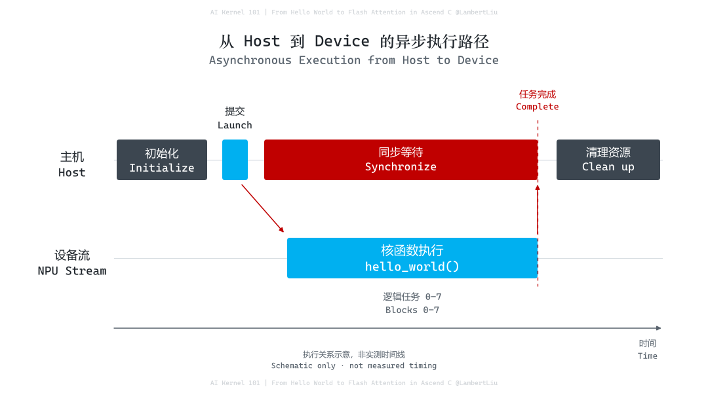

# Matplotlib 绘图工作流

新配图以白色为背景，红色和天蓝色为主题色，其他元素使用黑白灰。默认导出 **1080×600 PNG** 和同一布局的 SVG。优先用干净的纯色块、细线与统一间距塑造图形。概念图、模型预测、实测结果必须在图中区分，不能用示意布局暗示实测时序或物理资源数量。

插图以直观图形为主体：保留标题，用任务条、轨道、箭头、同步线或对象图形表达关系，文字只标识必要对象和动作。不采用分栏文字卡片、重复副标题或长段解释；能力范围与完整技术说明留在正文。异步图参照作者提供的 `cuda_streams.png` 的轨道表达方式，按当前样例重新绘制。

统一排版：标题两行，中文在上、英文在下，字号分别为 **24 px、18 px**。中文标题使用华文中宋，中文正文与标注使用微软雅黑；所有英文及数字使用 Cascadia Code。所有标注中文在上、英文在下，两行使用相同的标称字号。框内双语文字作为整体垂直居中，按实际字形边界计算，不靠手调首行位置。页眉、页脚均居中添加浅灰色 `AI Kernel 101 | From Hello World to Flash Attention in Ascend C @LambertLiu` 水印，颜色 `#CFD3D7`，字号 10 px。以上字号均按 100 DPI 画布的像素计，在代码中转换为 Matplotlib 的 pt。

## 文件与生成

```text
docs/figures/
├── src/
│   ├── theme.py                       # 配色、字体、尺寸、布局与导出函数
│   ├── 01-fig1-host-kernel.py
│   └── 01-fig2-run-paths.py
├── gen/                               # 与绘图脚本同名的 PNG 和 SVG
├── render.py                          # 批量入口，也支持选择单图
└── requirements.txt                   # 本次验证的 Matplotlib 版本
```

在仓库根目录运行（Python 需满足所固定 Matplotlib 的版本要求）：

```powershell
python -m venv .local/figures-venv
.local/figures-venv/Scripts/python.exe -m pip install -r docs/figures/requirements.txt
.local/figures-venv/Scripts/python.exe docs/figures/render.py
```

当前工作区已通过 uv 创建 `.local/figures-venv` 并安装依赖，可以直接运行最后一行。如用 uv 安装依赖，可运行：

```powershell
$env:UV_CACHE_DIR = "$PWD/.local/uv-cache"
uv pip install --python .local/figures-venv/Scripts/python.exe -r docs/figures/requirements.txt
```

选择单图或直接执行绘图脚本：

```powershell
.local/figures-venv/Scripts/python.exe docs/figures/render.py 01-fig1-host-kernel
.local/figures-venv/Scripts/python.exe docs/figures/src/01-fig2-run-paths.py
```

路径按脚本位置解析，换工作目录不改变输出位置。Linux／WSL 环境把解释器路径换为 `.local/figures-venv/bin/python`，并配置下面指定的字体。

正文在 `docs/drafts` 或 `docs/articles` 中这样引用：

```markdown

```

## 调整与检查

主题集中在 [src/theme.py](src/theme.py)：按作者提供的 `color.png` 实心色块取样，天蓝为 **RGB(0, 176, 240)／`#00B0F0`**，红色为 **RGB(192, 0, 0)／`#C00000`**。主要填充使用这两种纯色及深灰 `#3C4650`，浅色由 `tint` 与白色混合生成，不再沿用旧主题色。颜色不独立承担语义，箭头方向、虚实线及标签也应说明含义。布局坐标以像素计，原点在左上角，尺寸、标题字号、水印与 DPI 集中配置；导出不使用自动紧裁，保证 PNG 尺寸稳定。

新增单图使用 `篇次-fig序号-英文主题.py` 命名，复用 `canvas(title_zh, title_en)`、`bilingual(ax, x, y, zh, en, size)`、`bilingual_in_box(ax, x, y, w, h, zh, en, size)`、`box`、`arrow`、`save`。`canvas` 统一生成双语标题和上下水印，`bilingual` 保证标注的中英顺序及字号相等，`bilingual_in_box` 按两行字形的实际高度与行间距在框内整体居中；图形细节用 Matplotlib 图元绘制。批量入口会发现 `src/??-fig*.py`；辅助模块不生成图片。每次修改后重新生成 PNG／SVG，逐张检查字号、中文、遮挡、箭头、留白和正文含义，再检查 Markdown 相对链接。脚本只自动检查文字是否超出画布，不能替代视觉与技术审核。

图 2 的算子库框使用红色 `#C00000` 边框、2 px 线宽，内部填充近白浅灰 `#FAFAFA`，标注使用深色。图 2 的全部流程箭头及分支连接线统一为近黑深灰 `#20262C`。Matplotlib 线宽参数以 pt 计，2 px 按 `2 * 72 / DPI` 转换。

字体固定按文字角色选择：

| 角色 | 字体 | 字体文件覆盖变量 |
| --- | --- | --- |
| 中文标题 | 华文中宋（STZhongsong） | `FIGURE_TITLE_CHINESE_FONT` |
| 中文正文与标注 | 微软雅黑（Microsoft YaHei） | `FIGURE_CHINESE_FONT` |
| 全部英文与数字，含标题、标注和水印 | Cascadia Code | `FIGURE_ENGLISH_FONT` |

中英混排时，英文与数字由 Cascadia Code 渲染，中文按标题／正文角色回退到华文中宋／微软雅黑。字体缺失时明确报错；覆盖变量的值为有权使用的字体文件路径，不自动改用其他字体。Cascadia Code 也会从 `.local/figure-fonts/CascadiaCode-Regular.ttf` 加载，不要求系统安装。当前本地字体取自[微软官方固定版本 v2407.24](https://github.com/microsoft/cascadia-code/releases/tag/v2407.24) 的 `ttf/static/CascadiaCode-Regular.ttf`。

SVG 文字导出为路径，避免阅读端字体缺失；字体文件只留本地，不进入公开图包。修改图中文字应回到 Python 源码。

## 本批次来源与证据边界

两图均为本项目按正文与仓库源码生成的概念图，没有嵌入外部位图、没有使用性能数据，仓库整体许可证仍待作者选择。图 1 参考作者提供的 `cuda_streams.png` 的任务轨道、提交箭头与同步线表达，重新绘制为本样例的单 Kernel 流程；参考图的上游来源与许可未提供，不将其收入生成目录或插入正文。

| 图与源码 | 依据／修改内容 | 证据边界与引用 |
| --- | --- | --- |
| [01-fig1-host-kernel.py](src/01-fig1-host-kernel.py) | [hello_world.cpp](../../src/hello_world/hello_world.cpp) 与[01 草稿](../drafts/hello-world.md)；Host／NPU Stream 双轨道、提交箭头、纯色任务条和同步等待区 | 真机语境的执行依赖示意；样例提交后立即同步，不虚构其间有 CPU 计算；条长不表示时长，单条 Kernel 不表示 Block 串行执行或物理核映射 |
| [01-fig2-run-paths.py](src/01-fig2-run-paths.py) | 按作者要求加入算子库 `.so` 层；CPU 单独虚线框，SIM／NPU 合并虚线框，框下分别标注 CPU 域与 NPU 域调试范围 | `.so` 是按模式分别构建的产物类型示意，不表示三条路径共用同一二进制，也不表示 Hello World 已生成共享库；本篇 [CMakeLists.txt](../../src/hello_world/CMakeLists.txt) 定义的是可执行程序 `demo`。SIM 性能观察以模型为限，NPU 实际耗时需真机实测；图形不对应具体板卡布局 |

依据为本工作区 2026-11-14 的源码与草稿；草稿存在未提交编辑，不把日期当作固定源码版本。外部资料链接沿用正文，不新增未经核对的硬件或软件版本声明。两图均由第 01 篇引用，生成命令如上。

本次渲染环境：Python 3.15.2、Matplotlib 3.11.2；实际字体为华文中宋 1.02、微软雅黑 6.31、Cascadia Code 2407.024，版本读取自字体元数据。字体使用与嵌入遵循各自所附产品条款和字体许可；未将字体文件收入仓库，也未另行授予字体许可。跨环境字体版本变化可能改变字宽，需重新目视检查。旧孪生调试参考图片仍保留在原位置，其来源与许可状态不因本次自绘而改变。
