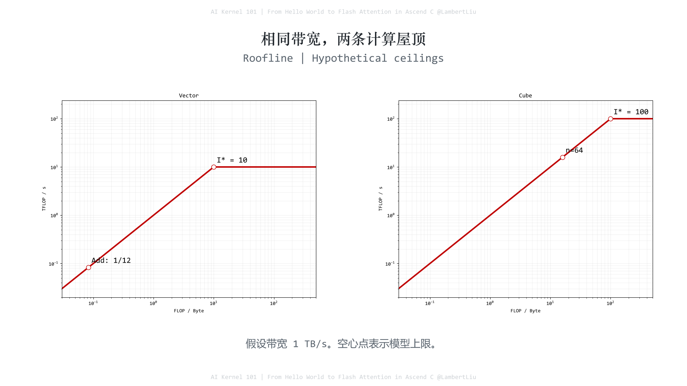

# 第 02 篇实验报告：从计算结构到数据流

本报告为[第 02 篇正文](../../../docs/drafts/hardware-dataflow.md)筛选既有结果，没有新增测量。frontmatter 日期沿用原始实验日期。[历史真机报告](npu-report.md)保留全部七项运行、修复及性能采集；其中“结果待分析”与图 12 待办属于原完整范围，不代表下列精选结果尚未执行。

# 范围、配置与计时

| 项目 | 原执行记录 |
| --- | --- |
| 主机、设备 | aarch64；框架逻辑设备 0；Ascend910_9362 |
| 可见资源 | 20 AIC、40 AIV |
| 驱动、固件 | npu-smi 与驱动显示 25.5.5；固件查询显示 NA |
| 工具链 | CANN 安装目录 cann-9.1.0；bisheng clang 15.0.5；目标 dav-2201 |
| 框架 | PyTorch 2.7.1+cpu、torch-npu 2.7.1.post4、NumPy 1.26.4 |
| Add | 连续 FP32 输入输出；每次处理 2048 个元素 |
| Matmul | 连续 ND、FP16 输入、FP32 输出；纯 Cube 模式；累计机制需结合接口核对 |
| 提交与检查 | 输入准备后同步；TASK_QUEUE_ENABLE=0；固定种子 2026 |
| 计时 | 预热至少 20 次，5 组、每组 50 次；组内折算单次均值，再取五组中位数 |

这里的时间是同一 Stream 上设备事件之间的整组时间折算值，排除输入上传、结果回传和主机校验，仍可能包含主机提交间隙。表中四分位区间描述五组均值的分布，不是单次调用分布，也不是置信区间；不能将这些数称为纯 Kernel 执行时间。

环境及源码对应关系见[环境快照](../results/2026-11-18/environment.txt)、[最终源码指纹](../results/2026-11-18/final-source-sha256.txt)和[历史报告](npu-report.md)。整卡型号映射、同精度理论峰值、全程频率均不从上述字段推断。

# 场景 1：Add 数据流

## 理论与路径

在本文限定的 2201 SIMD 路径中，输入由 GM 搬至 UB，Vector 完成相加，结果再由 UB 写回 GM。各输出相互独立，不需跨输出保留输入；搬运完成后才能计算，计算完成后才能写回。

长度为 $L$ ，输入输出互不覆盖，且各输入读一次、输出写一次时：

$$F=L,\qquad Q_{\mathrm{logical}}=12L\ \mathrm{Byte},\qquad I_{\mathrm{logical}}=\frac1{12}\ \mathrm{FLOP/Byte}.$$

这些是逻辑计数，不是实测 HBM 字节量。长度增长不改变这个比例；每任务缓冲复用使 UB 不必容纳整个向量。

## 取数与观察

A1 从 `kind=timing` 行选择长度 2048、65536、4194304，任务数 40；A2 选择长度 4194304、任务数 1／40。表中“有数据任务”取原记录 `active`，不等同于硬件活跃核计数。所有配置通过逐位正确性检查。

| 编号 | 长度 | 配置任务数 | 有数据任务 | 逻辑字节量（Byte） | 事件中位时间（微秒） | 组均值四分位区间（微秒） |
| --- | ---: | ---: | ---: | ---: | ---: | ---: |
| A1 | 2048 | 40 | 1 | 24576 | 6.564 | 6.536—6.564 |
| A1 | 65536 | 40 | 32 | 786432 | 6.578 | 6.567—6.603 |
| A1 | 4194304 | 40 | 40 | 50331648 | 25.268 | 25.266—25.301 |
| A2 | 4194304 | 1 | 1 | 50331648 | 848.394 | 848.122—848.417 |
| A2 | 4194304 | 40 | 40 | 50331648 | 25.459 | 25.458—25.475 |

来源：[A1 原始记录](../results/2026-11-18/A1.jsonl)、[A2 原始记录](../results/2026-11-18/A2.jsonl)。A1 与 A2 的 40 任务结果来自不同实验，分别保留，不能混成同一条样本。

A1 的前两个输入长度相差 32 倍，时间几乎不变；大输入时间明显增加。因此数据量不能直接按比例换算为时间。固定开销可能影响短输入，但这里没有分离其组成。

A2 的数学工作和逻辑流量相同，40 个任务比 1 个任务更快，支持“任务组织影响执行表现”的判断。它不证明带宽已饱和，也不证明全部核同时满负荷。完整任务扫描归第 04 篇，缓存与物理流量分析归第 11 篇。

# 场景 2：Matmul 数据流

## 理论与路径

左输入的一行可以参与多个输出，右输入的一列也可以参与多个输出。本文使用 GM → L1 → L0A／L0B → Cube 的简化供数路径，L0C 保留累计结果，再经输出路径写回。路径依据架构资料与实现配置；输出正确不能单独证明每次搬运的实际轨迹。

模型采用 FP16 输入、FP32 累计与输出，不读取旧输出。每次乘加计两次运算，方阵边长为 $n$ 。若两个输入各读一次、输出写一次：

$$F\approx2n^3,\qquad Q_{\min}=8n^2\ \mathrm{Byte},\qquad I_{\mathrm{ideal}}\approx\frac n4\ \mathrm{FLOP/Byte}.$$

| 方阵边长 | 约定运算量（FLOP） | 理想必要字节量（Byte） | 理想强度（FLOP/Byte） |
| ---: | ---: | ---: | ---: |
| 64 | 524288 | 32768 | 16 |
| 512 | 268435456 | 2097152 | 128 |

模型描述输入复用的潜力，并未证明实现达到该流量。实际分块重读、缓存、格式转换与工作区另计；原 JSONL 中的逻辑分块流量也不能当成 HBM 字节量。

## 基础正确性与所选配置

M0 从[原始检查](../results/2026-11-18/M0.jsonl)选择 `kind=check`、`tile=64`、`n=64/128`、`pattern=zero/identity/random` 的六行。零与单位阵最大绝对误差均为 0；随机输入最大绝对误差分别约为 $1.90\times10^{-7}$ 、 $3.74\times10^{-7}$ 。

随机参考由相同 FP16 输入提升到 FP64 后计算，逐元素判据为：

$$|c-c_{\mathrm{ref}}|\le10^{-3}+10^{-3}|c_{\mathrm{ref}}|.$$

其中 $c$ 是设备结果， $c_{\mathrm{ref}}$ 是主机参考。两个固定误差项分别提供绝对与相对容差，不能用一个最大相对误差数值替代逐元素判断。

这些用例支持所选 Matmul 接口的基础正确性。M0 实际 K 基础块覆盖整个 K，没有验证多段累计；精度探针、消去输入及累计精度的进一步解释留给第 09 篇。FP32 输出本身也不足以独立证明全部内部累计行为。

M1 只选 64、512 阶，配置 20 个任务、输出块 64。保留下表实际基础块是为了可复核，不在第 02 篇分析最优分块。

| 边长 | 实际 M／N／K 基础块 | 事件中位时间（微秒） | 组均值四分位区间（微秒） | 随机最大绝对误差 |
| ---: | --- | ---: | ---: | ---: |
| 64 | 64／64／64 | 7.118 | 7.104—7.120 | 1.8999e-07 |
| 512 | 64／64／256 | 13.724 | 13.668—13.726 | 1.83887e-06 |

来源：[M1 原始记录](../results/2026-11-18/M1.jsonl)中对应的 `timing` 与 `check` 行；两组均通过正确性检查。

边长增长 8 倍，约定运算量增长 512 倍，事件时间增长约 1.93 倍。规模同时改变输出任务覆盖和内部配置，不能把差异单独归因于数据复用或某个 Tiling 参数。512 阶补充多 K 段下的随机结果检查，仍不替代累计机制验证。

# 场景 3：Vector／Cube 对照

本场景只综合前述模型、实现路径与结果，不增加 Kernel 或测量。

| 维度 | Add | Matmul |
| --- | --- | --- |
| 计算关系 | 各输出独立 | 各输出沿 K 累计，输入可被多个输出共享 |
| 简化供数路径 | GM → UB → Vector | GM → L1 → L0A／L0B → Cube |
| 结果位置 | UB，随后写回 GM | L0C 累计，随后经输出路径写回 |
| 基础强度 | 逻辑强度为 1/12 FLOP/Byte | 充分复用时约为 n/4 FLOP/Byte |
| 执行证据 | 所选 A1／A2 正确，任务数影响事件时间 | 所选 M0 正确，M1 的时间不随运算量同比增长 |
| 不能推出 | 实测 HBM 饱和或 Vector 峰值 | 已实现理想流量、Cube 满载或某分块单独导致提速 |

表中路径限定为[2201 SIMD 架构](https://asc.gitcode.com/guide/programming_guide/advanced_programming/hardware_implementation/architecture_spec/npu_arch_2201.html)。不同精度、不同算子工作量下的事件耗时不能用来排名 Vector 与 Cube；比较的依据是操作形态和数据组织。

## 基础 Roofline 图

$$P\le\min(P_{\max},B_{\max}I).$$

其中 $P$ 为吞吐， $P_{\max}$ 为对应精度与计算路径的吞吐上限， $B_{\max}$ 为所选存储边界的带宽， $I$ 为同一边界的算术强度。图中假设带宽 1 TB/s、Vector 10 TFLOP/s、Cube 100 TFLOP/s；参数不属于本次设备实测，空心点不是测量值。

图中 Matmul 标记采用 64 阶理想模型；不把 512 阶实测时间叠在假设屋顶上。图与来源入口见[配图规划](../../../docs/assets/figures/plans/02-hardware-dataflow.md)。使用 HBM 带宽屋顶时，图中逻辑计数还假设全部形成对应 HBM 流量。实际字节量未核实，不能画成设备实测 Roofline。

# 结论与发表边界

所选证据支持基础认知：Add 用独立位置的批量计算组织数据；Matmul 值得保留输入与部分和，发挥跨输出复用机会。Vector／Cube 的操作形态与这些数据结构相匹配。Roofline 帮助理解供数和计算上界，不足以证明硬件必须采用这种分工。

第 02 篇无需等待 A3、M2、M3 的深入性能解释，也不需要为本报告新增测量。发布前仍需固定架构／接口资料版本、核对图注来源与视频引语；累计机制未核实的部分继续明确标注。设备峰值、HBM 字段、缓存归因和库函数性能差距留给后续篇章，不用未经验证的结论填补。

后续归属与原方案见[实验设计](../experiment-plan.md#实验归属与后续复用)。历史报告、原始数据、实验编号及源码保持原样。
