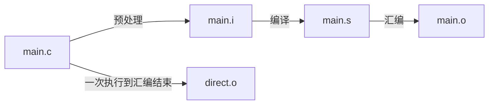

# 第 1 部分：从 C 源码读到 ELF

用一个最简单的 C 语言程序 `main.c` 做普通 Linux C 对照。

- 第 1 阶段先把构建拆开，认出每份产物。
- 第 2 阶段在同一份源码里增加数据和函数，练习从符号定位到文件字节。

## 第 1 阶段：哪一步产生了 `.o`？

从 Linux shell 进入仓库根目录。先预测下面哪一行会首次产生 ELF，哪一行之后才有可以启动的程序。逐行执行并保留回显。

```bash
workdir="lab/pre_link_load/results/compile_test"
mkdir -p $workdir

cp lab/pre_link_load/src/main.c "$workdir/"
cd "$workdir"

gcc -E main.c -o main.i						# 预编译
gcc -O0 -fno-pie -S main.i -o main.s		# 编译
gcc -c main.s -o main.o						# 汇编

# 开始有回显
gcc -### -no-pie main.o -o app-exec
gcc -no-pie main.o -o app-exec				# 链接成可执行文件
./app-exec									# 执行可执行文件
echo "$?"
```

### 预编译（Precompiling）

| 命令           | 观察什么                               |
| ------------ | ---------------------------------- |
| `cat main.i` | 找 `return` 那一行，对照源码里的 `EXIT_CODE`。 |

回显：

```c
# 0 "main.c"
# 0 "<built-in>"
# 0 "<command-line>"
# 1 "/usr/include/stdc-predef.h" 1 3 4
# 0 "<command-line>" 2
# 1 "main.c"

int main(void)
{
    return 0;		// 
}
```


### 编译（Compilation）

| 命令           | 观察什么                               |
| ------------ | ---------------------------------- |
| `cat main.s` | 找 `main` 标签和返回前的指令。能认出函数的位置就够了。    |

```asm
	.file	"main.c"
	.text
	.globl	main
	.type	main, @function
main:
.LFB0:
	.cfi_startproc
	endbr64
	pushq	%rbp
	.cfi_def_cfa_offset 16
	.cfi_offset 6, -16
	movq	%rsp, %rbp
	.cfi_def_cfa_register 6
	movl	$0, %eax
	popq	%rbp
	.cfi_def_cfa 7, 8
	ret
	.cfi_endproc
.LFE0:
	.size	main, .-main
	.ident	"GCC: (Ubuntu 13.3.0-6ubuntu2~24.04.1) 13.3.0"
	.section	.note.GNU-stack,"",@progbits
	.section	.note.gnu.property,"a"
	.align 8
	.long	1f - 0f
	.long	4f - 1f
	.long	5
0:
	.string	"GNU"
1:
	.align 8
	.long	0xc0000002
	.long	3f - 2f
2:
	.long	0x3
3:
	.align 8
4:
```

### 汇编（Assembly）

| 命令                                   | 观察什么                                                                                                       |
| ------------------------------------ | ---------------------------------------------------------------------------------------------------------- |
| `file main.i main.s main.o app-exec` | 按文件内容粗分文本、可重定位目标文件和可执行文件。                                                                                  |

```bash
$ file main.i main.s main.o app-exec
main.i:   C source, ASCII text
main.s:   assembler source, ASCII text
main.o:   ELF 64-bit LSB relocatable, x86-64, version 1 (SYSV), not stripped
app-exec: ELF 64-bit LSB executable, x86-64, version 1 (SYSV), dynamically linked, interpreter /lib64/ld-linux-x86-64.so.2, BuildID[sha1]=0a28ef6ff40a6ab8f17e1efd2fad6e5db7e003d1, for GNU/Linux 3.2.0, not stripped
```

### 链接（Link）

| 命令                                   | 观察什么                                                                                                       |
| ------------------------------------ | ---------------------------------------------------------------------------------------------------------- |
| `readelf -h main.o app-exec`         | 抄下两份文件的 `Magic`、`Class`、`Data`、`Type`、`Machine`。`Magic` 前四字节 `7f 45 4c 46` 标识 ELF，`Type` 说明它在构建和运行中扮演什么角色。 |

```bash
$ readelf -h main.o app-exec

File: main.o
ELF Header:
  Magic:   7f 45 4c 46 02 01 01 00 00 00 00 00 00 00 00 00 
  Class:                             ELF64
  Data:                              2's complement, little endian
  Version:                           1 (current)
  OS/ABI:                            UNIX - System V
  ABI Version:                       0
  Type:                              REL (Relocatable file)
  Machine:                           Advanced Micro Devices X86-64
  Version:                           0x1
  Entry point address:               0x0
  Start of program headers:          0 (bytes into file)
  Start of section headers:          456 (bytes into file)
  Flags:                             0x0
  Size of this header:               64 (bytes)
  Size of program headers:           0 (bytes)
  Number of program headers:         0
  Size of section headers:           64 (bytes)
  Number of section headers:         12
  Section header string table index: 11

File: app-exec
ELF Header:
  Magic:   7f 45 4c 46 02 01 01 00 00 00 00 00 00 00 00 00 
  Class:                             ELF64
  Data:                              2's complement, little endian
  Version:                           1 (current)
  OS/ABI:                            UNIX - System V
  ABI Version:                       0
  Type:                              EXEC (Executable file)
  Machine:                           Advanced Micro Devices X86-64
  Version:                           0x1
  Entry point address:               0x401020
  Start of program headers:          64 (bytes into file)
  Start of section headers:          13816 (bytes into file)
  Flags:                             0x0
  Size of this header:               64 (bytes)
  Size of program headers:           56 (bytes)
  Number of program headers:         13
  Size of section headers:           64 (bytes)
  Number of section headers:         28
  Section header string table index: 27
```

其中：`gcc -###` 打印准备执行的子命令。

```bash
$ gcc -### -no-pie main.o -o app-exec
Using built-in specs.
COLLECT_GCC=gcc
COLLECT_LTO_WRAPPER=/usr/libexec/gcc/x86_64-linux-gnu/13/lto-wrapper
OFFLOAD_TARGET_NAMES=nvptx-none:amdgcn-amdhsa
OFFLOAD_TARGET_DEFAULT=1
Target: x86_64-linux-gnu
Configured with: ../src/configure -v --with-pkgversion='Ubuntu 13.3.0-6ubuntu2~24.04.1' --with-bugurl=file:///usr/share/doc/gcc-13/README.Bugs --enable-languages=c,ada,c++,go,d,fortran,objc,obj-c++,m2 --prefix=/usr --with-gcc-major-version-only --program-suffix=-13 --program-prefix=x86_64-linux-gnu- --enable-shared --enable-linker-build-id --libexecdir=/usr/libexec --without-included-gettext --enable-threads=posix --libdir=/usr/lib --enable-nls --enable-bootstrap --enable-clocale=gnu --enable-libstdcxx-debug --enable-libstdcxx-time=yes --with-default-libstdcxx-abi=new --enable-libstdcxx-backtrace --enable-gnu-unique-object --disable-vtable-verify --enable-plugin --enable-default-pie --with-system-zlib --enable-libphobos-checking=release --with-target-system-zlib=auto --enable-objc-gc=auto --enable-multiarch --disable-werror --enable-cet --with-arch-32=i686 --with-abi=m64 --with-multilib-list=m32,m64,mx32 --enable-multilib --with-tune=generic --enable-offload-targets=nvptx-none=/build/gcc-13-EldibY/gcc-13-13.3.0/debian/tmp-nvptx/usr,amdgcn-amdhsa=/build/gcc-13-EldibY/gcc-13-13.3.0/debian/tmp-gcn/usr --enable-offload-defaulted --without-cuda-driver --enable-checking=release --build=x86_64-linux-gnu --host=x86_64-linux-gnu --target=x86_64-linux-gnu --with-build-config=bootstrap-lto-lean --enable-link-serialization=2
Thread model: posix
Supported LTO compression algorithms: zlib zstd
gcc version 13.3.0 (Ubuntu 13.3.0-6ubuntu2~24.04.1)
COMPILER_PATH=/usr/libexec/gcc/x86_64-linux-gnu/13/:/usr/libexec/gcc/x86_64-linux-gnu/13/:/usr/libexec/gcc/x86_64-linux-gnu/:/usr/lib/gcc/x86_64-linux-gnu/13/:/usr/lib/gcc/x86_64-linux-gnu/
LIBRARY_PATH=/usr/lib/gcc/x86_64-linux-gnu/13/:/usr/lib/gcc/x86_64-linux-gnu/13/../../../x86_64-linux-gnu/:/usr/lib/gcc/x86_64-linux-gnu/13/../../../../lib/:/lib/x86_64-linux-gnu/:/lib/../lib/:/usr/lib/x86_64-linux-gnu/:/usr/lib/../lib/:/usr/lib/gcc/x86_64-linux-gnu/13/../../../:/lib/:/usr/lib/
COLLECT_GCC_OPTIONS='-no-pie' '-o' 'app-exec' '-mtune=generic' '-march=x86-64' '-dumpdir' 'app-exec.'
 /usr/libexec/gcc/x86_64-linux-gnu/13/collect2 -plugin /usr/libexec/gcc/x86_64-linux-gnu/13/liblto_plugin.so "-plugin-opt=/usr/libexec/gcc/x86_64-linux-gnu/13/lto-wrapper" "-plugin-opt=-fresolution=/tmp/cc8j7C05.res" "-plugin-opt=-pass-through=-lgcc" "-plugin-opt=-pass-through=-lgcc_s" "-plugin-opt=-pass-through=-lc" "-plugin-opt=-pass-through=-lgcc" "-plugin-opt=-pass-through=-lgcc_s" --build-id --eh-frame-hdr -m elf_x86_64 "--hash-style=gnu" --as-needed -dynamic-linker /lib64/ld-linux-x86-64.so.2 -z relro -o app-exec /usr/lib/gcc/x86_64-linux-gnu/13/../../../x86_64-linux-gnu/crt1.o /usr/lib/gcc/x86_64-linux-gnu/13/../../../x86_64-linux-gnu/crti.o /usr/lib/gcc/x86_64-linux-gnu/13/crtbegin.o -L/usr/lib/gcc/x86_64-linux-gnu/13 -L/usr/lib/gcc/x86_64-linux-gnu/13/../../../x86_64-linux-gnu -L/usr/lib/gcc/x86_64-linux-gnu/13/../../../../lib -L/lib/x86_64-linux-gnu -L/lib/../lib -L/usr/lib/x86_64-linux-gnu -L/usr/lib/../lib -L/usr/lib/gcc/x86_64-linux-gnu/13/../../.. main.o -lgcc --push-state --as-needed -lgcc_s --pop-state -lc -lgcc --push-state --as-needed -lgcc_s --pop-state /usr/lib/gcc/x86_64-linux-gnu/13/crtend.o /usr/lib/gcc/x86_64-linux-gnu/13/../../../x86_64-linux-gnu/crtn.o
COLLECT_GCC_OPTIONS='-no-pie' '-o' 'app-exec' '-mtune=generic' '-march=x86-64' '-dumpdir' 'app-exec.'
```

可以在对应回显里找 `collect2` 或链接器，以及输入的 `main.o` 和输出的 `app-exec`。

实际链接由下一条 `gcc` 命令完成。这里显式使用 `-fno-pie` 和 `-no-pie`，便于观察 `ET_REL` 与 `ET_EXEC` 的区别。退出状态预计为 `0`，程序本身没有终端输出。[GCC 构建阶段选项](https://gcc.gnu.org/onlinedocs/gcc/Overall-Options.html) · [GCC 链接选项](https://gcc.gnu.org/onlinedocs/gcc/Link-Options.html)

### 再对照日常写法

```bash
gcc -### -O0 -fno-pie -c main.c -o direct.o
gcc -O0 -fno-pie -c main.c -o direct.o
readelf -h direct.o
```

这次的 `-c` 从 C 源码开始，包含预处理、编译和汇编。它在链接前停下。前面从 `main.s` 开始的 `-c` 只需要汇编。最后对 `direct.o` 分析：

```bash
$ readelf -h direct.o 
ELF Header:
  Magic:   7f 45 4c 46 02 01 01 00 00 00 00 00 00 00 00 00 
  Class:                             ELF64
  Data:                              2's complement, little endian
  Version:                           1 (current)
  OS/ABI:                            UNIX - System V
  ABI Version:                       0
  Type:                              REL (Relocatable file)
  Machine:                           Advanced Micro Devices X86-64
  Version:                           0x1
  Entry point address:               0x0
  Start of program headers:          0 (bytes into file)
  Start of section headers:          456 (bytes into file)
  Flags:                             0x0
  Size of this header:               64 (bytes)
  Size of program headers:           0 (bytes)
  Number of program headers:         0
  Size of section headers:           64 (bytes)
  Number of section headers:         12
  Section header string table index: 11
```

把两次执行的输入和输出画在一张图上：



 `Type` 解释为什么两次都得到可重定位目标文件。

```bash
$ readelf -h main.o | grep Type
  Type:                              REL (Relocatable file)
$ readelf -h direct.o | grep Type
  Type:                              REL (Relocatable file)
```

```bash
$ cmp main.o direct.o
```

无回显，表示二者完全相同。ELF 的 REL 即是 `ET_REL`，表示这两个文件都可以作为后续链接的输入。

## 第 2 阶段：从符号找到 `.data` 中的字节

第 1 阶段完成后，在临时目录里的 `main.c` 加上三个元素。给一个文件作用域变量赋非零初值，例如 `int bias = 7`。定义一个没有显式初始化的文件作用域变量，例如 `int scratch`。再写一个被 `main` 调用的 `static` 辅助函数，让函数读写这两个变量。编译前先预测四个符号 `main`、辅助函数、`bias`、`scratch` 分别会落在哪个节。

```bash
gcc -O0 -fno-pie -fno-common -c main.c -o sections.o
readelf -W -S sections.o
readelf -W -s sections.o
readelf -W -x .data sections.o
```

1. 在符号表找到四个名字，用 `Ndx` 对应节表的编号，比较辅助函数和 `main` 的 `Bind`。
2. 在 `sections.o` 中，用 `bias` 所在节的 `Off` 加上它的 `Value` 算出文件位置。用 `.data` 的十六进制回显、符号 `Size` 和 ELF 头的字节序，把原始字节读回初值。
3. 在节表找到 `.bss`，记录其类型和大小。`NOBITS` 可以有非零大小，文件中不存这一节的数据字节，因此不能套用上一步去找 `scratch` 的初值。运行时它的初值为零。 [ELF gABI 节表](https://gabi.xinuos.com/elf/03-sheader.html) · [符号表](https://gabi.xinuos.com/elf/05-symtab.html)

第一周结束时，按「命令 → 关键回显 → 判断」各留一条记录。第 1 条解释 `.o` 和 `app-exec` 从哪里来，第 2 条解释 `bias` 的文件位置怎么得到，第 3 条解释 `.bss` 的大小代表什么。后续读 Ascend C 的 `.aicore_binary` 和 `fatbinDataLength` 时，会复用第 2 条里的节编号与偏移读法。
