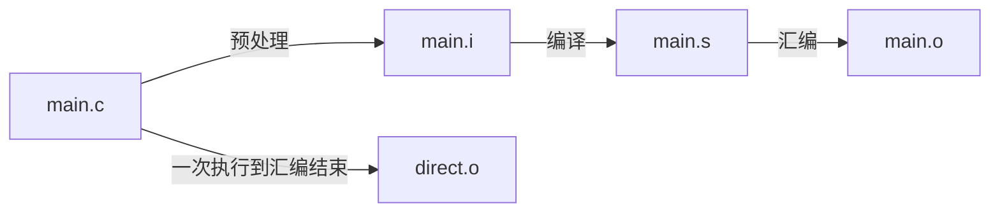

# 第 1 部分：从 C 源码读到 ELF

用一个最简单的 C 语言程序 `main.c` 做普通 Linux C 对照。

- 第 1 阶段先把构建拆开，认出每份产物。
- 第 2 阶段在同一份源码里增加数据和函数，练习从符号定位到文件字节。

## 第 1 阶段：哪一步产生了 `.o`？

`main.c` 示例代码：

```C
#define EXIT_CODE 0

int main(void)
{
    return EXIT_CODE;
}
```

从 Linux shell 进入仓库根目录。先预测下面哪一行会首次产生 ELF，哪一行之后才有可以启动的程序。逐行执行并保留回显。

```bash
workdir="lab/pre_link_load/results/compile_test"
mkdir -p $workdir

cp lab/pre_link_load/src/main.c "$workdir/"
cd "$workdir"

gcc -E main.c -o main.i						# 预编译
gcc -O0 -fno-pie -S main.i -o main.s		# 编译
gcc -c main.s -o main.o						# 汇编

# 开始有回显
gcc -### -no-pie main.o -o app-exec
gcc -no-pie main.o -o app-exec				# 链接成可执行文件
./app-exec									# 执行可执行文件
echo "$?"
```

### 预编译（Precompiling）

| 命令           | 观察什么                                           |
| -------------- | -------------------------------------------------- |
| `cat main.i` | 找 `return` 那一行，对照源码里的 `EXIT_CODE`。 |

回显：

```c
# 0 "main.c"
# 0 "<built-in>"
# 0 "<command-line>"
# 1 "/usr/include/stdc-predef.h" 1 3 4
# 0 "<command-line>" 2
# 1 "main.c"

int main(void)
{
    return 0;		// 
}
```

### 编译（Compilation）

| 命令           | 观察什么                                                 |
| -------------- | -------------------------------------------------------- |
| `cat main.s` | 找 `main` 标签和返回前的指令。能认出函数的位置就够了。 |

```asm
	.file	"main.c"
	.text
	.globl	main
	.type	main, @function
main:
.LFB0:
	.cfi_startproc
	endbr64
	pushq	%rbp
	.cfi_def_cfa_offset 16
	.cfi_offset 6, -16
	movq	%rsp, %rbp
	.cfi_def_cfa_register 6
	movl	$0, %eax
	popq	%rbp
	.cfi_def_cfa 7, 8
	ret
	.cfi_endproc
.LFE0:
	.size	main, .-main
	.ident	"GCC: (Ubuntu 13.3.0-6ubuntu2~24.04.1) 13.3.0"
	.section	.note.GNU-stack,"",@progbits
	.section	.note.gnu.property,"a"
	.align 8
	.long	1f - 0f
	.long	4f - 1f
	.long	5
0:
	.string	"GNU"
1:
	.align 8
	.long	0xc0000002
	.long	3f - 2f
2:
	.long	0x3
3:
	.align 8
4:
```

### 汇编（Assembly）

| 命令                                   | 观察什么                                           |
| -------------------------------------- | -------------------------------------------------- |
| `file main.i main.s main.o app-exec` | 按文件内容粗分文本、可重定位目标文件和可执行文件。 |

```bash
$ file main.i main.s main.o app-exec
main.i:   C source, ASCII text
main.s:   assembler source, ASCII text
main.o:   ELF 64-bit LSB relocatable, x86-64, version 1 (SYSV), not stripped
app-exec: ELF 64-bit LSB executable, x86-64, version 1 (SYSV), dynamically linked, interpreter /lib64/ld-linux-x86-64.so.2, BuildID[sha1]=0a28ef6ff40a6ab8f17e1efd2fad6e5db7e003d1, for GNU/Linux 3.2.0, not stripped
```

### 链接（Link）

| 命令                           | 观察什么                                                                                                                                                       |
| ------------------------------ | -------------------------------------------------------------------------------------------------------------------------------------------------------------- |
| `readelf -h main.o app-exec` | 抄下两份文件的 `Magic`、`Class`、`Data`、`Type`、`Machine`。`Magic` 前四字节 `7f 45 4c 46` 标识 ELF，`Type` 说明它在构建和运行中扮演什么角色。 |

```bash
$ readelf -h main.o app-exec

File: main.o
ELF Header:
  Magic:   7f 45 4c 46 02 01 01 00 00 00 00 00 00 00 00 00 
  Class:                             ELF64
  Data:                              2's complement, little endian
  Version:                           1 (current)
  OS/ABI:                            UNIX - System V
  ABI Version:                       0
  Type:                              REL (Relocatable file)
  Machine:                           Advanced Micro Devices X86-64
  Version:                           0x1
  Entry point address:               0x0
  Start of program headers:          0 (bytes into file)
  Start of section headers:          456 (bytes into file)
  Flags:                             0x0
  Size of this header:               64 (bytes)
  Size of program headers:           0 (bytes)
  Number of program headers:         0
  Size of section headers:           64 (bytes)
  Number of section headers:         12
  Section header string table index: 11

File: app-exec
ELF Header:
  Magic:   7f 45 4c 46 02 01 01 00 00 00 00 00 00 00 00 00 
  Class:                             ELF64
  Data:                              2's complement, little endian
  Version:                           1 (current)
  OS/ABI:                            UNIX - System V
  ABI Version:                       0
  Type:                              EXEC (Executable file)
  Machine:                           Advanced Micro Devices X86-64
  Version:                           0x1
  Entry point address:               0x401020
  Start of program headers:          64 (bytes into file)
  Start of section headers:          13816 (bytes into file)
  Flags:                             0x0
  Size of this header:               64 (bytes)
  Size of program headers:           56 (bytes)
  Number of program headers:         13
  Size of section headers:           64 (bytes)
  Number of section headers:         28
  Section header string table index: 27
```

其中：`gcc -###` 打印准备执行的子命令。

```bash
$ gcc -### -no-pie main.o -o app-exec
Using built-in specs.
COLLECT_GCC=gcc
COLLECT_LTO_WRAPPER=/usr/libexec/gcc/x86_64-linux-gnu/13/lto-wrapper
OFFLOAD_TARGET_NAMES=nvptx-none:amdgcn-amdhsa
OFFLOAD_TARGET_DEFAULT=1
Target: x86_64-linux-gnu
Configured with: ../src/configure -v --with-pkgversion='Ubuntu 13.3.0-6ubuntu2~24.04.1' --with-bugurl=file:///usr/share/doc/gcc-13/README.Bugs --enable-languages=c,ada,c++,go,d,fortran,objc,obj-c++,m2 --prefix=/usr --with-gcc-major-version-only --program-suffix=-13 --program-prefix=x86_64-linux-gnu- --enable-shared --enable-linker-build-id --libexecdir=/usr/libexec --without-included-gettext --enable-threads=posix --libdir=/usr/lib --enable-nls --enable-bootstrap --enable-clocale=gnu --enable-libstdcxx-debug --enable-libstdcxx-time=yes --with-default-libstdcxx-abi=new --enable-libstdcxx-backtrace --enable-gnu-unique-object --disable-vtable-verify --enable-plugin --enable-default-pie --with-system-zlib --enable-libphobos-checking=release --with-target-system-zlib=auto --enable-objc-gc=auto --enable-multiarch --disable-werror --enable-cet --with-arch-32=i686 --with-abi=m64 --with-multilib-list=m32,m64,mx32 --enable-multilib --with-tune=generic --enable-offload-targets=nvptx-none=/build/gcc-13-EldibY/gcc-13-13.3.0/debian/tmp-nvptx/usr,amdgcn-amdhsa=/build/gcc-13-EldibY/gcc-13-13.3.0/debian/tmp-gcn/usr --enable-offload-defaulted --without-cuda-driver --enable-checking=release --build=x86_64-linux-gnu --host=x86_64-linux-gnu --target=x86_64-linux-gnu --with-build-config=bootstrap-lto-lean --enable-link-serialization=2
Thread model: posix
Supported LTO compression algorithms: zlib zstd
gcc version 13.3.0 (Ubuntu 13.3.0-6ubuntu2~24.04.1)
COMPILER_PATH=/usr/libexec/gcc/x86_64-linux-gnu/13/:/usr/libexec/gcc/x86_64-linux-gnu/13/:/usr/libexec/gcc/x86_64-linux-gnu/:/usr/lib/gcc/x86_64-linux-gnu/13/:/usr/lib/gcc/x86_64-linux-gnu/
LIBRARY_PATH=/usr/lib/gcc/x86_64-linux-gnu/13/:/usr/lib/gcc/x86_64-linux-gnu/13/../../../x86_64-linux-gnu/:/usr/lib/gcc/x86_64-linux-gnu/13/../../../../lib/:/lib/x86_64-linux-gnu/:/lib/../lib/:/usr/lib/x86_64-linux-gnu/:/usr/lib/../lib/:/usr/lib/gcc/x86_64-linux-gnu/13/../../../:/lib/:/usr/lib/
COLLECT_GCC_OPTIONS='-no-pie' '-o' 'app-exec' '-mtune=generic' '-march=x86-64' '-dumpdir' 'app-exec.'
 /usr/libexec/gcc/x86_64-linux-gnu/13/collect2 -plugin /usr/libexec/gcc/x86_64-linux-gnu/13/liblto_plugin.so "-plugin-opt=/usr/libexec/gcc/x86_64-linux-gnu/13/lto-wrapper" "-plugin-opt=-fresolution=/tmp/cc8j7C05.res" "-plugin-opt=-pass-through=-lgcc" "-plugin-opt=-pass-through=-lgcc_s" "-plugin-opt=-pass-through=-lc" "-plugin-opt=-pass-through=-lgcc" "-plugin-opt=-pass-through=-lgcc_s" --build-id --eh-frame-hdr -m elf_x86_64 "--hash-style=gnu" --as-needed -dynamic-linker /lib64/ld-linux-x86-64.so.2 -z relro -o app-exec /usr/lib/gcc/x86_64-linux-gnu/13/../../../x86_64-linux-gnu/crt1.o /usr/lib/gcc/x86_64-linux-gnu/13/../../../x86_64-linux-gnu/crti.o /usr/lib/gcc/x86_64-linux-gnu/13/crtbegin.o -L/usr/lib/gcc/x86_64-linux-gnu/13 -L/usr/lib/gcc/x86_64-linux-gnu/13/../../../x86_64-linux-gnu -L/usr/lib/gcc/x86_64-linux-gnu/13/../../../../lib -L/lib/x86_64-linux-gnu -L/lib/../lib -L/usr/lib/x86_64-linux-gnu -L/usr/lib/../lib -L/usr/lib/gcc/x86_64-linux-gnu/13/../../.. main.o -lgcc --push-state --as-needed -lgcc_s --pop-state -lc -lgcc --push-state --as-needed -lgcc_s --pop-state /usr/lib/gcc/x86_64-linux-gnu/13/crtend.o /usr/lib/gcc/x86_64-linux-gnu/13/../../../x86_64-linux-gnu/crtn.o
COLLECT_GCC_OPTIONS='-no-pie' '-o' 'app-exec' '-mtune=generic' '-march=x86-64' '-dumpdir' 'app-exec.'
```

可以在对应回显里找 `collect2` 或链接器，以及输入的 `main.o` 和输出的 `app-exec`。

实际链接由下一条 `gcc` 命令完成。这里显式使用 `-fno-pie` 和 `-no-pie`，便于观察 `ET_REL` 与 `ET_EXEC` 的区别。退出状态预计为 `0`，程序本身没有终端输出。[GCC 构建阶段选项](https://gcc.gnu.org/onlinedocs/gcc/Overall-Options.html) · [GCC 链接选项](https://gcc.gnu.org/onlinedocs/gcc/Link-Options.html)

### 再对照日常写法

```bash
gcc -### -O0 -fno-pie -c main.c -o direct.o
gcc -O0 -fno-pie -c main.c -o direct.o
readelf -h direct.o
```

这次的 `-c` 从 C 源码开始，包含预处理、编译和汇编。它在链接前停下。前面从 `main.s` 开始的 `-c` 只需要汇编。最后对 `direct.o` 分析：

```bash
$ readelf -h direct.o 
ELF Header:
  Magic:   7f 45 4c 46 02 01 01 00 00 00 00 00 00 00 00 00 
  Class:                             ELF64
  Data:                              2's complement, little endian
  Version:                           1 (current)
  OS/ABI:                            UNIX - System V
  ABI Version:                       0
  Type:                              REL (Relocatable file)
  Machine:                           Advanced Micro Devices X86-64
  Version:                           0x1
  Entry point address:               0x0
  Start of program headers:          0 (bytes into file)
  Start of section headers:          456 (bytes into file)
  Flags:                             0x0
  Size of this header:               64 (bytes)
  Size of program headers:           0 (bytes)
  Number of program headers:         0
  Size of section headers:           64 (bytes)
  Number of section headers:         12
  Section header string table index: 11
```

把两次执行的输入和输出画在一张图上：



 `Type` 解释为什么两次都得到可重定位目标文件。

```bash
$ readelf -h main.o | grep Type
  Type:                              REL (Relocatable file)
$ readelf -h direct.o | grep Type
  Type:                              REL (Relocatable file)
```

```bash
$ cmp main.o direct.o
```

无回显，表示二者完全相同。ELF 的 REL 即是 `ET_REL`，表示这两个文件都可以作为后续链接的输入。

## 第 2 阶段：从符号找到 `.data` 中的字节

第 1 阶段完成后，在临时目录里的 `main.c` 加上三个元素。

```c
int bias = 7;
int scratch;

static void add_bias(void)
{
    scratch += bias;
}

int main(void)
{
    add_bias();
    return scratch == 7 ? 0 : 1;
}
```

- 给一个文件作用域变量赋非零初值，`int bias = 7`。
- 定义一个没有显式初始化的文件作用域变量， `int scratch`。
- 再写一个被 `main` 调用的 `static` 辅助函数，让函数读写这两个变量。

```bash
workdir="lab/pre_link_load/results/data"
mkdir -p $workdir

cp lab/pre_link_load/src/main.c "$workdir/"
cd "$workdir"
```

编译前先预测四个符号 `main`、辅助函数、`bias`、`scratch` 分别会落在哪个节。

### 编译成目标文件

```bash
gcc -O0 -fno-pie -fno-common -c main.c -o sections.o
```

跟上文保持一致。

接下来可以使用 `readelf` 命令来仔细查阅 ELF 文件。

> [!TIP]
> `readelf` 命令参数含义：
>
> - `-W`（`--wide`）使用宽格式输出，避免较长的表格行换行。
> - `-S`（`--section-headers`）显示节表，可以查看节的编号、名称、类型、文件偏移和大小。
> - `-s`（`--symbols`）显示符号表，可以查看符号的名称、绑定属性和所在节编号 `Ndx`。注意 `-S` 与 `-s` 的大小写。
> - `-x .data`（`--hex-dump=.data`）以十六进制显示 `.data` 节的原始字节。`.data` 是传给 `-x` 的节名。

### 读取节表（Section Table）

```bash
readelf -W -S sections.o
```

依次回显：

```bash
$ readelf -W -S sections.o
There are 13 section headers, starting at offset 0x2f8:

Section Headers:
  [Nr] Name              Type            Address          Off    Size   ES Flg Lk Inf Al
  [ 0]                   NULL            0000000000000000 000000 000000 00      0   0  0
  [ 1] .text             PROGBITS        0000000000000000 000040 00003d 00  AX  0   0  1
  [ 2] .rela.text        RELA            0000000000000000 0001f8 000060 18   I 10   1  8
  [ 3] .data             PROGBITS        0000000000000000 000080 000004 00  WA  0   0  4
  [ 4] .bss              NOBITS          0000000000000000 000084 000004 00  WA  0   0  4
  [ 5] .comment          PROGBITS        0000000000000000 000084 00002e 01  MS  0   0  1
  [ 6] .note.GNU-stack   PROGBITS        0000000000000000 0000b2 000000 00      0   0  1
  [ 7] .note.gnu.property NOTE           0000000000000000 0000b8 000020 00   A  0   0  8
  [ 8] .eh_frame         PROGBITS        0000000000000000 0000d8 000058 00   A  0   0  8
  [ 9] .rela.eh_frame    RELA            0000000000000000 000258 000030 18   I 10   8  8
  [10] .symtab           SYMTAB          0000000000000000 000130 0000a8 18     11   4  8
  [11] .strtab           STRTAB          0000000000000000 0001d8 00001e 00      0   0  1
  [12] .shstrtab         STRTAB          0000000000000000 000288 00006c 00      0   0  1
Key to Flags:
  W (write), A (alloc), X (execute), M (merge), S (strings), I (info),
  L (link order), O (extra OS processing required), G (group), T (TLS),
  C (compressed), x (unknown), o (OS specific), E (exclude),
  D (mbind), l (large), p (processor specific)
```


> [!TIP]
> **怎么读 `readelf -W -S` 的节表**
>
> 首行的 `13 section headers` 是节表条目数，包含编号为 `0` 的保留条目。`0x2f8` 是整张节表在文件中的起始偏移。表内的 `Off` 则逐行给出各节内容对应的文件偏移。
>
> | 字段 | 含义与本次回显示例 |
> | --- | --- |
> | `[Nr]` | 节表索引。符号表中数字形式的 `Ndx` 可以用它找到对应的节。例如 `Ndx=3` 指向 `.data`。 |
> | `Name` | 节名。`readelf` 从节名字符串表 `.shstrtab` 取得这些名字。 |
> | `Type` | 节的内容类型。`PROGBITS` 表示文件保存节内容，`NOBITS` 表示节可以有非零大小，但文件中没有对应的数据字节。`RELA` 是带显式加数的重定位表，`SYMTAB` 是符号表，`STRTAB` 是字符串表，`NOTE` 保存注记，`NULL` 用于保留条目。 |
> | `Address` | 节在进程映像中的起始虚拟地址。本次 `sections.o` 是可重定位目标文件，各节的 `Address` 都是 `0`，最终布局留到链接时确定。 |
> | `Off` | 节内容相对于文件开头的字节偏移，以十六进制显示。例如 `.data` 从 `0x80` 开始。对 `NOBITS`，该列只给出名义偏移。 |
> | `Size` | 节的大小，以十六进制字节数显示。`.data` 和 `.bss` 都是 `0x4` 字节，其中只有 `.data` 在文件中存放这 4 字节的内容。 |
> | `ES` | 固定长度表项的单项大小，以十六进制字节数显示。`.symtab` 的 `18` 表示每条符号记录占 `0x18`（24）字节。`00` 表示没有固定大小的表项。 |
> | `Flg` | 节属性。`W` 表示可写，`A` 表示在进程映像中分配空间，`X` 表示含可执行指令，`M` 表示链接时可以合并重复条目，`S` 表示含以空字符结尾的字符串，`I` 表示 `Inf` 是节表索引。其余标志见回显末尾的 `Key to Flags`。 |
> | `Lk` | 关联节的索引，具体关联由 `Type` 决定。例如 `.rela.text` 的 `10` 指向它使用的 `.symtab`，`.symtab` 的 `11` 指向保存符号名的 `.strtab`。 |
> | `Inf` | 随节类型变化的附加信息。`.rela.text` 的 `1` 指向重定位所作用的 `.text`。`.symtab` 的 `4` 则是第一条非局部符号的索引。 |
> | `Al` | 节的对齐要求，以十进制字节数显示。`.data` 的 `4` 表示要求 4 字节对齐，`0` 和 `1` 都表示无额外对齐限制。 |

注意，这里的 `Off` 给出文件偏移，`Address` 给出节的虚拟地址。`.bss` 和 `.comment` 的 `Off` 同为 `0x84`，从这个位置开始的 `0x2e` 个文件字节属于 `.comment`。因为 `.bss` 是 `NOBITS` 节，`Size=0x4` 只记录它需要的内存大小，`.bss` 和 `.comment` 并未产生内存交叠。各节的 `Address` 同为 `0`，因为 `sections.o` 还未链接，需要装入内存的节要等链接器安排虚拟地址。

### 读取符号表（Symbol Table）

```bash
readelf -W -s sections.o
```

回显：
```bash
$ readelf -W -s sections.o

Symbol table '.symtab' contains 7 entries:
   Num:    Value          Size Type    Bind   Vis      Ndx Name
     0: 0000000000000000     0 NOTYPE  LOCAL  DEFAULT  UND 
     1: 0000000000000000     0 FILE    LOCAL  DEFAULT  ABS main.c
     2: 0000000000000000     0 SECTION LOCAL  DEFAULT    1 .text
     3: 0000000000000000    31 FUNC    LOCAL  DEFAULT    1 add_bias
     4: 0000000000000000     4 OBJECT  GLOBAL DEFAULT    3 bias
     5: 0000000000000000     4 OBJECT  GLOBAL DEFAULT    4 scratch
     6: 000000000000001f    30 FUNC    GLOBAL DEFAULT    1 main
```

> [!TIP]
> **怎么读 `readelf -W -s` 的符号表**
>
> 首行说明当前显示的是 `.symtab`，共有 7 个条目，包括编号为 `0` 的保留条目。节表中 `.symtab` 的 `Size=0xa8`，每项 `ES=0x18` 字节，两者相除正好是 7。
>
> | 字段 | 含义与本次回显示例 |
> | --- | --- |
> | `Num` | 条目在当前符号表中的索引。例如 `main` 是第 `6` 号符号。 |
> | `Value` | 符号值，以十六进制显示。在本次 `ET_REL` 目标文件中，定义在普通节中的函数或变量，其 `Value` 表示相对于所在节开头的字节偏移。`main` 的 `Ndx=1`、`Value=0x1f`，表示它从 `.text` 内偏移 `0x1f` 处开始。 |
> | `Size` | 符号关联的实体大小，本次以十进制字节数显示。`add_bias` 的函数代码占 31 字节，`bias` 和 `scratch` 各占 4 字节。`0` 可表示没有大小信息，也可用于没有对应字节范围的条目。 |
> | `Type` | 符号所代表的实体类型。`FUNC` 表示函数，`OBJECT` 表示数据对象，`SECTION` 表示节，`FILE` 记录源文件名，`NOTYPE` 表示类型未指定。 |
> | `Bind` | 绑定属性，决定链接器处理符号时的作用范围。`LOCAL` 仅在定义它的目标文件内参与符号解析，例如声明为 `static` 的 `add_bias`。`GLOBAL` 可参与不同目标文件之间的符号解析，例如 `main`、`bias` 和 `scratch`。 |
> | `Vis` | ELF 可见性属性。`DEFAULT` 表示采用默认可见性规则，仍要结合 `Bind` 来读。例如 `add_bias` 虽然显示 `DEFAULT`，其 `LOCAL` 绑定依然将它限制在当前目标文件内。 |
> | `Ndx` | 定义该符号的节索引或特殊标记。数字对应节表的 `[Nr]`，例如 `3` 对应 `.data`，`4` 对应 `.bss`。`UND` 表示未定义，本次出现在第 `0` 号保留条目中。`ABS` 表示绝对标记，本次用于记录源文件名的 `FILE` 条目。 |
> | `Name` | 显示的符号名称，例如 `add_bias`、`bias`、`main`。`SECTION` 条目显示对应的节名，如 `.text`，`FILE` 条目显示源文件名 `main.c`。 |

### 读取原始字节

```bash
readelf -W -x .data sections.o
```

回显：
```bash
$ readelf -W -x .data sections.o

Hex dump of section '.data':
  0x00000000 07000000                            ....
```

> [!TIP]
> **怎么读 `readelf -W -x .data` 的十六进制回显**
>
> 首行 `Hex dump of section '.data'` 确认当前显示的是 `.data` 节的内容。
>
> | 回显 | 含义与本次回显示例 |
> | --- | --- |
> | `0x00000000` | 本行第一个字节的显示地址。本次 `.data` 的 `Address` 为 `0`，因此首行从 `0` 显示。要在 `sections.o` 文件中定位这 4 个字节，查节表的 `Off=0x80`。 |
> | `07000000` | 按文件中的顺序显示原始字节，每两个十六进制数字表示一个字节。拆开是 `07 00 00 00`，共 4 字节，与节表的 `Size=0x4` 一致。按 ELF 头标示的小端序将这 4 字节读成整数，得到 `bias` 的初值 `7`。 |
> | `....` | 同一组字节的字符预览。每个不可打印的字节显示为一个点。 |


1. 在符号表找到四个名字，用 `Ndx` 对应节表的编号，比较辅助函数和 `main` 的 `Bind`。
2. 在 `sections.o` 中，用 `bias` 所在节的 `Off` 加上它的 `Value` 算出文件位置。用 `.data` 的十六进制回显、符号 `Size` 和 ELF 头的字节序，把原始字节读回初值。
3. 在节表找到 `.bss`，记录其类型和大小。`NOBITS` 可以有非零大小，文件中不存这一节的数据字节，因此不能套用上一步去找 `scratch` 的初值。运行时它的初值为零。 [ELF gABI 节表](https://gabi.xinuos.com/elf/03-sheader.html) · [符号表](https://gabi.xinuos.com/elf/05-symtab.html)

第一周结束时，按「命令 → 关键回显 → 判断」各留一条记录。

第 1 条解释 `.o` 和 `app-exec` 从哪里来，
第 2 条解释 `bias` 的文件位置怎么得到，
第 3 条解释 `.bss` 的大小代表什么。

后续读 Ascend C 的 `.aicore_binary` 和 `fatbinDataLength` 时，会复用第 2 条里的节编号与偏移读法。

### `sections.o` 的文件布局

`sections.o` 是尚未链接的 `ET_REL` 目标文件。下图按从文件开头计数的字节偏移排列，各区块的高度未按比例绘制。

```text
File offset
0x000  +--------------------------------------+
       | ELF header (0x40 bytes)              |
0x040  +--------------------------------------+
       | .text, .data, other sections / pads  |
0x130  +--------------------------------------+
       | .symtab (7 entries x 0x18 bytes)     |
0x1d8  +--------------------------------------+
       | .strtab, relocations, .shstrtab, pads|
0x2f8  +--------------------------------------+
       | Section header table                 |
       | 13 entries x 0x40 bytes              |
0x638  +--------------------------------------+  EOF
```

从 ELF 头的 `e_shoff=0x2f8` 找到节表，再读第 `10` 项 `.symtab` 的 `Off=0x130` 和 `Size=0xa8`，就能找到符号表的数据。第 `10` 项是 `.symtab` 的节头，记录它的位置和大小。符号表的 7 条记录存放在文件前面 `0x130` 至 `0x1d7` 的范围内。

读取某个符号时，沿它的 `Ndx` 找到节表里同编号的 `[Nr]`。在本次 `ET_REL` 文件里，再用 `Value` 确定符号在该节内的位置。

```text
.symtab (0x130)                              Section header table (0x2f8)
Num  Name       Ndx   Value                  [Nr]  Name    Off     Type
  3  add_bias     1   0x00  ----------------> [ 1]  .text   0x040   PROGBITS
  6  main         1   0x1f  ----------------> [ 1]  .text   0x040   PROGBITS
  4  bias         3   0x00  ----------------> [ 3]  .data   0x080   PROGBITS
  5  scratch      4   0x00  ----------------> [ 4]  .bss    0x084   NOBITS
```

`add_bias` 和 `main` 的箭头都指向同一条 `.text` 节头，各自的 `Value` 给出不同的节内偏移。`main` 的首字节位于文件偏移 `0x40 + 0x1f = 0x5f`。`scratch` 指向的 `.bss` 是 `NOBITS`，文件里没有它的初始数据字节。
