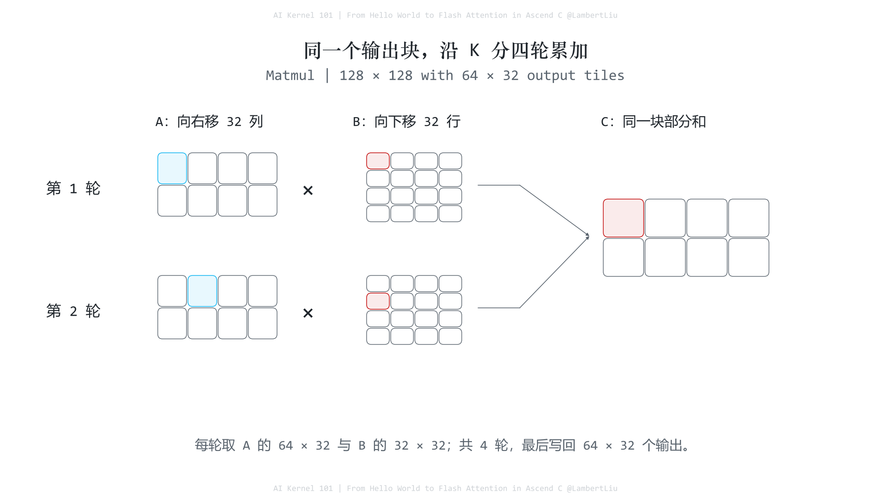
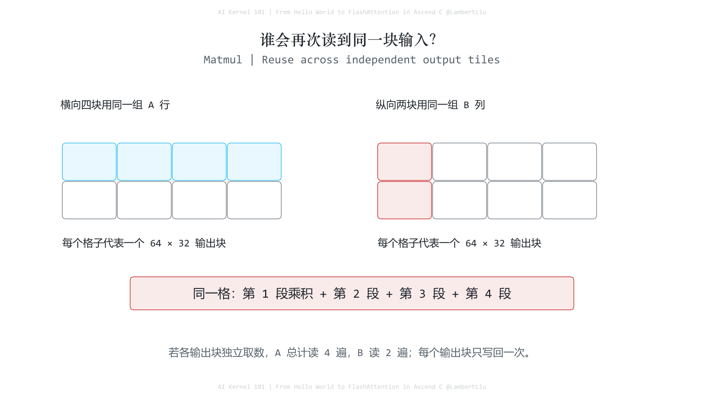
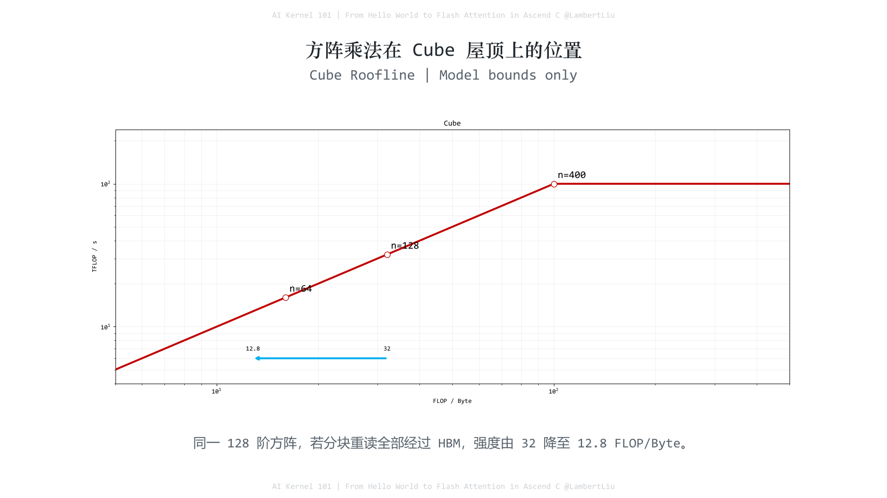

> 当前篇次为 09，文件名中的 07 保留早期路径；以[文章目录](../../docs/README.md)为准。

# 第 09 篇提纲：矩阵乘为什么快？理解 Cube 的数据复用

> 依据[系列计划](../series-plan.md)，承接第02篇硬件分工、第04篇分块与容量、第05篇依赖和计时。正文尚未展开，本提纲不承诺完成底层 GEMM 或高性能 Attention。

核心问题：矩阵乘的性能为什么依赖分块、布局和复用，不能直接照搬向量加的数据组织？

中心论点：Cube 的计算能力需要合适的输入组织与供数才能利用；复用、累计生命周期及任务规模共同约束实际效率。

前置知识：矩阵乘法、地址与存储、Block／Tile。第07篇的归约不作为独立 Matmul 的硬前置，但两者共同支撑第14篇。

# 一、一个输出是点积，一块输出却能共享输入

固定 A∈R^(M×K)、B∈R^(K×N)、C=AB∈R^(M×N)，先只讨论无 bias、不读取旧 C 的基本乘法。写出 c_ij=Σ_k a_ik b_kj，从一个元素扩展到输出块，指出 A 的元素可沿 N 方向复用，B 的元素可沿 M 方向复用。

按一次乘加计 2 FLOPs，工作量主项为 2MNK；这不意味着每个形状都能达到相同吞吐。题目中的“快”是待解释的能力与条件，不是所有 Matmul 必然快的结论。

配图：一块输出对应两块输入，标出输入被哪些输出共享。衔接到如何用有限片上空间保留这些机会。

# 二、M/N 分块与 K 分段，职责不同

## 2.1 输出划分与输入覆盖

选取 BM×BN 输出块，输入块为 BM×BK 与 BK×BN。M/N 方向决定产生哪些输出，K 方向决定同一输出还缺哪些贡献。不同输出任务可独立计算，但同一输出的 K 部分和需要正确合并。

## 2.2 部分和的生命周期

手算例子：向量 [1,2,3,4] 与 [5,6,7,8] 的点积为 70；前两项贡献 17，后两项贡献 53。把 K 分成两段后，要得到 17+53，而不是用第二段覆盖第一段。

推广成 C_tile=Σ_t A_tile,t B_t,tile，说明首次初始化、后续累计与最后写回的边界。Matmul 高阶 API 可能内部完成 K 分段；不要求为了展示原理而在 Host 发起大量小 Matmul。

## 2.3 输入、部分和与缓冲份数预算

按 dtype 分开计算 BM×BK、BK×BN、BM×BN 的存储需求，再计各层副本、对齐、内部 workspace 和双缓冲份数。L1、L0A/B/C、UB、GM 不合成一个总容量池，每项必须在其实际位置检查。

这些是模型与生命周期设计；具体片上路径以目标架构和接口为准。衔接：即使元素集合选对，物理排列也可能尚不满足计算要求。

# 三、数学转置、物理布局与数据路径

区分 Bᵀ 的数学索引关系与实际内存是否发生转置；接口 transpose 标志、stride 与布局必须一起解释。用行主序与分块布局的自绘示意说明地址关系，不展开所有分形格式或完整底层指令。

以选定目标架构画 GM、L1、L0A/B、Cube、L0C 和输出位置的主要路径，记录哪些转换由高阶 API 承担。高阶接口减少用户代码，不代表没有搬运、内部缓冲或等待。

图示与接口版本：**待核对后定稿。** 保留产品、SoC、编译目标与软件版本分别登记，不将其他代际直达通路画入当前目标。

# 四、最小 Matmul 基线：预留实现位置

## 4.1 先冻结输入输出契约

**待核对。** 从一种规则 shape、连续布局、无转置或明确转置约定开始，优先考察 FP16 输入与 FP32 累计；最终输出 dtype 依接口确认后固定。声明首版不支持的尾块、任意 stride 或其他 dtype，不编造支持集合。

## 4.2 Host Tiling 与 Device Matmul

**待实现。** 使用主环境实际支持的高阶 Matmul API，解释 Tiling 信息、workspace 大小与分配、执行及取回结果的生命周期。正文只保留维系因果关系的片段，完整构建、ACL 检错和代码放 lab。

## 4.3 输入布局、转置和 K 累计检查

**待实现／待验证。** 用能定位行列错误的确定性输入检查转置和地址，再用 K 跨多个内部块的用例检查累计与最终输出。若接口不暴露内部部分和，就检查可观测结果和源码契约，不伪造内部状态采样。

# 五、正确性和形状性能：预留实验位置

## 5.1 CPU 参考与误差标准

**待实现。** 以实际 dtype 输入提升到高精度计算参考；记录输入、累计与输出精度。先固定误差判据，另查非预期 NaN/Inf，不把普通 Add 的逐位相等标准直接沿用到矩阵乘。

## 5.2 规则、狭长与边界形状

**待选定／待验证。** 在已支持的输入集合内选小矩阵、规则较大矩阵、较小 M 或 N 的狭长矩阵，以及需要检查 K 累计的形状；非整除和非对齐形状仅在确认接口契约后纳入。M/N/K 任一为零时由 Host 契约决定返回或拒绝，不盲目启动。

## 5.3 相同口径下的耗时与吞吐

**待测。** 沿用第05篇的计时规则，记录 2MNK / Kernel 时间对应的有效浮点吞吐、波动和原始数据。不同 shape 的复用、任务数、布局转换与启动占比可能不同，不能只按 FLOPs 归一化后就断言同样高效。

| M/N/K、dtype、布局 | 正确性误差 | Kernel 耗时与波动 | 有效吞吐 | 已知限制 |
| --- | --- | --- | --- | --- |
| 待选定 | 待验证 | 待测 | 待计算 | 待分析 |

## 5.4 复用模型与实测是否相符

理论上若 A/B 各读一次、C 写一次，逻辑 GM 字节数为 sA·MK+sB·KN+sC·MN，sA/B/C 分别是各 dtype 字节数。分块重读、缓存、布局、workspace 和实际物理流量另计。用模型提出假设，不以其代替 profiler 流量。

**待分析。** 根据测量选择少量 Tile 或调度对照，不预设最佳块大小，也不把低吞吐单独归因于 Cube 能力。

# 六、给 Attention 预留接口检查，不把它当作已完成融合

第14篇会使用两种矩阵形状：Q_i 为 Br×d，K_j 为 Bc×d，因此 Q_i K_jᵀ 为 Br×Bc；未归一化权重 E_ij 为 Br×Bc，乘 Bc×dv 的 V_j，得到 Br×dv 的输出贡献。这里的数学形状先明确，实际布局与类型转换随后核对。

## 6.1 Cube 输出到 Vector 消费

**待核对／待实现／待真机验证。** 记录输出位置、格式、取回模式与同步，追踪是否经 GM。LocalTensor 返回值不直接证明片上直达；单个 Kernel 包含两类计算也不自动证明数据全在片上。

## 6.2 Vector 结果作为第二次 Matmul 输入

**待核对／待实现／待真机验证。** 记录 E 的转换精度、输入路径、缓冲生命周期与容量。不能用第一次 Matmul 正确替代第二次接口能力验证。

| 检查项 | 本篇应留下的材料 | 当前状态 |
| --- | --- | --- |
| 结果位置与实际中转 | 明确地址空间和数据路径 | 待核对／待验证 |
| 布局与输入／累计／输出 dtype | 两次 Matmul 的契约与转换 | 待固定 |
| 同步、临时空间与缓冲复用 | 依赖图与容量清单 | 待实现／待验证 |
| 对第15篇路线的影响 | 可行路径、限制与待决策项 | 待分析 |

如果只能通过 GM 交接，就如实记录所选路径，不把分离基线冒充目标片上融合；也不据此推断该芯片不能实现高性能 Attention。是否调整第15—16篇原定范围，由作者结合证据决定。

# 七、构件齐备之后，重新看中间矩阵

结尾回到复用：矩阵乘的计算效率来自数据组织与硬件资源共同作用，换一个 shape 或接口路径，就需要重新检查约束。

本篇之后先以 Conv2D、Roofline、Quantization 和 Fusion 建立映射与性能方法。第14篇再把第07篇的稳定 Softmax 与两次矩阵乘组成 Attention，追问：最终只要 O，为什么要保存完整分数和概率？这里不提前展开 m/l/u 递推。

# 写作与资料检查

- 必需产物：复用与部分和示意、各层容量表、Matmul 基线、误差与形状对照、融合接口检查记录。可复用的 Lab02 基线与证据见下文；本篇新增实现及实验待完成。
- 资料入口：[Matmul 配置与缓存说明](https://asc.gitcode.com/api/SIMD-API/adv_api/cube_compute/Matmul_Kernel/MatmulConfig.html)、[GetTensorC 输出与同步接口](https://asc.gitcode.com/api/SIMD-API/adv_api/cube_compute/Matmul_Kernel/GetTensorC.html)。查到在线资料不代表当前 CANN/SoC 已支持，需要固定版本并实际核查。
- [现有固定 shape Attention 示例](../../lab/flash-attention-fixed/README.md)可以作为候选代码素材；它的 CPU 参考通过不能替代本篇 Matmul 的 NPU 结果，也不能继承上游性能声明。
- 本提纲不改代码、构建或历史结果，不生成待测结果数字，不承诺手写完整底层 GEMM。

# 从第 02 篇保留的研究材料

以下保存第 02 篇收敛前的推导，供本篇结构设计与写作复用。原有提纲保留；其中“待实现／待测”指本篇尚未完成的扩展，已有规则方阵基线应优先复用 Lab02，避免重复实现。本文仍处于提纲阶段。

## 已有证据与待补边界

- [Lab02 源码与复现入口](../../lab/hardware-dataflow/README.md)、[实验设计](../../lab/hardware-dataflow/experiment-plan.md)、[真机报告](../../lab/hardware-dataflow/reports/npu-report.md)是代码、方案和执行记录的权威入口。本材料不复制或改写原始结果。
- **M0 已执行**：两种输出块、两种方阵尺寸及五类输入通过检查。实际 K 基础块覆盖整个 K，不能把 M0 说成已验证多段累计；FP32 输出探针也不足以独立证明完整累计机制。
- **M1 已执行**：规则方阵规模扫描通过随机正确性检查，其中 512／1024 阶配置的实际 K 基础块为 256，补充多段累计的结果检查。狭长、尾块、任意布局和融合接口仍需本篇另行验证。
- **M2 已执行**：512 阶、输出块 32／64 的事件中位耗时为 28.286／13.708 微秒，profiler 为 28.560／13.940 微秒；实际 K 基础块也从 512 改为 256。不能把差异单独归因于输出块大小或流量下降。17／9 MiB 是下面的逻辑请求模型，尚非 HBM 实测字节量。
- **M3 已执行**：可作为后续同 dtype 库对照入口，计时差异和峰值核对见 [第 11 篇研究材料](11-roofline-研究材料.md)。

## 图与资料的复用

原图 9、10 分别承担分块过程与重读解释，源文件和编号保持不动；下文保留引用。原图 11 及假设设备的交点推算归入第 11 篇研究材料，下文保留原段落以维持完整推导上下文，不表示第 09 篇必须再次展开 Roofline。图源入口为[第 02 篇配图规划](../../docs/assets/figures/plans/02-hardware-dataflow.md)。所有容量式均为逻辑有效负载，不能当成某一 API 的实际缓冲分配证明。

## 原稿：输入块与复用次数

选择一块 $B_M\times B_N$ 的输出，并沿求和维度取长度为 $B_K$ 的输入片段，需要配套的两块输入分别为 $B_M\times B_K$ 和 $B_K\times B_N$ 。在这一块计算中，一个左矩阵元素可参与 $B_N$ 个输出，一个右矩阵元素可参与 $B_M$ 个输出。

## 原稿：分块、容量与流量推导

以下原稿中的“前面”“图 9”等沿用原文语境，假设设备参数不是真机规格。“正文分析待回填”是保留段落的历史状态；已执行情况以上述证据清单和报告为准。

## Matmul：复用机会怎样改变模型，又怎样被实现限制

### 从输出元素到部分和的存储位置

以两个 128 行、128 列的矩阵相乘为例，结果也有 128 行、128 列。输入用 FP16，累加和输出用 FP32，每个输出从零开始累加。

**先切输出，决定一个任务负责哪一块。** 每个任务负责输出中连续的 64 行、32 列。沿行方向能切出 2 份，沿列方向能切出 4 份，整个输出共有 8 块。以左上角那块为例，按下标从 0 算，它覆盖第 0 到 63 行、第 0 到 31 列。要算这块里的所有元素，只会用到左矩阵的这 64 行和右矩阵的这 32 列。

**再切求和维度，决定这个任务每轮读什么。** 刚选出的每一行和每一列都包含 128 个待配对的数，每轮先处理其中 32 对。第一轮从左矩阵选中的 64 行取前 32 列，从右矩阵选中的 32 列取前 32 行。两块相乘，为输出块的每个位置算出一份部分和。第二轮把左矩阵的取数窗口向右移 32 列，把右矩阵的窗口向下移 32 行，乘积仍加到**同一块输出**上。共做 4 轮，每个输出元素才累加完全部 128 项。

*图 9　输出分成两行四列。沿 K 移动输入窗口，四轮乘积累加到同一块。*

在本文限定的数据路径中，每轮的两个输入块经 GM、L1 分别送入 L0A 和 L0B，供 Cube 做矩阵乘加。L0C 保留同一输出块的部分和，直到最后一轮结束。实际输出与格式转换需按所选接口核对。[Matmul 缓存与调度配置](https://asc.gitcode.com/api/SIMD-API/adv_api/cube_compute/Matmul_Kernel/MatmulConfig.html)

### 先算理想流量，再算具体分块的流量

把左矩阵记为 $A$ ，形状为 $M\times K$ ；右矩阵记为 $B$ ，形状为 $K\times N$ 。输出 $C=AB$ 共有 $MN$ 个元素，每个元素沿求和维度处理 $K$ 对输入。按每次乘加计两次浮点操作，运算量约为 $2MKN$ 。

先假设每个输入只从 GM 读一次、输出只写一次。两个输入分别有 $MK$ 和 $KN$ 个 FP16 元素，每个占 2 字节；输出有 $MN$ 个 FP32 元素，每个占 4 字节。由此得到理想流量

$$F_{\mathrm{mm}}\approx2MKN,\qquad Q_{\min}=2MK+2KN+4MN.$$

这里的运算量不扣除从零初始化等细节。对方阵 $M=N=K=n$ ，有 $Q_{\min}=8n^2$ ，于是 $I_{\mathrm{ideal}}\approx n/4$ 。

| 用例 | 约定运算量 | 理想逻辑流量 $Q_{\min}$ | 理想强度 |
| --- | ---: | ---: | ---: |
| $n=64$ | $524288$ FLOP | $32768$ Byte | $16$ FLOP/Byte |
| $n=128$ | $4194304$ FLOP | $131072$ Byte | $32$ FLOP/Byte |

接着把图 9 的分块方式写成一般形式。每个输出块有 $B_M$ 行、 $B_N$ 列，每轮沿求和维度取 $B_K$ 对输入。第 $t$ 轮的左输入块记为 $A_{\mathrm{tile},t}$ ，形状为 $B_M\times B_K$ ；右输入块记为 $B_{t,\mathrm{tile}}$ ，形状为 $B_K\times B_N$ 。各轮乘积累加到同一块输出

$$C_{\mathrm{tile}}=\sum_t A_{\mathrm{tile},t}B_{t,\mathrm{tile}}.$$

若 L1 每次只保存一轮的两个 FP16 输入块，L0C 保存一块 FP32 部分和，逻辑有效负载分别为

$$C_{\mathrm{L1,input}}=2B_MB_K+2B_KB_N,\qquad C_{\mathrm{L0C}}=4B_MB_N\quad[\mathrm{Byte}].$$

图 9 中， $B_M=64$ 、 $B_N=32$ 、 $B_K=32$ ，对应 L1 输入共 6 KiB、L0C 部分和 8 KiB。L0A 与 L0B 还分别需要对应操作数空间。各存储层级要分别核对容量、布局和对齐要求，双缓冲、填充、临时空间及框架预留另计。

上表把每个输入元素只算了一次。可在图 9 的例子里，把一个 128 阶方阵的输出切成 $64\times32$ 的块后，光是顶上一排就有 4 个输出块。算左上角那块，要用到 $A$ 的前 64 行。接着算它右边那块，换的是 $B$ 的列，用的还是 $A$ 的前 64 行。如果每个任务都从 GM 自己取数，这些行就要读 4 遍。同理，左边一列有上下两个输出块，都要用到 $B$ 的前 32 列，所以这些列要读 2 遍。

把这个数法推广到任意矩阵。设 $M$ 是 $B_M$ 的整数倍， $N$ 是 $B_N$ 的整数倍，这样输出恰好排成 $M/B_M$ 行块、 $N/B_N$ 列块。每个任务算一个输出块，分轮读完所需的输入，把部分和留在片上，最后写回结果。整个矩阵乘法向 GM 请求的字节数由三项相加得到。

| 数据 | 怎样数读写次数 | 总字节数 |
| --- | --- | ---: |
| 读左矩阵 $A$ | 每个元素都用于同一行块里的全部 $N/B_N$ 个输出块，各读一次。 $A$ 有 $MK$ 个 FP16 元素，每个 2 字节。 | $2MK\times(N/B_N)$ |
| 读右矩阵 $B$ | 每个元素都用于同一列块里的全部 $M/B_M$ 个输出块，各读一次。 $B$ 有 $KN$ 个 FP16 元素，每个 2 字节。 | $2KN\times(M/B_M)$ |
| 写输出 $C$ | 每个元素算完才写回一次，共 $MN$ 个 FP32 元素，每个 4 字节。 | $4MN$ |

$$Q_{\mathrm{tile}}=2MK\frac{N}{B_N}+2KN\frac{M}{B_M}+4MN.$$

*图 10　独立输出块重复读取输入，每个输出块沿 K 保留自己的部分和。*

代回图 9： $A$ 和 $B$ 各占 32 KiB， $C$ 占 64 KiB。左矩阵读 4 遍，右矩阵读 2 遍，输出写 1 遍，合计 $4\times32+2\times32+64=256$ KiB。这里用不到 $B_K$ ：它决定每轮取多长的一段，而同一个任务沿 $K$ 取完所有段，刚好把自己需要的输入读了一遍。如果实现把部分和也写回 GM，或者让相邻输出块共用已经装入的输入，就要按实际的读写次数重新计算。

若输入是边长为 $n$ 的方阵，输出块也是边长为 $b$ 的方块，两个输入就各读 $n/b$ 遍。把两项输入流量与一次输出写回相加，再用运算量 $2n^3$ 除以总字节数，得到分块后的算术强度。

$$Q_{\mathrm{tile}}=\frac{4n^3}{b}+4n^2,\qquad I_{\mathrm{tile}}\approx\frac{nb}{2(n+b)}.$$

当 $b$ 固定、 $n$ 增大，强度趋近 $b/2$ ，不会像理想模型那样无限按 $n/4$ 增长。例如 $n=128,b=32$ 时， $Q_{\mathrm{tile}}=327680$ Byte，强度为 $12.8$ FLOP/Byte；若只报理想值 $32$ ，就掩盖了实现中的重读。缓存可能降低实际 HBM 流量，所以这仍是逻辑请求模型，不是物理传输实测。

假设 HBM 每秒能传输 $1\ \mathrm{TB}$ ，Cube 每秒最多能完成 $100\ \mathrm{TFLOP}$ 。要让 Cube 按这个速度计算，平均每从 HBM 搬运 1 字节，就得用它完成 100 次浮点运算。这就是图 11 中带宽斜线与计算水平线相交的位置，横坐标为 $I_*=100\ \mathrm{FLOP/Byte}$ 。

先按理想情况算：两个输入各从 HBM 读一遍，结果写回一遍。边长为 64 的方阵每搬运 1 字节能做 $64/4=16$ 次浮点运算。即使带宽用满，每秒也只够支撑 $16\ \mathrm{TFLOP}$ 的计算。边长增至 128，这个上限随之升到 $32\ \mathrm{TFLOP/s}$ 。图上这两个位置都在交点左边：Cube 还有计算余力，但 HBM 每秒能送来的数据有限。

把理想强度 $n/4$ 代入交点条件 $n/4=100$ ，才得到 $n=400$ 。这里假定输入只读一遍。还拿边长 128 的方阵来说，如果按边长 32 分块，并且每次重读都要访问 HBM，那么强度就从 32 降到 12.8 FLOP/Byte，在图上向左移。真机上，缓存能省掉多少次 HBM 读取，决定了横坐标；同样多的运算用了多长时间，决定了纵坐标。可并行的任务太少时，即使强度很高，吞吐也可能远低于屋顶。

*图 11　假设设备上的 Cube Roofline。三个空心点均为理论上限。*

### 把输出块做大，矩阵乘法就会更快吗？

用同一对边长 512 的方阵做两次乘法。第一次每块算 $32\times32$ 个输出，第二次改成 $64\times64$ ，两次做的乘加总数一样。假设每块都单独读取所需输入，手算的读写量会从 17 MiB 降到 9 MiB。先数实际实现为各块读取了多少数据，再测两次各花多长时间。

大块让输入有更多机会重复使用，但可分给各个核的输出块也从 256 个减到了 64 个。若程序确实少读了数据，耗时却没有下降，就要看实际有多少核在工作、缓存替两种实现各省了多少次显存读取。再换几个矩阵尺寸重复比较，就能看出这种现象出现在哪些规模上。

> 已完成 Matmul 真机检查、规模扫描、分块与 ACLNN 对照。实际 K 基础块由接口调整，结果与限制见[真机报告](../../lab/hardware-dataflow/reports/npu-report.md#lab02-m0)，正文分析待回填。完整方案见 [实验设计 Lab02-M0—Lab02-M3](../../lab/hardware-dataflow/experiment-plan.md#matmul验证理想复用与分块重读)。
