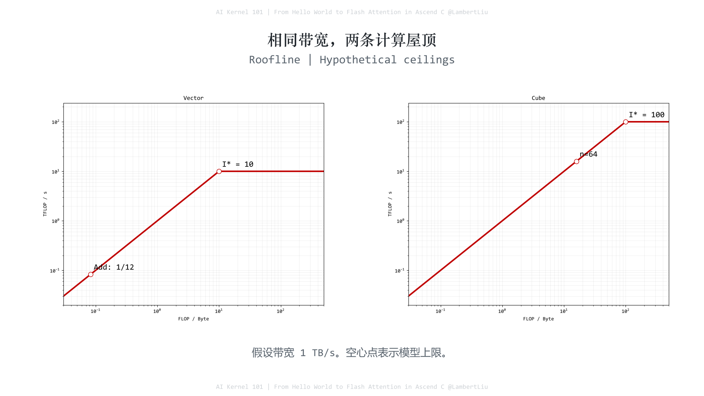
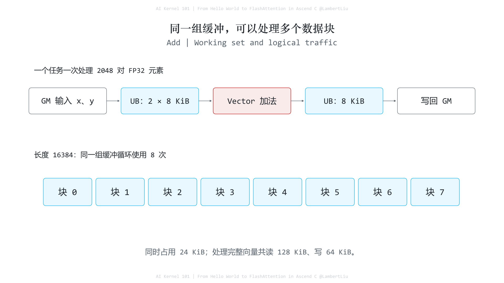
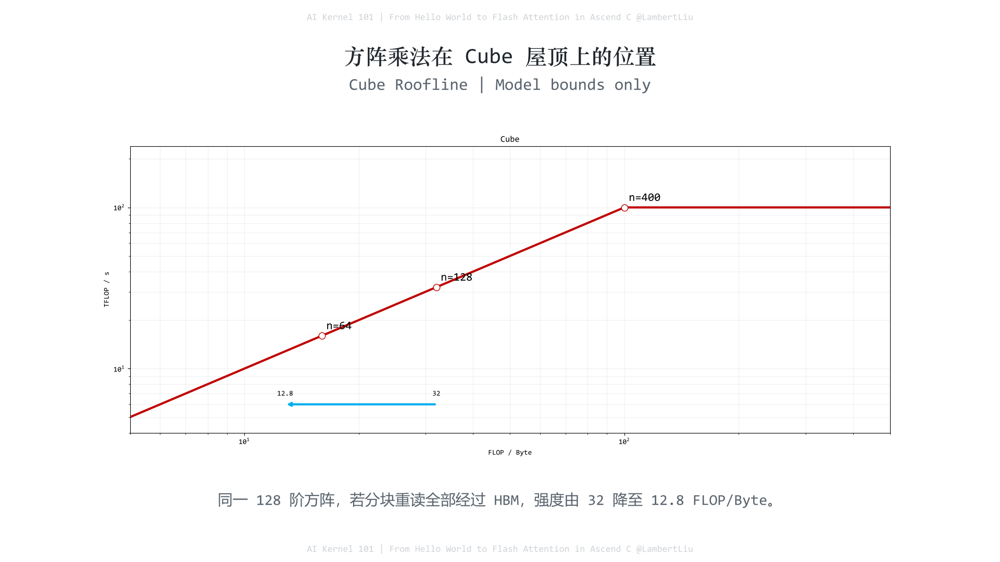

# 第 11 篇：Roofline 研究材料

本文件保留第 02 篇收敛时移出的模型和实验问题，服务[第 11 篇规划](../series-plan.md#11-roofline为什么算力翻倍kernel-却不一定更快)。它不表示本篇新增实验已执行，也不替代 [Lab02 真机报告](../../lab/hardware_dataflow/reports/npu-report.md)。报告中的“正文待回填”和图 12 待完成属于当时的交付范围；当前第 02 篇只使用 A1、A2、M0、M1 的代表性观察，不再要求完整性能曲线。

## 知识与证据分工

| 去向 | 可复用内容 | 证据与尚未解决的问题 |
| --- | --- | --- |
| 第 04 篇 | Add 每任务容量、长度与任务数的区别；原图 8 | A1／A2 已运行，完整任务扫描可复用；不要将任务数直接当成活跃核数 |
| 第 09 篇 | 输出分块、K 分段、容量和重读公式；原图 9—10 | 见[现有 Matmul 提纲及迁入材料](07-矩阵乘与数据复用-提纲.md)；M2 同时改变输出块和实际 K 基础块 |
| 第 11 篇 | Roofline 交点、逻辑／物理强度、原图 11；原图 12 的实验图表设计 | A1—A3、M1—M3 已运行；设备峰值、HBM 计数解释和因果判定未完成 |

## 计量与解释清单

- A1／A2 的事件折算时间包含可能的主机提交间隙；规模或任务数变化只能直接支持时间变化的观察。固定开销的构成、带宽是否饱和需要独立证据。
- A3 的单组／轮换地址下，Add 事件时间为 25.475／46.906 微秒，profiler 为 25.841／47.491 微秒。地址覆盖变化与变慢并存，仍不足以量化缓存命中率或确认 HBM 饱和；maximum 的实现与调度也不同。
- M2 的 17／9 MiB 是独立输出块读取模型。缓存、接口实际 K 分段及内部搬运策略需要分开核查，不把模型流量当计数器结果。
- M3 的 256 阶 ACLNN 事件时间为 25.114 微秒，profiler 为 7.580 微秒，需解释提交和计时边界后再比较。设备同精度稠密峰值尚未核实，不用观测吞吐倒推规格。
- 报告中的 HBM 系统采样包含初始化、回传、主机校验间隔；main_mem／L2 字段的事件定义、汇总和分母仍待核对。`hbm_bytes` 为空，不可补写单次物理字节量。
- 第 11 篇自己的跨算子验证方案仍未执行。Lab02 已有证据可以复用，不能替代新增算子、形状和计量口径的验证。

完整输入、误差判据和计时样本见[实验设计](../../lab/hardware_dataflow/experiment-plan.md)、[真机报告](../../lab/hardware_dataflow/reports/npu-report.md)及[复现入口](../../lab/hardware_dataflow/README.md)。

## 原稿保留：Roofline 基本模型与假设参数

以下推导沿用原稿假设，并非设备实测规格。来源链接、公式及图引用保留。

## 先建立共同的性能尺度：Roofline 怎样读？

把一次 Kernel 的浮点运算次数记为 $F$ ，单位 FLOP；选定存储边界的搬运量记为 $Q$ ，单位 Byte。每次加法计一次浮点运算，乘加计两次；算术强度（Arithmetic Intensity）是：

$$I=F/Q\quad[\mathrm{FLOP/Byte}].$$

这里必须先问清“字节从哪里经过”。源码中对 GM 发起的逻辑读写，与外部高带宽内存（High Bandwidth Memory，HBM）实际传输的物理字节量，不是同一个数；缓存命中、重复读取、事务粒度和布局转换都会造成差别。后文用 $Q_{\mathrm{logical}}$ 表示逻辑计数， $Q_{\mathrm{HBM}}$ 表示需要计数器核对的物理流量，不把二者混用。

设所选精度和计算路径的吞吐上限为 $P_{\max}$ ，单位 FLOP/s；选定边界的带宽上限为 $B_{\max}$ ，单位 Byte/s。即使搬运与计算能够理想重叠，执行时间仍有下界：

$$t\ge\max\left(\frac{F}{P_{\max}},\frac{Q}{B_{\max}}\right).$$

代入 $P=F/t$ ，得到屋顶线模型（Roofline Model）的基本形式：

$$P\le\min(P_{\max},B_{\max}I).$$

这是一条性能上界，而不是运行时间的等式。Roofline 将数据局部性、带宽与计算吞吐放在一起考察；模型背景见 [Berkeley Lab 的 Roofline 说明](https://amcr.lbl.gov/departments/computer-science-department/ppan/roofline-performance-model/)，原始推导见 [Williams、Waterman 与 Patterson 的技术报告](https://www2.eecs.berkeley.edu/Pubs/TechRpts/2008/EECS-2008-134.html)。

在横轴为 $I$ 、纵轴为 $P$ 的双对数图上， $P=B_{\max}I$ 是向右上方延伸的带宽斜线， $P=P_{\max}$ 是水平的计算屋顶。两线交点对应的强度为：

$$I_* = P_{\max}/B_{\max}.$$

当 $I<I_*$ ，带宽项给出的上界更低，减少字节数或提高有效带宽更值得关注；当 $I>I_*$ ，计算项的上界更低，需要关注计算资源利用。但一个点远低于两条线，可能是启动、同步、并行度或供数问题，不能仅凭它在交点哪边就宣布找到了实测瓶颈。

为便于手算，**假设**某设备对应边界的带宽为 $1\ \mathrm{TB/s}$ ，Vector FP32 路径上限为 $10\ \mathrm{TFLOP/s}$ ，Cube 的 FP16 输入、FP32 累计路径上限为 $100\ \mathrm{TFLOP/s}$ ，均按十进制单位计。两个交点分别是 $10$ 与 $100\ \mathrm{FLOP/Byte}$ 。

> [!NOTE]
> 注意，以上这组数字只用于方便计算和读图，既不是昇腾规格，也不是本文测量真实值。

因此，Add 与 Matmul 不能共用一个未经区分的“整卡峰值”。核数范围、精度、稠密／稀疏模式、计算路径及带宽读写口径必须匹配。HBM 带宽屋顶只能配 HBM 流量；若只有逻辑字节计数，就先报告逻辑有效吞吐，不能把它当成物理 HBM 带宽利用率。

*图 7　共享强度刻度下的 Vector 与 Cube 理论屋顶。*

## 原稿保留：Add 容量、流量及完整实验设计

以下“待回填”等表述保留原稿语境；七项实验已经执行，当前解释状态见本文件开头。

## Add：从一行公式，推到容量与搬运约束

### 数学语义怎样变成数据路径

向量加法按相同位置配对两个输入，结果写入独立的输出数组。每个任务负责其中一段，先把 GM 中的两个输入片段搬入 UB，交给 Vector 相加，再把结果从 UB 写回 GM。

任务在 UB 中分别准备输入缓冲和结果缓冲。输入搬完才能计算，计算完成才能写回；当前数据使用完毕后，这些缓冲可以继续处理下一段。向量较长时，任务通过分块循环完成计算，搬运、计算和缓冲复用之间的依赖由同步保证。

### 流量计数与理论值

设向量长度为 $L$ ，每个任务一次处理 $T$ 个元素，两个输入与输出均为 FP32，且互不覆盖。每个元素占 4 字节，两块输入缓冲和一块结果缓冲所需的 UB 有效负载为

$$C_{\mathrm{UB}}=3T\times4=12T\ \mathrm{Byte}.$$

[现有基础样例](../../lab/vector_add/src/00_basic/add.cpp)取 $T=2048$ ，对应每个任务 24 KiB 的缓冲申请量，框架预留另计。固定分块大小时，向量越长，要处理的块越多，每个任务所需的缓冲容量不变。

假设输入各读一次、输出写一次，没有额外复制。算完整个向量，所有任务合计从 GM 读入 $8L$ 字节、写回 $4L$ 字节，完成 $L$ 次加法。因此，逻辑流量与算术强度为

$$F_{\mathrm{add}}=L,\qquad Q_{\mathrm{logical,add}}=12L,\qquad I_{\mathrm{logical,add}}=\frac1{12}\ \mathrm{FLOP/Byte}.$$

| 用例 | 浮点运算量 | 逻辑 GM 字节量 | 三块 UB 缓冲 |
| --- | ---: | ---: | ---: |
| $L=16384,\ T=2048$ | $16384$ FLOP | $196608$ Byte | $24576$ Byte／任务 |
| $L=1048576,\ T=2048$ ，分块循环 | $1048576$ FLOP | $12582912$ Byte | $24576$ Byte／任务 |

*图 8　每个任务使用 24 KiB 缓冲；处理 16384 个元素共读写 192 KiB。*

假设上述逻辑读写全部经过 HBM，按前面设定的带宽 $1\ \mathrm{TB/s}$ 计算，每秒可传输 $10^{12}$ 字节。将带宽乘以算术强度，就得到带宽所允许的加法吞吐上限。

$$P_{\mathrm{BW}}=B_{\max}I=10^{12}\ \mathrm{Byte/s}\times\frac{1\ \mathrm{FLOP}}{12\ \mathrm{Byte}}\approx 8.33\times10^{10}\ \mathrm{FLOP/s}=83.3\ \mathrm{GFLOP/s}.$$

假设的 Vector 计算上限为 $10\ \mathrm{TFLOP/s}=10\,000\ \mathrm{GFLOP/s}$ 。两者取较低值，因此模型给出的上限约为 $83.3\ \mathrm{GFLOP/s}$ 。对于较长向量，实际吞吐能否接近这条带宽屋顶，还要通过实验验证。

### 实验验证

三个实验均使用 FP32 输入输出，每个任务一次处理 2048 个元素。先与主机参考结果逐位比较，再预热 20 次，测量 5 组、每组 50 次，记录耗时中位数和波动范围。输入上传与结果回传放在计时区间外。

- **Lab02-A1，改变向量长度。** 固定任务数，将长度从 2048 增至 16777216，选取多个规模分别计时。比较数据量与耗时的增长关系，再用逻辑读写量 $12L$ 除以耗时，观察短向量的固定开销与长向量的处理速度。

- **Lab02-A2，改变任务数。** 固定长度为 4194304，依次用 1、2、4、8 个任务及设备选定的任务数运行。比较耗时是否随任务数增加而下降，判断当前实现还有多少并行处理的余地。

- **Lab02-A3，改变地址复用方式。** 固定长度和任务数，先反复使用同一组数组，再轮换多组数组，使总覆盖量超过已核实的 L2 容量。比较两种方式的耗时，并用同样两读一写的 maximum 内核作流式参照；另行采集 HBM 相关指标，核对其含义后再判断缓存与显存供数的影响。

> 已完成 Add 真机正确性检查、长度与任务数扫描、地址轮换对照及性能采集。结果见[真机报告](../../lab/hardware_dataflow/reports/npu-report.md#lab02-a1)，正文分析待回填。完整输入、计时和反例判据见 [实验设计 Lab02-A1—Lab02-A3](../../lab/hardware_dataflow/experiment-plan.md#add验证容量流量与并行度)。

## 原稿保留：Cube 交点与分块重读

假设 HBM 每秒能传输 $1\ \mathrm{TB}$ ，Cube 每秒最多能完成 $100\ \mathrm{TFLOP}$ 。要让 Cube 按这个速度计算，平均每从 HBM 搬运 1 字节，就得用它完成 100 次浮点运算。这就是图 11 中带宽斜线与计算水平线相交的位置，横坐标为 $I_*=100\ \mathrm{FLOP/Byte}$ 。

先按理想情况算：两个输入各从 HBM 读一遍，结果写回一遍。边长为 64 的方阵每搬运 1 字节能做 $64/4=16$ 次浮点运算。即使带宽用满，每秒也只够支撑 $16\ \mathrm{TFLOP}$ 的计算。边长增至 128，这个上限随之升到 $32\ \mathrm{TFLOP/s}$ 。图上这两个位置都在交点左边：Cube 还有计算余力，但 HBM 每秒能送来的数据有限。

把理想强度 $n/4$ 代入交点条件 $n/4=100$ ，才得到 $n=400$ 。这里假定输入只读一遍。还拿边长 128 的方阵来说，如果按边长 32 分块，并且每次重读都要访问 HBM，那么强度就从 32 降到 12.8 FLOP/Byte，在图上向左移。真机上，缓存能省掉多少次 HBM 读取，决定了横坐标；同样多的运算用了多长时间，决定了纵坐标。可并行的任务太少时，即使强度很高，吞吐也可能远低于屋顶。

*图 11　假设设备上的 Cube Roofline。三个空心点均为理论上限。*

## 后续图表

[原配图规划](../../docs/assets/figures/plans/02-hardware-dataflow.md)中的图 12 设计可供本篇复用：分别展示 Add 规模／任务数和 Matmul 分块对照，区分模型线、实测点及波动。它尚未生成，不是第 02 篇的配图缺项。现有图 8、11 的图片及生成代码保留，正文使用时重新审核口径与图注。
