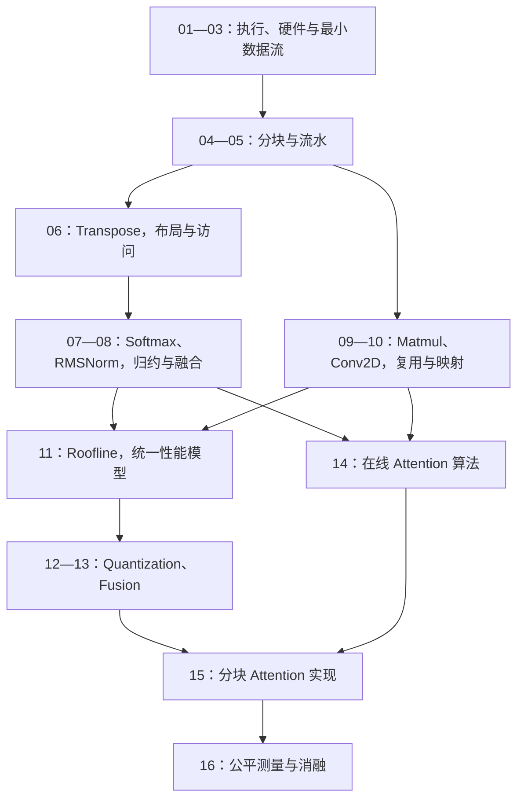

---
aliases:
  - 系列写作框架与计划
  - 专栏总计划
start_time: 2026-11-06
last_edit_time: 2026-11-18
description: 以总体系列五阶段、16 篇安排为准。另设专栏导读与配套实验
---
# 《AI Kernel 101：从 Hello World 到 FlashAttention》系列写作框架与计划

> 以 Ascend C 为实践载体，从第一性原理理解 AI Kernel 的设计与性能优化。

# 一、系列要交付什么

核心问题：工程师如何把张量公式变成运行在昇腾 NPU 上的算子，并解释它为何正确、为何快、何时会变慢？

中心论点：算子开发的主线是把计算映射到硬件的数据流与执行资源，再用模型和测量修正设计。API 是表达这种映射的工具。

系列按五个知识阶段递进：认识执行与硬件模型；理解访存、分块和流水；处理 Vector 归约与融合；建立 Cube 计算及通用性能设计方法；最后完成 FlashAttention 的在线算法、功能实现与性能验证。

每篇应解决一个主要问题，并让下一篇的问题自然出现。读者最终应能分析一个陌生算子的工作量、数据流、容量约束和主要瓶颈。

# 二、读者、前置知识与范围

主要读者：初步接触 AI Kernel 的 C/C++ 工程师，使用 Ascend C、CUDA、Triton 的算子开发者，希望理解瓶颈的推理与部署工程师；相关学生和希望进入 AI 系统性能领域的工程师为次级读者。必要前提按需解释，不扩展成计算机基础百科。

最低前置知识：数组与指针、矩阵乘法、指数函数、基本浮点误差概念，以及 Host/Device 的大致分工。Roofline 和流水并行在使用时做必要解释，不把熟悉完整性能工程知识体系设为入口门槛。

完成后应能：

- 根据算子的依赖关系设计数据划分和片上存储方案。
- 写出带有明确 shape、dtype 和布局约束的 Ascend C Kernel。
- 区分程序计算实现、仿真观察、性能预测和真机测量。
- 设计实验判断性能瓶颈，并解释优化的有效范围。
- 理解并复现一个范围受控的 FlashAttention 前向实现。

主线暂不纳入：完整 CANN 安装百科、所有 API 的分类介绍、SIMD/SIMT 全面比较、多种架构的全面适配、完整训练反向、多卡通信、Paged Attention、完整量化算子体系、生产级全 shape 调优。

量化的位置：02 用必要篇幅说明 dtype 对字节数、计算路径和误差的影响；12 再以实际支持的低精度 GEMM 路径讨论转换成本与精度／性能权衡，不扩展为完整量化体系。量化仍不是理解最小 Vector Add 的前置课程。

# 三、终点与实验环境先约定

最终交付限定为一个基于 FlashAttention 思路、范围明确且可复现的前向 Kernel，暂定范围如下：

| 维度     | 初始约定                              | 完成标准              |
| ------ | --------------------------------- | ----------------- |
| 数学语义   | scaled dot-product attention 前向   | 与明确的参考实现比较        |
| 张量形状   | Q/K/V 使用明确且固定的一种连续布局；优先自注意力       | 文档给出维度含义和地址计算     |
| dtype  | 从一种输入类型开始，优先 FP16；累计精度依目标接口能力确认   | 声明各阶段 dtype 与误差阈值 |
| mask   | 先 non-causal，再支持 causal           | 两种语义分别通过验证        |
| 序列与头维度 | 先验证一组规则 shape，再扩展若干边界 shape       | 支持集合明确，不宣称任意形状    |
| 排除项    | dropout、backward、GQA/MQA、稀疏与分页 KV | 不计入本季交付           |
| 性能目标   | 能解释相比分离基线的变化与适用范围                 | 无论提速或退化，都有可核对的测量  |

关键约束：不能把完整的 N×N 分数矩阵或概率矩阵写回 GM 后，再称作最终的 FlashAttention 实现。教学中可以先做这样的分离基线，但必须清楚标注。

性能目标不设未经实验支持的倍数，不承诺超过官方优化实现。最终报告同时列出支持范围、误差、耗时、中间存储与已知限制。

现有草稿记录了 CANN 9.1.0、CANNLab A3 与 dav-2201 等环境信息。这些是既有实验记录，正式写作前需重新核对设备型号、SoC、编译目标、软件版本和实际可用 API 的对应关系。选定一套能持续访问的主环境并固定版本；不为追随新版本而中途更换主线接口。

主线优先沿用已有 Vector 示例的 SIMD 路径。公开文档中存在不同编程范式和多代架构，引用时必须注明适用版本，不能把不同版本的能力拼接成同一设备的能力。官方资料入口见文末。

# 四、五个知识阶段与十六篇目录

系列一共规划十六篇文章，篇次用于推荐阅读顺序；已有文件路径、实验编号、实验结果和写作阶段不因扩展自动改变。

## 第一阶段：认识 NPU 与 Kernel 编程模型

建立硬件模型与数据流概念，运行环境 → 硬件结构 → 最小 Vector 数据流。

| 篇次  | 标题                              | 核心问题                  | 读者获得的能力            |
| --- | ------------------------------- | --------------------- | ------------------ |
| 01  | 没有昇腾 NPU，真的能写出第一个 Kernel 吗？     | 不同运行模式能证明什么？          | 区分运行路径与证据边界        |
| 02  | 同样是计算，NPU 为什么要区分 Vector 和 Cube？ | 为什么相似的公式需要不同的硬件映射？    | 建立算子分类与架构模型        |
| 03  | 只做一次加法，为什么还要搬来搬去？               | 数学表达如何变成 Block 内的数据流？ | 理解最小 Vector Kernel |

## 第二阶段：理解访存、分块与流水线

从规则访存进入复杂数据访问，容量与覆盖 → 流水重叠 → 布局和跨步访问。

| 篇次  | 标题                            | 核心问题               | 读者获得的能力           |
| --- | ----------------------------- | ------------------ | ----------------- |
| 04  | 数据放不下怎么办？从一个 Kernel 理解 Tiling | 如何让固定样例覆盖不同长度？     | 设计划分、容量与尾块策略      |
| 05  | Double Buffer 一定更快吗？用实验拆解计算流水 | 有双缓冲，为什么仍可能没有变快？   | 用实验判断流水优化是否成立     |
| 06  | Transpose：没有复杂计算，为什么数据重排仍然很慢？ | 连续与跨步访问为何可能产生不同耗时？ | 分析内存布局、非连续访问与分块重排 |

## 第三阶段：Vector 计算与归约融合

从 Reduction 走向多阶段计算，行内依赖 → 统计量、广播和多阶段数据流。

| 篇次  | 标题                            | 核心问题              | 读者获得的能力       |
| --- | ----------------------------- | ----------------- | ------------- |
| 07  | Softmax 为什么难并行？从 Reduction 讲起 | 行内依赖如何改变算子设计？     | 处理归约、稳定性与行级调度 |
| 08  | RMSNorm：为什么一次归一化需要反复访问数据？     | 如何组织统计量、广播和逐元素阶段？ | 设计归约融合与数值精度策略 |

## 第四阶段：Cube 计算与高性能算子设计

从计算密集到低精度与融合，矩阵复用 → 卷积映射 → 统一建模 → 低精度 → 融合边界。

| 篇次  | 标题                              | 核心问题              | 读者获得的能力                        |
| --- | ------------------------------- | ----------------- | ------------------------------ |
| 09  | 矩阵乘为什么快？理解 Cube 的数据复用           | 为什么矩阵乘不能照搬向量加？    | 理解矩阵分块、布局和计算效率                 |
| 10  | Conv2D：为什么滑动窗口计算可以变成矩阵乘法？       | 滑动窗口如何映射为可复用的计算？  | 比较 Direct Conv、im2col 与隐式 GEMM |
| 11  | Roofline：为什么算力翻倍，Kernel 却不一定更快？ | 如何从计算量和访存量建立性能上界？ | 统一计算强度、上界校准与瓶颈判断               |
| 12  | Quantization：数据精度减半，性能就能翻倍吗？    | 低精度的收益何时被转换开销抵消？  | 分析数据量、误差与计算路径的权衡               |
| 13  | Kernel Fusion：算子融合越多，性能就越好吗？    | 消除中间搬运何时被资源消耗抵消？  | 设计融合边界并解释性能退化                  |

## 第五阶段：从 Attention 走向 FlashAttention

最终综合实践，在线算法 → 功能实现 → 性能验证。

| 篇次  | 标题                                    | 核心问题                         | 读者获得的能力          |
| --- | ------------------------------------- | ---------------------------- | ---------------- |
| 14  | FlashAttention 为什么不需要保存注意力矩阵？         | 不保存完整矩阵，如何保持数学语义？            | 推导并验证在线 m/l/u 状态 |
| 15  | 从零拼出分块 Attention：Matmul、Softmax 与状态更新 | 如何把 Matmul、Softmax 与状态更新接起来？ | 实现功能闭合的前向 Kernel |
| 16  | FlashAttention 到底快在哪里？一次完整的性能分析       | 减少搬运和改善调度各贡献多少？              | 做受控优化与完整结果报告     |

## 知识依赖与阅读顺序



这张图表示能力汇合，不要求理解在线递推之前必须实现所有算子。第 14 篇的直接数学前置仍是第 07 篇的归约／稳定 Softmax、第 09 篇的矩阵形状与部分和，以及第 02／04 篇的存储和分块概念。Conv2D 和 Quantization 提供可迁移的映射与精度案例，不是数学推导的硬前置。

Roofline 模型采用“先用指标，再统一建模”的安排：第 02 篇保留理想 FLOPs／Bytes、基础强度与一幅上界示意，使用实验的代表性观察；03—05 逐步解释任务划分、逻辑搬运量及计时。详细 Matmul 分块推导归入第 09 篇，完整性能分析保存在[第 11 篇研究材料](outlines/11-roofline-研究材料.md)，后续统一上界校准、强度口径与多个算子的模型对照。

RMSNorm 的融合用于解释一行内部的统计量、广播和逐元素阶段；第 13 篇研究跨算子的 Matmul Epilogue、资源竞争和融合边界；14—16 才综合在线状态与 Cube／Vector 交接。三者的研究问题分别成立。

## 旧十篇与当前篇次映射

| 原篇次 | 当前篇次 | 稳定主题 |
| --- | --- | --- |
| 01—05 | 01—05 | Hello World、硬件、Add、Tiling、Double Buffer |
| 06 | 07 | Softmax |
| 07 | 09 | Matmul |
| 08 | 14 | 在线 Attention 推导 |
| 09 | 15 | 分块 Attention 实现 |
| 10 | 16 | Attention 性能分析 |

现有 Softmax、Matmul、在线 Attention 提纲文件名中的 06／07／08 是早期编号，保留路径以避免断链；文件元数据、标题与本目录使用新篇次。Lab01／Lab02 及其全部既有编号不变。后续新增实验在详细设计落实后再登记编号，不为规划卡片预建结果文件。

专栏导读与配套实验不计入 16 篇核心文章。新增篇章先在本计划中保存问题、论证路线与核心实验假设；尚未形成独立提纲的篇章在文章目录标为“—”，不生成空正文。

# 五、逐篇写作卡片

## 01 没有昇腾 NPU，真的能写出第一个 Kernel 吗？

**核心问题**：程序跑通究竟证明了什么？

**前置知识**：基本 C++ 和命令行操作。**中心论点**：应按证据需求选择运行模式；启动成功只是后续算子实验的起点。

正文递进：

1. 从“没有本地卡能否开始”切入，明确开发、功能验证、性能验证的不同目标。
2. 用最小 Kernel 解释 Host 发射、Device 执行、Stream 等待；配一张调用路径图。
3. 比较 CPU 调试、SIM 与真机的证据范围，配同一样例的运行记录。
4. 给出最小复现入口与环境记录，把长篇安装命令放入实验页。

证据与交付：一个可复现 Hello World、三类模式的记录及适用限制。打印顺序不用于推导硬件调度；仿真耗时不冒充真机耗时。

衔接：打印没有张量，也没有数据依赖。下一篇先建立承载真实计算的硬件模型。

## 02 同样是计算，NPU 为什么要区分 Vector 和 Cube？

**核心问题**：算子的计算结构如何决定它需要哪些硬件资源？

**前置知识**：01、向量和矩阵。**中心论点**：先看数据依赖和复用，再讨论资源映射；算子类别不等于固定的性能瓶颈。

正文递进：

1. 以 Add、Softmax、Matmul、Attention 四个公式建立 Element-wise、Reduction、Matrix、Fusion 四类问题；分类允许交叠。
2. 回应01的耦合／分离架构，用2201数据路径图解释 Scalar、Vector、Cube 与搬运单元及存储分工；以 Ampere A100 作组织层级对照，不建立硬件等价关系。
3. 分别说明 Add／Matmul 的基础数据路径与理想流量，用 A1／A2／M0／M1 的代表性结果检验简单外推；以一幅 Roofline 示意解释计算与带宽上界。任务划分、完整分块重读推导及实测瓶颈分析留到 04／09／11，不将耗时变化直接归因为某个底层机制。
4. 说明 dtype 改变字节数、误差与可用计算路径，量化作为这一问题的延伸。
5. 如需 CUDA 对照，以能力、调度、数据路径逐项比较，不用“Tensor Core 就是 Cube”等一句话建立等价关系。

第 14 篇反向检查补充：明确区分存储容量、逻辑搬运量与实测访存；中间张量变小不直接意味着总 IO 变为线性。

证据与交付：组织与数据路径图、算子分类表、可手算的 FLOPs/Bytes 对照及 [Add／Matmul 实验设计](../lab/hardware_dataflow/experiment-plan.md)与[插图规划及生成入口](../docs/assets/figures/plans/02-hardware-dataflow.md)。七项真机实验已运行并归档，02 已回填 A1／A2／M0／M1 的代表性观察，配图来源与版本仍待核对。A3／M2／M3 及完整性能计量问题转入后续材料，不改原始报告；具体资源参数引用对应架构资料。

正式证据按[第 02 篇精选报告](../lab/hardware_dataflow/reports/article-02.md)的三个场景组织：A1 三个长度与 A2 的 1／40 任务构成 Add 数据流；M0 基础正确性与 M1 的 64／512 阶构成 Matmul 数据流；第三场景综合 Vector／Cube，不新增 Kernel。A3／M2／M3 不再作为本篇核心论据。

衔接：先选择依赖最简单的 Add，把硬件模型落到可运行数据流。

## 03 只做一次加法，为什么还要搬来搬去？

**核心问题**：为什么 z=x+y 需要组织 GM、UB、搬运和依赖？

**前置知识**：02。**中心论点**：Kernel 的主体是有依赖的数据流，加法只是其中一个阶段。

正文递进：

1. 固定规则 shape 与 dtype，明确输入、输出和 Block 负责区间。
2. 区分地址绑定、局部存储申请与真实搬运，配 GM→UB→Vector→GM 数据流图。
3. 追踪一次迭代的读写依赖，解释所选同步原语实际保证什么；按目标版本重新审核现有代码。
4. 与参考结果比较，并计算理论工作量和逻辑 GM 流量。

证据与交付：最小正确 Add、数据流图、正确性记录。若采用 FP32 且每个输入只读一次、输出只写一次，则逻辑流量为 12N 字节，运算为 N 次加法；该估计不等同于实测物理访存量。

衔接：固定长度能成立，不代表任意长度和容量都能成立。

## 04 数据放不下怎么办？从一个 Kernel 理解 Tiling

**核心问题**：如何同时满足数据覆盖、容量限制和搬运约束？

**前置知识**：03。**中心论点**：Tiling 是数据覆盖、资源容量和调度开销之间的折中。

正文递进：

1. 用超过单次片上容量的输入解释分块必要性，区分核间划分和核内循环分块。
2. 推导 Block 与 Tile 的起点、长度和数量，证明覆盖完整且不重叠。
3. 根据同时存活的输入、输出、临时区和缓冲份数，推导容量预算。
4. 将尾块与对齐作为方案的边界检验，比较目标接口支持的处理方式。
5. 用若干长度验证正确性，再做小范围参数扫描，观察分块过大或过小的代价。

第 14 篇反向检查补充：区分逻辑有效元素与物理对齐补齐；Add 中不参与输出的补齐值，在归约中可能改变结果，不能无条件沿用。

已有证据：[Lab02-A2 完整任务数扫描](../lab/hardware_dataflow/reports/npu-report.md#lab02-a2)归本篇复用，第 02 篇仅展示 1／40 任务。该扫描支持固定实现下的任务数量观察，不能替代本篇尾块、容量与覆盖验证。

证据与交付：参数化 Add、覆盖关系图、容量表、边界用例；包括短输入、整除、非整除和非对齐情形。零长度行为需在 Host 接口契约中明确。

衔接：分块产生了重复的搬运与计算阶段，下一步才有讨论重叠的基础。

## 05 Double Buffer 一定更快吗？用实验拆解计算流水

**核心问题**：双缓冲为什么有时有效、有时无效？

**前置知识**：04。**中心论点**：缓冲和队列只是创造重叠条件，依赖关系、执行资源和任务规模共同决定收益。

正文递进：

1. 先建立测量口径：Kernel 耗时、完整调用耗时、Host↔Device 搬运耗时分别是什么。
2. 给出串行执行时间线；引入所选队列/同步机制，解释生产、消费与缓冲生命周期。
3. 构造双缓冲时间线，比较串行和理想重叠模型，交代预热、排空和资源竞争的假设。
4. 对照单缓冲与双缓冲，控制 shape、dtype、Tile 和其他变量，观察耗时与可用的 profiler 证据。
5. 扫描小、中、大输入，解释启动主导、带宽主导和重叠不足等不同现象。

证据与交付：两种实现、可复用基准方法、时间线、参数扫描结果。逻辑有效带宽应明确定义为逻辑字节数除以 Kernel 时间，不直接等同硬件总线带宽。

衔接：先把计算保持简单，观察同样的分块与流水在 Transpose 的跨步访问中是否仍有效；随后再进入 Softmax 的行内依赖。

## 06 Transpose：没有复杂计算，为什么数据重排仍然很慢？

**核心问题**：计算量很少时，为什么连续访问与跨步访问仍可能产生显著耗时差异？

**前置知识**：03—05。**中心论点（待验证）**：有效带宽与访问布局、分块重排和任务组织共同相关，减少算术操作本身不足以解释数据重排性能。

正文递进：

1. 固定二维转置的数学语义与输入输出布局，画出一个元素的源地址和目标地址；区分改变视图与实际搬运。
2. 用朴素方案展示“读连续、写跨步”及其反向安排，计算逻辑读写量。
3. 用片上分块重排组织连续搬运，说明 Tile 容量、对齐、边界与附加同步。
4. 比较不同形状与 Tile 的耗时，检查重排开销或并行度是否抵消访问改善，再讨论双缓冲是否有可观察收益。

**核心性能假设**：在相同语义、dtype、任务配置与输入地址条件下，分块方案可能改善跨步访问造成的有效带宽损失；小输入或片上重排成本较高时可能不成立。

**实验骨架（未执行）**：朴素转置与分块转置作主对照；输入覆盖方阵、长宽不对称矩阵和合法的非整除边界，具体尺寸随目标接口确认。先逐元素检查输出，再记录逻辑字节量、设备耗时、有效带宽与可取得的访存指标。形状、Tile 或流水对照一次只改变一个主要变量；若耗时差异落在波动范围内，不宣称访问优化有效。

衔接：访问方式已经改变数据到达计算单元的代价，Softmax 再引入整行统计依赖。

## 07 Softmax 为什么难并行？从 Reduction 讲起

**核心问题**：如何兼顾行内归约、数值稳定和片上容量？

**前置知识**：04—06、指数函数。**中心论点**：Softmax 的设计难点在于整行依赖与局部存储之间的矛盾。

正文递进：

1. 从逐元素到求最大值、求和，解释归约如何改变并行方式。
2. 推导减最大值的稳定 Softmax，明确归约轴和数值含义。
3. 先实现一行能放入片上的版本，画出 max→exp→sum→normalize 的阶段图。
4. 分析跨行并行、行长和临时存储如何影响调度；长行先提出问题，不在本篇完成在线 Attention。
5. 与参考实现及可用高阶 API 比较，讨论误差和性能差异。

第 14 篇反向检查补充：明确 rowmax/rowsum 的输出形状及逐行广播；写出 Softmax 公共平移因子约掉的代数；区分未归一化指数权重与概率，并说明稳定化不等于消除浮点舍入误差。在线递推留给第 14 篇。

证据与交付：一组 Reduce 小例子与稳定 Softmax、不同值域和行宽测试、归约依赖图。高阶接口与分步实现承担不同的教学任务，实验比较必须说明各自范围。

衔接：归约之后，RMSNorm 用统计量、广播与逐元素运算研究多阶段数据流。跨块可合并统计量与在线 Attention 留到第 14 篇。

## 08 RMSNorm：为什么一次归一化需要反复访问数据？

**核心问题**：统计量计算、广播和逐元素输出为什么可能反复读取同一行？

**前置知识**：04、07。**中心论点（待验证）**：融合的收益取决于中间结果是否被物化、输入是否可保留，以及归约和局部存储的代价。

正文递进：

1. 固定 RMSNorm 的归一化轴、权重、epsilon、输入与累计精度，画出统计量和输出的依赖。
2. 建立多 Kernel 分阶段基线，逐项记录中间张量的生命周期与逻辑读写。
3. 将行内统计、广播和逐元素输出合入单 Kernel，比较留存输入与重读输入的容量／流量权衡。
4. 扫描行宽与行数，解释归约、并行度、片上空间和精度条件何时改变融合收益。

**核心性能假设**：减少中间张量落到全局内存及启动次数可能缩短整条 RMSNorm 路径，但长行重读、归约或资源占用可能抵消收益。

**实验骨架（未执行）**：多 Kernel RMSNorm 与单 Kernel RMSNorm 对照，固定数学定义、权重、epsilon、dtype 与累计策略，分别测 Kernel 序列总时间和必要的分阶段时间；记录误差、逻辑流量、临时空间和可观测硬件指标。LayerNorm 作为统计量和数值路径的对比实验，按各自语义核对参考结果，不把二者输出不同当作精度错误，也不直接当作等价实现排名。BatchNorm 只作统计范围的延伸解释。

衔接：行内融合提供局部案例，随后用矩阵乘研究另一类数据复用与计算映射。

## 09 矩阵乘为什么快？理解 Cube 的数据复用

**核心问题**：矩阵乘的性能为什么依赖分块、布局与复用？

**前置知识**：02、04、05，矩阵乘法。**中心论点**：高计算效率依赖把操作数按计算单元要求组织起来，并减少重复装载。

正文递进：

1. 从 C=AB 与约 2MNK 的工作量建立计算和复用模型，注明 FLOPs 计数约定。
2. 解释 M/N/K 分块，以及输入和累加结果的生命周期；配分块和存储路径图。
3. 用主环境实际支持的 Matmul 高阶 API 完成最小正确版本，解释布局、转置、累加精度和 workspace 契约。
4. 扫描有限几组矩阵形状，观察小矩阵、窄矩阵和规则大矩阵的差异。
5. 明确后续融合所需的结果位置、生命周期和同步能力。

第 14 篇反向检查补充：区分输出 M/N 分块与 GEMM 的 K 维部分和；补一个矩阵乘部分和的例子。明确数学转置与物理布局的区别，声明输入和累计 dtype，为 QKᵀ 与加权和乘 V 的形状推导铺垫。

已有材料：[Matmul 提纲](outlines/07-矩阵乘与数据复用-提纲.md)已合并第 02 篇的输出分块、容量、重读公式、图 9—10 及 M0—M2 证据边界。Lab02 规则方阵基线已在 NPU 执行。M1 完整规模扫描、M2 分块对照、M0 扩展正确性和累计精度分析归本篇；第 02 篇只选基础检查与两个规模。本篇仍需补充形状、布局和融合接口验证，不把 M0 输出精度检查等同于内部累计机制证明。

证据与交付：Matmul 基线、复用示意、shape 对照与接口能力记录。主线不承诺手写完整底层 GEMM；如其融合接口不能满足第 15 篇要求，应在这里提前调整实现路径。

衔接：先用 Conv2D 检验矩阵计算映射的收益与转换代价，再在 Roofline、Quantization 和 Fusion 中抽象出通用性能方法，最后汇合到 Attention。

## 10 Conv2D：为什么滑动窗口计算可以变成矩阵乘法？

**核心问题**：同一个卷积定义，为什么不同计算映射会产生不同的数据重用和转换开销？

**前置知识**：04、06、09。**中心论点（待验证）**：GEMM 映射的计算收益必须连同数据展开、布局转换、临时存储与输入复用一起评估。

正文递进：

1. 在一个固定配置族中说明输入、卷积核、输出与窗口索引，不扩展为完整卷积库。
2. 用 Direct Conv 建立语义和参考基线，标出相邻窗口的重叠输入。
3. 将窗口映射到 GEMM，分别解释显式 im2col 和隐式取数的计算、容量及布局代价。
4. 对同一配置族比较总耗时、核心计算时间与临时空间，交代哪些方案在当前工具链上确实实现。

**核心性能假设**：矩阵计算映射可能提高复用和计算效率，但展开、重排或额外临时存储可能使完整路径更慢。

**实验骨架（未执行）**：Direct Conv 与可实际实现的 GEMM 映射作对照，固定 padding、stride、dilation、group、布局、输入与累计 dtype；在选定配置族中只扫描少量空间尺寸或通道规模。分别记录包括 im2col／转换在内的总时间、仅 GEMM 时间、临时空间、误差和逻辑数据量。隐式 GEMM 先检查接口和实现可行性；未实现时仅说明设计，不补造其性能结果。

衔接：多个算子的现象需要共同的上界和计量口径，由 Roofline 统一。

## 11 Roofline：为什么算力翻倍，Kernel 却不一定更快？

**核心问题**：如何把前面的不同性能现象统一为可检验的上界，而不是给算子贴固定瓶颈标签？

**前置知识**：03—10 中的流量、计时、归约与矩阵复用案例。**中心论点**：上界预测必须匹配存储层级、dtype、实际计算路径和计时范围，并接受反例检验。

正文递进：

1. 回顾 02 的局部模型和 03—05 的基本指标，不重复写出另一套硬件介绍。
2. 统一 FLOPs、逻辑读写、HBM 实际计数、设备时间与完整调用时间的口径。
3. 用同设备、同 dtype 的独立带宽与计算基线校准不同屋顶，区分理论峰值与可持续对照。
4. 将 Add、RMSNorm、Matmul 放入相同约定下分析，检查缓存、启动开销、小规模和并行度导致的偏离。

**核心性能假设**：资源需求不同的算子即使面对更高计算屋顶，也未必获得相应提速；在同一设备内可先通过改变规模、复用或访问方式检验模型，不能虚构“算力翻倍”的设备实测。

已有材料：[从第 02 篇保留的 Roofline 推导与证据清单](outlines/11-roofline-研究材料.md)包含已执行的 Lab02 观察及尚未解释的计量问题。A3 地址轮换与 M3 库函数对照归本篇；M2 和 M1 完整扫描由第 09 篇先解释，再按需要作为模型输入。原图 8 可供第 04 篇容量说明复用，原图 11／12 作为本篇图表素材；不把已有 Lab02 结果当成本篇完整验证。

**新增实验骨架（未执行）**：比较预先给出的上界预测与正确性通过的 Add、RMSNorm、Matmul 真机数据；固定环境和计量口径，记录模型偏差及分布。HBM Roofline 的强度使用 HBM 实际字节数；无计数时只报告逻辑强度和相应估算，不把它标为硬件实测 Roofline。跨设备比较仅在实际设备与软件条件可核对时追加，不将规模扫描当作设备算力变化。

衔接：性能上界明确之后，再检验低精度是否同时改变字节数、计算路径与额外工作。

## 12 Quantization：数据精度减半，性能就能翻倍吗？

**核心问题**：低精度的数据量、计算吞吐与转换成本，如何共同决定最终耗时？

**前置知识**：09、11。**中心论点（待验证）**：存储字节数减少不保证实际吞吐同比增加，误差、量化参数和设备支持的计算路径必须一起考虑。

正文递进：

1. 固定目标工具链实际支持的一条低精度 GEMM 路径及其浮点基线，先确认接口、累加和输出契约。
2. 定义量化参数、尺度范围与参考输出，区分量化／反量化和核心矩阵计算。
3. 分别计量预量化输入的计算路径，以及包括转换在内的完整路径。
4. 扫描少量形状与值域，分析规模、转换成本、复用和误差界限何时改变收益。

**核心性能假设**：较少的数据搬运或更适合的低精度计算路径可能提速，但量化、反量化、参数读取和布局转换可能抵消收益。

**实验骨架（未执行）**：浮点路径与支持的低精度路径使用同一原始输入及输出契约，分别报告误差、核心计算时间、转换时间、完整时间、逻辑字节量与临时空间；固定量化参数策略、shape、布局和计时范围。数据预先离线量化时明确排除的成本。若目标硬件／版本不支持所选类型，就缩小或调整用例，不假定 INT8、FP8 等任一路径必然可用。

衔接：转换与计算组合后的真实成本，引向跨算子融合边界。

## 13 Kernel Fusion：算子融合越多，性能就越好吗？

**核心问题**：减少中间搬运与启动的收益，何时会被片上资源、同步和并行度损失抵消？

**前置知识**：05、08、09、11；涉及低精度时再使用 12。**中心论点（待验证）**：融合边界由数据生命周期、接口能力和资源约束决定，不能只按消去的 Kernel 数量判断。

正文递进：

1. 从独立 Matmul 加 Bias／Activation 的基线出发，固定激活定义、精度和计时范围。
2. 画出中间输出与 Epilogue 数据流，明确融合究竟消除了哪些存储或启动。
3. 核对高阶 Matmul 的输出、后处理与同步能力，形成真实可执行的 Fused Epilogue 对照。
4. 扫描少量形状和 Tile，观察临时空间、任务数、同步及转换如何使融合有效、持平或退化。

**核心性能假设**：真实消除中间全局读写可能缩短整条路径，但资源占用上升或执行资源协作受限时也可能变慢。

**实验骨架（未执行）**：独立 Matmul + Bias／Activation 与可用的 Fused Epilogue 作同语义对照，固定输入、shape、dtype、累计及输出精度；测完整设备路径、误差、临时空间、逻辑读写和可观测的资源／调度指标。若所谓融合仍经 GM 中转，要明确保留的中间搬运。完整 SwiGLU MLP 只作边界讨论，不预设多个矩阵乘和激活都能放进单个 Kernel。

衔接：融合的工程条件已明确，最后结合在线算法研究 FlashAttention 的中间状态与存储。

## 14 FlashAttention 为什么不需要保存注意力矩阵？

**核心问题**：不保存完整分数与概率矩阵，如何得到相同数学定义的 Attention 输出？

**前置知识**：07、09。**中心论点**：将整行归一化改写为分块可更新的状态，是避免物化完整中间矩阵的关键。

正文递进：

1. 拆解 O=softmax(QKᵀ/√d)V，列出每个中间张量的形状和生命周期。
2. 区分运算复杂度、中间存储与搬运量，明确 FlashAttention 不意味着一般稠密 Attention 的运算量变为线性。
3. 从两块数据推导最大值 m 与归一化分母 l 的合并，再推广到多块。
4. 引入未归一化加权和 u，推导 m/l/u 联合更新和最终输出 u/l；统一符号，避免与归一化输出混用。
5. 在 Python 参考实现中验证不同分块与极端值域，区分数学等价与浮点逐位一致。

证据与交付：分离参考实现、在线参考实现、递推推导、存储生命周期图、误差检查。若独立 Softmax 最终仍需输出全部概率，统计量的一遍扫描不等于所有输出只需一遍读取；Attention 的关键还在于结合 V 累计输出。

衔接：算法成立以后，才讨论它在 Ascend C 上的具体资源映射。

详细论证和前置审查见 [第 14 篇论证提纲](<outlines/08-Attention 为什么需要分块：从中间矩阵到在线递推-论证提纲.md>)。原有代数推导与前置检查完整保留；02、04、07、09 的补强点继续有效，新增篇章补充性能设计能力，不改变 m/l/u 的定义与数学边界。第 14 篇同时定义 Attention 的基本语义、mask 与空状态约定，不要求这些在前文全部展开。

## 15 从零拼出分块 Attention：Matmul、Softmax 与状态更新

**核心问题**：如何让矩阵乘、向量运算与状态更新形成正确的数据流？

**前置知识**：04、05、07、09、13、14。**中心论点**：融合实现需要同时满足数学递推、数据布局、存储生命周期和执行依赖。

正文递进：

1. 固定布局、dtype、head dimension 和初始 shape，列清输入输出契约。
2. 以 Q 分块为外层、K/V 分块为内层，定义循环结构与状态归属。
3. 把 QKᵀ、在线归约、概率乘 V 和输出更新映射到目标接口，配跨计算单元的数据流与缓冲生命周期图。
4. 完成规则 shape 的 non-causal 版本，先用保守调度确保正确。
5. 增加 causal 与边界处理，解释掩码在归约前的作用及全屏蔽行的约定。

证据与交付：一个真实完成融合的最小版本、依赖图、正确性记录、中间存储清单。规则输入通过只是阶段结果；最终支持范围以实际通过的测试为准。

实施风险：Matmul 输出位置、Cube/Vector 交接、同步及片上容量可能限制融合。必须在正文前通过小规模集成实验验证。若只能先写回 GM，则保留为过渡基线，继续完成融合路径后再发布主线终篇。

衔接：功能闭合以后，用第 05 篇的方法分析瓶颈，而不是直接叠加优化。

## 16 FlashAttention 到底快在哪里？一次完整的性能分析

**核心问题**：算法减少 IO 与工程改善调度，各自贡献了什么？

**前置知识**：11、13、15。**中心论点**：性能结论来自公平对照、逐项消融和适用范围，而不是单个最快样例。

正文递进：

1. 建立四类比较：分离 Attention、基础融合版本、优化融合版本，以及语义和支持范围可对齐的库实现。
2. 从中间存储和逻辑搬运估计解释算法变化，再用实测验证性能趋势。
3. 按观测瓶颈选择少数优化，例如 Tile、任务划分、缓冲和流水；每次只改变主要研究变量。
4. 扫描序列长度、head dimension 与并行规模，分别报告 non-causal 和 causal。
5. 报告误差、时间分布、存储、失败或退化案例，并指出可迁移到其他融合算子的分析方法。

证据与交付：原始测量记录、可重跑基准、消融表、性能曲线与最终支持范围。无法对齐的库实现标注差异，不直接列为等价性能排名。

## 新增六篇的核心性能假设与对照

以下固定研究问题和主要对照，不是已经得到的性能结论。具体 SoC、接口、shape、阈值和重复测量配置在各主题详细实验设计中确认后再实施。

| 篇次 | 对照 | 主要观察 | 能够否定原先预测的现象 |
| --- | --- | --- | --- |
| 06 Transpose | 朴素跨步访问／分块重排 | 相同逻辑字节量下的设备时间、有效带宽与重排成本 | 分块没有显著提速，或小输入／重排成本使其退化 |
| 08 RMSNorm | 多 Kernel 分阶段／单 Kernel 融合 | 全路径时间、临时张量、重读量与误差 | 归约、容量或并行度代价抵消省去的启动与搬运 |
| 10 Conv2D | Direct Conv／GEMM 映射 | 包含展开转换的总时间、计算时间和临时空间 | 仅 GEMM 更快，完整路径却更慢 |
| 11 Roofline | 统一口径的理论／校准上界与 Add、RMSNorm、Matmul 实测 | 屋顶、强度、模型偏差与运行规模 | 口径不匹配、缓存或启动开销使简单判断失效 |
| 12 Quantization | 浮点／实际支持的低精度数据路径 | 误差、转换时间、核心时间及总时间 | 数据量减小但总耗时持平或增加 |
| 13 Fusion | 独立 Matmul + Bias／Activation／Fused Epilogue | 全路径时间、资源、同步与中间读写 | 消去中间张量仍不足以抵消资源或调度损失 |

每篇坚持“一个关键问题、一种核心机制、一组验证实验”。对照必须先通过各自的正确性判据；差异不超过测量波动时如实报告，不以最快单次结果证明优化。

# 六、现有三篇怎么使用

| 已有内容                       | 建议去向                       | 后续工作                                                 |
| ------------------------------ | ------------------------------ | -------------------------------------------------------- |
| 01 Hello World                 | 新系列 01 的主要素材           | 保留真实记录；压缩环境复现正文，把长命令转入实验页       |
| 02 Vector Add                  | 新系列 03 的主要素材           | 补齐前置的硬件篇后再定稿；复核同步语义与性能测量表述     |
| 03 尾块与对齐                  | 新系列 04 的案例与配套实验     | 从“改命令”改为解释覆盖、容量和搬运约束；保留未实测状态 |
| inbox 中早期选题的硬件对照想法 | 新系列 02 的候选素材           | 按目标架构资料核验；能力类比与架构等价分开               |
| inbox 中早期选题的量化想法     | 新系列 02 的铺垫与 12 的候选问题 | 核对硬件、接口和误差契约后限定一条低精度路径                                   |

已有材料沿用稳定主题文件名，01 已定稿位于 docs/articles，02—04 正文仍在 docs/drafts；具体对应见 [文章目录](../docs/README.md)。旧篇的发布状态尚未核对，如果已经发布，保留平台链接，通过专栏索引说明推荐阅读顺序。

# 七、正文、实验与证据分开组织

工作区采用以下产物结构：

```text
ai-kernel-101/
├── docs/
│   ├── README.md       # 文章编号、入口与状态
│   ├── drafts/         # 写作中的正文
│   ├── articles/       # 定稿正文
│   └── assets/         # figures 插图、screenshot 截图、brand 品牌素材
├── planning/           # 系列计划、提纲；创意与随笔统一放 inbox
├── lab/                # 按主题统一管理设计、源码、运行、数据与分析报告
└── publishing/         # 各平台对应版本与真实发布记录
```

同一篇正文由 drafts 移入 articles，不长期维护两份。文内只展示必要代码与证据链接。参考资料随提纲、正文与实验记录保存，资料增长后再建立独立索引。lab 将同一主题的设计、源码、执行脚本、数据和报告放在一起，大型原始输出按约定留在本地。

.local/scripts 中的工作区检查脚本仅在本地保留，不纳入 Git，不作为仓库必需文件。

原代码仓库导入的工作副本现已按主题并入 lab，包含既有 .cpp 改名及对应构建更新。文章引用同步到实际文件位置；上游来源链接保持原样。合并沿用原 GitHub 历史，后续在同一项目中隔离维护文稿和源码，不维护两套互相漂移的实现。

每篇动笔前填写一张内部写作卡：核心问题；读者前置；一句话中心论点；章节之间的因果递进；必需公式、图、代码与实验；反例与边界；依赖的版本资料；下一篇问题。

内部流程可以统一，公开文章不必反复使用同样的“背景—原理—实验—总结”标题。标题应描述本节实际推进的认识。

系列语气约定：保持技术深度，以工程问题、推理和实践观察推进叙述，保留作者的判断与声音。不采用学院式教科书口吻；“学习目标”“本节希望建立的认识”“读完本节应掌握”等只用于内部策划，不进入公开正文。人情味来自真实的疑问、尝试和取舍，可以适度使用第一人称，但不编造经历、不刻意煽情。章节之间由尚未解决的问题自然衔接。

# 八、实验与技术论证标准

性能实验统一记录：设备/SoC、编译目标、驱动与 CANN、编译选项、代码提交、shape、dtype、布局、Tile、Block、缓冲配置、计时区间、预热与重复方法、时间统计量和原始结果位置。

初期可从预热 20 次、重复 100 次试跑开始，再根据耗时、噪声和设备条件调整。不能把该数字当成充分可靠的普遍标准。默认展示中位数与波动范围；吞吐型批量测量注明是否包含队列和启动成本。

正确性按实际语义选择指标：最大绝对误差、相对误差以及必要的整体误差指标；相对误差处理近零分母。阈值在实验前根据 dtype、累计精度与问题规模约定，不能为了通过结果临时放宽。

每项优化填写：

| 项目 | 要回答的问题                     |
| ---- | -------------------------------- |
| 假设 | 当前最可能的限制是什么？         |
| 改动 | 改变了哪个关键变量？             |
| 预测 | 哪个可观测量应如何变化？         |
| 对照 | 哪些条件保持相同？               |
| 结果 | 哪些是真机测量，哪些是模型估计？ |
| 解释 | 支持假设，还是存在其他原因？     |
| 边界 | 哪些 shape 或参数下失效？        |

CPU 和仿真结果用于它们能支持的结论，真机性能必须另行取得。Profiler 指标的定义和可用性按目标版本核对，不要求每篇展示硬件根本无法提供的指标。

# 九、工作量与阶段门槛

Matmul 输出、Cube／Vector 交接、低精度计算与 Epilogue 的接口检查应提前开展，不等读者顺序走到对应篇章才发现设备或工具链不支持。失败时缩小配置族、改用明确的过渡基线或延期，不编造运行与性能结果。

# 十、阶段检查点与当前优先级

1. **范围检查**：16 篇各自只有一个主要问题；Conv2D 只覆盖固定配置族，Quantization 先限定一条实际支持的路径，Fusion 从 Matmul Epilogue 起步。
2. **可行性检查**：核实主设备与工具链，提前检查 Matmul 输出、Cube／Vector 交接、低精度与融合接口；设计和预测不能替代运行证据。
3. **证据检查**：01 的功能记录、02 的七项已运行实验、03—04 的历史材料和未完成事项分别保留；新目录不提升状态。
4. **当前工作**：完成 02 配图来源与资料版本核对；详细分块和性能分析按迁入材料继续 09／11；按真实状态继续 03—05；将新增六篇的卡片细化为独立提纲与实验设计，再实现和运行。
5. **终篇门槛**：14 保留在线递推与数值边界；15 验证设备功能与真实数据路径；16 分开分析算法 IO 与工程调度的贡献。

## 选修扩展，不进入本轮主线

| 方向 | 推荐阅读位置 | 价值与边界 |
| --- | --- | --- |
| Gather／Scatter：为什么不规则访存难以优化？ | 06 Transpose 之后 | 索引驱动访问、随机读写与写入冲突；单独补充不规则访存，不挤入首次布局案例 |
| RoPE：位置编码为什么也需要专门的 Kernel？ | 14 FlashAttention 之前 | 位置索引、广播、布局和融合机会；保留工程案例，不作为在线递推的数学前置 |

正式目录冻结为 16 篇。上述两个方向有明确需求后再形成选修提纲，不预建第 17／18 篇正文，不据此改变本轮工期或主线证据门槛。

发布前检查：核心问题清楚；章节确有递进；公式解释工程含义；版本与硬件对应；正确性可复核；性能比较公平；失败与边界明确；代码、数据和图表可追溯。

# 十一、资料基线

- [Ascend C 官方算子开发指南](https://asc.gitcode.com/guide/)：用于查找编程模型、架构、API、调试调优与融合相关资料。该入口会随版本更新，正文引用必须进一步定位到具体版本与章节。
- [FlashAttention: Fast and Memory-Efficient Exact Attention with IO-Awareness](https://arxiv.org/abs/2205.14135)：第 14—16 篇的算法与 IO 分析基础。论文的 GPU 实验数字不直接作为昇腾性能结论。
- [Online normalizer calculation for softmax](https://arxiv.org/abs/1805.02867)：第 14 篇在线归一化推导的基础资料。

以上网页于规划时查阅；这里只建立研究入口。尚未逐项核实终篇所需的全部 Ascend C 接口能力，必须通过版本核对与小规模可行性实验闭合。

# 十二、本轮已确认边界与待决策项

正式品牌已确定为《AI Kernel 101：从 Hello World 到 FlashAttention》。这是AI Kernel与推理系统性能工程的首个系列，不把长期方向限定为昇腾，当前 16 篇仍以 Ascend C 为实践载体，不增加跨生态专篇。

planning/inbox 默认仅本地，创意与随笔仍在原路径记录；经整理并确认可公开的技术内容进入提纲或正文。已有公开历史不清除，公开页面不依赖被忽略文件。一般草稿是否公开仍由作者选择。

许可证暂不选择。需核对的事项：CMake所引根LICENSE缺项、六组代码来源与声明、官方配图的版本和使用许可、CANNLab截图公开裁剪范围、具体SoC／驱动／目标关联、PipeBarrier相关说明与目标版本实际语义、历史日志和数据对应提交。以上不是已经确认的错误或授权结论；保留现状，未补证前不扩大声明。

第一篇的运行路径、第三篇的五次耗时与第四篇的待验证状态保持不变；标题和规范更新不提升证据等级。原 08—10 现为 14—16：在线状态、不变量、数值边界、实现可行性与性能条件继续适用。

规范重构不提交或推送远程，不重命名仓库，不自动发布社交平台，不运行新的技术实验。后续发布须沿正文、实现、实验数据与平台实际版本追溯。
